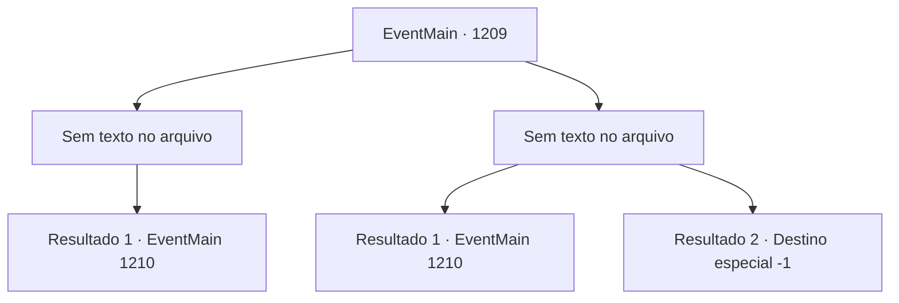

# Eventos principais · 1209

[Índice da tabela](index.md) · [Índice geral](../index.md)

ID: `pt:EventMain:1209` · Fonte: `EventMain4` · Versão: 1.2.47.

Mapeamento estático dos arquivos; a disponibilidade e a execução dependem do estado da run.

## Texto do evento

*Sem texto no arquivo.*

## Dados de entrada

```json
{
  "id": 1209,
  "grade": 1,
  "normalGoal": "",
  "required": ""
}
```

## Mapa das escolhas



## Escolhas e resultados

### Escolha 1

*Sem texto no arquivo; o papel dessa opção depende da interface do jogo.*

Requisitos e outros campos da escolha:

```json
{
  "required": ""
}
```

#### Resultado 1.1

Você derrota o cavaleiro da morte e se junta aos seus homens. Rennart corre até você para checar. 

 "Você está bem, meu senhor?! Está ferido?"

 Então, a voz de Kalman ecoa do topo de uma torre. 

 "Que agradecimento, por estarem dispostos a ajudar o velho tio Kalman. Todos esses cadáveres fresquinhos. Devo agradecer pessoalmente."

 Você olha para cima e nota Katrin presa em seu abraço. 

 "Eu também capturei a traidora, tudo graças a vocês."

 Katrin luta, o aperto de Kalman sufocando seu pescoço. 

 "L- SOLTA! Venha, vamos conversar como seres civilizados..."

 Mas antes mesmo que ela termine, Kalman a joga do parapeito da torre. 

 "NÃOOOOOOO--!!"

 Seu grito logo termina com um forte baque. Kalman solta uma risada maligna. 

 "Fufufu... Ah, eu precisava disso."

 Com isso, os soldados mortos-vivos começam a atacar.

Continuação registrada: [Evento 1210](1210.md) na mesma tabela.

```json
{
  "required": "",
  "chance": "1",
  "nextEvent": 1210,
  "type": 2,
  "reward": "6_0_200|5_928_1",
  "place": 4
}
```

### Escolha 2

*Sem texto no arquivo; o papel dessa opção depende da interface do jogo.*

Requisitos e outros campos da escolha:

```json
{
  "required": ""
}
```

#### Resultado 2.1

O cavaleiro da morte balança sua espada contra seu pescoço. Você torce o corpo, recebendo o ataque no ombro em vez disso, e crava sua arma no pescoço do cavaleiro da morte. Rennart corre até você para checar. 

 "Você está bem, meu Senhor? Está ferido?"

 Então, a voz de Kalman ecoa do alto de uma torre. 

 "Que grato, que você esteja disposto a ajudar o velho tio Kalman. Todos esses corpos frescos. Devo agradecer pessoalmente."

 Você olha para cima e percebe Katrin presa em seu abraço. 

 "Eu ainda tenho que capturar o traidor também, tudo graças a você."

 Katrin luta, o aperto de Kalman estrangulando seu pescoço. 

 "L- SOLTE! Venha, vamos conversar como seres civilizados..."

 Mas antes mesmo que ela possa terminar, Kalman a atira para fora da beira da torre. 

 "NÃOOOOOOO--!!"

 Seu grito logo termina com um forte baque. Kalman solta uma risada maléfica. 

 "Fufufu... Ah, eu precisava disso."

 Com isso, os soldados mortos-vivos começam a atacar.

Continuação registrada: [Evento 1210](1210.md) na mesma tabela.

```json
{
  "required": "1_0_2|1_1_2",
  "chance": "1",
  "nextEvent": 1210,
  "type": 2,
  "reward": "0_0_-1|0_1_-1|6_0_200|5_928_1",
  "place": 4
}
```

#### Resultado 2.2

O cavaleiro da morte balança sua espada em direção ao seu pescoço. Você tenta desviar, mas a espada se move muito mais rápido. Você vomita sangue no chão, então se ajoelha. Então, a voz de Kalman ecoa do topo de uma torre. 

 "Que gratificante, que você esteja disposto a ajudar o velho tio Kalman. Todos esses cadáveres frescos. Devo agradecer pessoalmente."

 Você olha para cima e percebe Katrin presa em seu aperto. 

 "Também fui eu que capturei a traidora, tudo graças a você."

 Katrin luta, o aperto de Kalman estrangulando seu pescoço. 

 "L- LARGUE! Venha, conversemos como seres civilizados ..."

 Mas antes que ela termine, Kalman a empurra da borda da torre. 

 "NÃOOOOOOOO--!!"

 Seu grito logo termina com um forte baque. Kalman solta uma risada maligna. 

 "Fufufu... Ah, eu precisava disso."

 Então, Kalman levanta as mãos para você. Agudas lascas de osso começam a flutuar ao redor dele. Com um movimento de pulso, as lascas de osso são lançadas contra você. Infelizmente, você é perfurado por cem fragmentos de osso afiados, e perde a consciência.

Continuação registrada: [Destino especial `-1`](../destinos-especiais.md).

```json
{
  "required": "-1|2_0_2|2_1_2",
  "chance": "1",
  "nextEvent": -1,
  "type": 2,
  "reward": "0_0_-1|0_1_-1|15_7_6|15_7_1|25_8_1"
}
```

## Referências que chegam a este evento

- [Evento 1203 · escolha 3 · resultado 1](1203.md#escolha-3)
- [Evento 1204 · escolha 5 · resultado 1](1204.md#escolha-5)
- [Evento 1205 · escolha 1 · resultado 1](1205.md#escolha-1)
