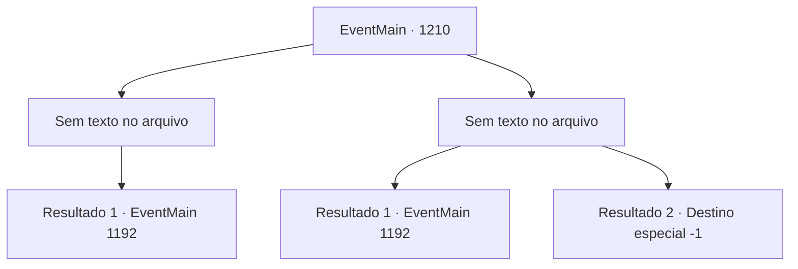

# Eventos principais · 1210

[Índice da tabela](index.md) · [Índice geral](../index.md)

ID: `pt:EventMain:1210` · Fonte: `EventMain4` · Versão: 1.2.47.

Mapeamento estático dos arquivos; a disponibilidade e a execução dependem do estado da run.

## Texto do evento

*Sem texto no arquivo.*

## Dados de entrada

```json
{
  "id": 1210,
  "grade": 1,
  "normalGoal": "",
  "required": ""
}
```

## Mapa das escolhas



## Escolhas e resultados

### Escolha 1

*Sem texto no arquivo; o papel dessa opção depende da interface do jogo.*

Requisitos e outros campos da escolha:

```json
{
  "required": ""
}
```

#### Resultado 1.1

Você lidera a luta contra os mortos-vivos, então chega à torre onde Kalman está. Você sobe correndo a escada em espiral e confronta Kalman. Ele sorri, como se já esperasse por este momento. 

 "Sim... Eu esperava nada menos de você. Isso vai ser divertido."

 Kalman fica sobre as muralhas do castelo. O vento sacode sua túnica. Então, ele pula, estendendo os braços. Você corre até a beira da torre e olha para baixo. Lá embaixo, os mortos-vivos estão convergindo em uma única massa gigante. Rennart vê isso e fica pálido. 

 "P- pelos deuses..."

 O enorme pedaço de carne e osso logo ganha seu próprio par de braços e pernas. Depois, uma cauda, e por fim um pescoço — no fim do qual se forma uma cabeça. |drawing_abominationCreature| A abominação levanta a cabeça e solta um rugido gutural. É uma cacofonia de cem vozes diferentes, risos e gritos misturados. <link=shake><color=purple>

 "AHAHAHAH!! GYAHHH!!!"

</color></link> A monstruosidade se choca contra a torre em que você está. Com um único golpe, toda a estrutura desaba, e você também cai ao chão.

Continuação registrada: [Evento 1192](1192.md) na mesma tabela.

```json
{
  "required": "",
  "chance": "1",
  "nextEvent": 1192,
  "type": 2,
  "reward": ""
}
```

### Escolha 2

*Sem texto no arquivo; o papel dessa opção depende da interface do jogo.*

Requisitos e outros campos da escolha:

```json
{
  "required": ""
}
```

#### Resultado 2.1

A horda de mortos-vivos circula ao seu redor e ataca. Você aparadamente suas pancadas uma a uma, mas eventualmente é cercado. Então, Tarrys e Rennart rompem a formação para resgatá-lo. 

 "Meu senhor!"

 Enquanto Tarrys o ajuda a levantar, o líder mercenário entra para abrir caminho. Ele brandamente balança sua espada grande, gritando. 

 "NÃO RECUEM! SE EU VIR SUAS COSTAS, EU MATO TODOS VOCÊS PESSOALMENTE!"

 Graças à ajuda deles, você consegue romper a horda de mortos-vivos e chegar à torre onde Kalman está. Você corre pela escadaria em espiral e confronta Kalman. Ele sorri, como se estivesse esperando por este momento. 

 "Sim... Eu esperava nada menos de você. Isso vai ser divertido."

 Kalman ergue os braços. Então, os mortos-vivos começam a circular ao redor dele, convergindo em um enorme amontoado. Rennart vê isso e fica pálido. 

 "P- pelo deus..."

 O enorme pedaço de carne e osso logo cresce seu próprio par de braços e pernas. Depois, um rabo, e por fim um pescoço — na ponta do qual se forma uma cabeça. |drawing_abominationCreature| A abominação ergue a cabeça e solta um rugido gutural. É uma cacofonia de cem vozes diferentes, risadas e gritos misturados. <link=shake><color=purple>

 "AHAHAHAH!! GYAHHH!!!"

</color></link> A monstruosidade se choca contra a torre em que você está. Com um único golpe, toda a estrutura desaba, e você também cai ao chão. Hesitantes, os soldados cambaleiam para longe de Kalman.

Continuação registrada: [Evento 1192](1192.md) na mesma tabela.

```json
{
  "required": "1_0_2|1_1_2",
  "chance": "1",
  "nextEvent": 1192,
  "type": 2,
  "reward": "0_0_-1|0_1_-1"
}
```

#### Resultado 2.2

A horda de mortos-vivos circula ao seu redor e ataca. Você aparar os golpes um a um, mas eventualmente é cercado. Então, Tarrys e Rennart rompem a formação para resgatá-lo. 

 "Meu senhor!"

 Enquanto Tarrys o ajuda a se levantar, o líder mercenário junta-se para abrir caminho. Ele brandindo seu espadão freneticamente, gritando. 

 "Por aqui! Por aqui!"

 Então, Rennart se aproxima de você e fala. 

 "Temos que recuar! Talvez mais tarde possamos..."

 Mas ele não chega a terminar, pois Kalman atravessa Rennart com sua estaca óssea. Mais estacas ósseas voam pelo campo de batalha, e logo tudo fica em silêncio. Você e Kalman são os únicos de pé. 

 "Devo admitir, gostei de ver você lutar. Mas aqui é onde a diversão termina."

 Os mortos-vivos obedecem às suas ordens. Ghouls, wights, golems de carne e até cavaleiros da morte — os mortos-vivos o derrubam sem piedade. A voz de Kalman é a última coisa que você ouve. 

 "Oh, não fique tão triste agora. Vou fazer bom uso da sua carne."

 Uma estaca óssea se crava no seu peito. Com ela vem uma dor imensa, e você sente sangue na boca. Então, tudo fica escuro.

Continuação registrada: [Destino especial `-1`](../destinos-especiais.md).

```json
{
  "required": "-1|2_0_2|2_1_2",
  "chance": "1",
  "nextEvent": -1,
  "type": 2,
  "reward": "15_7_6|15_7_1|25_8_1"
}
```

## Referências que chegam a este evento

- [Evento 1209 · escolha 1 · resultado 1](1209.md#escolha-1)
- [Evento 1209 · escolha 2 · resultado 1](1209.md#escolha-2)
