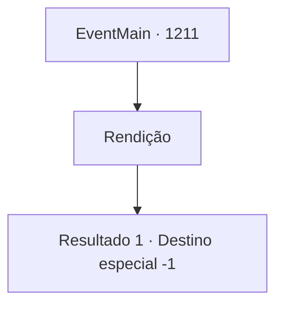

# Eventos principais · 1211

[Índice da tabela](index.md) · [Índice geral](../index.md)

ID: `pt:EventMain:1211` · Fonte: `EventMain4` · Versão: 1.2.47.

Mapeamento estático dos arquivos; a disponibilidade e a execução dependem do estado da run.

## Texto do evento

*Sem texto no arquivo.*

## Dados de entrada

```json
{
  "id": 1211,
  "grade": 1,
  "normalGoal": "",
  "required": ""
}
```

## Mapa das escolhas



## Escolhas e resultados

### Escolha 1

Rendição

Requisitos e outros campos da escolha:

```json
{
  "required": ""
}
```

#### Resultado 1.1

Relutantemente, você pega a pena e a molha na tinta. Então, você assina seu nome no rodapé do documento. Sem dizer nada, Katrin derrama um pouco de cera de vela no brasão da casa Greymoor e carimba. Em seguida, ela aponta para baixo. 

 "...Aqui."

 Você faz o mesmo. O brasão da casa Briovich é carimbado no documento. Com isso, sua rendição foi confirmada. Katrin se vira para Sir Wojciech e continua. 

 "Acompanhá-lo para fora do castelo. Para que seus homens pudessem ver."

 Você segue Sir Wojciech, caminhando pelo pavilhão principal, pelo castelo interno e finalmente pelo castelo externo. Você sente o olhar dos soldados de Greymoor sobre você. Você já percorreu este caminho antes — mas agora parece muito mais longo. Por fim, o portão externo do castelo se abre, e você é expulso — gentilmente — do Castelo Greymoor. 

 "Adeus."

 E com isso, Sir Wojciech fecha o portão. Rennart está esperando por você com um cavalo. Ele conduz seu cavalo até você. Além das colinas, você encontra o posto avançado de Briovich, mas seus homens já estão embalando suas coisas. Você monta em seu cavalo e segue para lá.

Continuação registrada: [Destino especial `-1`](../destinos-especiais.md).

```json
{
  "required": "",
  "chance": "1",
  "nextEvent": -1,
  "type": 2,
  "reward": "15_7_2"
}
```

## Referências que chegam a este evento

- [Evento 1203 · escolha 3 · resultado 2](1203.md#escolha-3)
- [Evento 1204 · escolha 5 · resultado 2](1204.md#escolha-5)
- [Evento 1208 · escolha 2 · resultado 1](1208.md#escolha-2)
