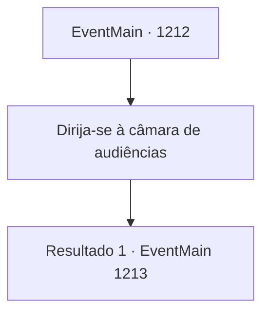

# Eventos principais · 1212

[Índice da tabela](index.md) · [Índice geral](../index.md)

ID: `pt:EventMain:1212` · Fonte: `EventMain4` · Versão: 1.2.47.

Mapeamento estático dos arquivos; a disponibilidade e a execução dependem do estado da run.

## Texto do evento

|drawing_stephangrad| Você chega a Stephangrad, a capital do Reino de Rothar. No topo das muralhas de camada dupla, uma bandeira de águia dourada tremula ao vento. Você passa pelo portão principal, e uma estrada larga se revela. As ruas estão densamente ocupadas por edifícios de pedra. Pedestres e carroças estão por toda parte, movendo-se atarefadamente. Você passa por eles e chega ao palácio real. Seu gigantesco portão de latão é adornado com arcos brancos imaculados. Um guarda real fica de vigia ao lado dele. Ele se aproxima de você, confirma sua identidade e abre o portão. 

 "Por aqui."


## Dados de entrada

```json
{
  "id": 1212,
  "grade": 1,
  "normalGoal": "",
  "required": "13_6_11|1_2_100"
}
```

## Mapa das escolhas



## Escolhas e resultados

### Escolha 1

Dirija-se à câmara de audiências

Requisitos e outros campos da escolha:

```json
{
  "required": ""
}
```

#### Resultado 1.1

A guarda real entra primeiro. Você e Rennart seguem a guarda real, escoltando Katrin e outros vassalos da Casa Greymoor. Vocês caminham por um tapete vermelho, passando pelo salão principal. As portas duplas da sala de audiências se abrem. O rei Rothar está em seu trono. Você se ajoelha, ao que o rei levanta a mão — sinalizando que você deve se levantar. 

 "Deve ter sido uma viagem e tanto, lá de longe da propriedade Briovich. Sabe — eu já estava pensando em convocar vocês à capital."

 O rei Rothar olha para você com um sorriso satisfeito. 

 "Ouvi dizer que vocês lidaram com os orcs na fronteira? Excelente trabalho."

 Seu olhar percorre você. 

 "Você parece ter algo a dizer. Pois bem, fale então!"


Continuação registrada: [Evento 1213](1213.md) na mesma tabela.

```json
{
  "required": "",
  "chance": "1",
  "nextEvent": 1213,
  "type": 2,
  "reward": ""
}
```

## Referências que chegam a este evento

Nenhum `nextEvent` positivo da mesma tabela aponta para este nó. Isso não prova que seja inacessível: sorteio e estado de história podem selecioná-lo.

