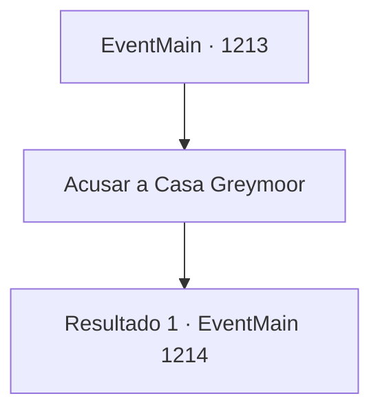

# Eventos principais · 1213

[Índice da tabela](index.md) · [Índice geral](../index.md)

ID: `pt:EventMain:1213` · Fonte: `EventMain4` · Versão: 1.2.47.

Mapeamento estático dos arquivos; a disponibilidade e a execução dependem do estado da run.

## Texto do evento

*Sem texto no arquivo.*

## Dados de entrada

```json
{
  "id": 1213,
  "grade": 1,
  "normalGoal": "",
  "required": ""
}
```

## Mapa das escolhas



## Escolhas e resultados

### Escolha 1

Acusar a Casa Greymoor

Requisitos e outros campos da escolha:

```json
{
  "required": ""
}
```

#### Resultado 1.1

Você entrega os registros das negociações entre a Casa Greymoor e a tribo Zaraid ao rei. Então, você oficialmente acusa a Casa Greymoor de traição contra o reino. O rei Rothar franze o cenho. 

 "Então... você está dizendo que a Condessa Greymoor fez um acordo com os orcs e os fez atacar a propriedade Briovich deliberadamente?"

 O rei gesticula com as mãos. Um dos servos próximos se aproxima dele e se curva. 

 "...Envie uma carta para a Condessa Greymoor agora mesmo. Diga a ela que é obrigada a comparecer imediatamente à corte real. Ao menos darei a ela uma chance de se defender."

 O rei se volta para você mais uma vez. 

 "Peço que permaneça em sua mansão por alguns dias. Mandarei meu pessoal assim que o julgamento estiver pronto para prosseguir."


Continuação registrada: [Evento 1214](1214.md) na mesma tabela.

```json
{
  "required": "",
  "chance": "1",
  "nextEvent": 1214,
  "type": 2,
  "reward": "4_388_1"
}
```

## Referências que chegam a este evento

- [Evento 1212 · escolha 1 · resultado 1](1212.md#escolha-1)
