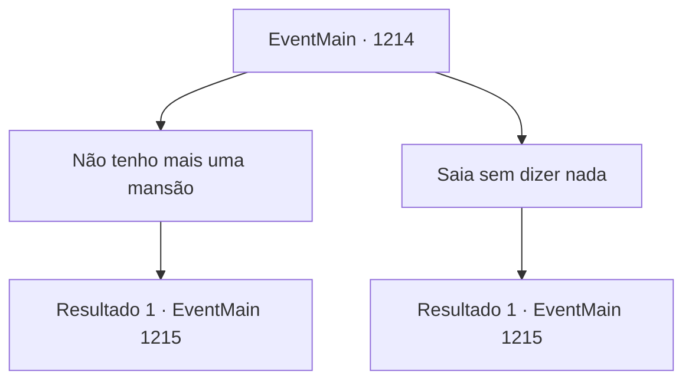

# Eventos principais · 1214

[Índice da tabela](index.md) · [Índice geral](../index.md)

ID: `pt:EventMain:1214` · Fonte: `EventMain4` · Versão: 1.2.47.

Mapeamento estático dos arquivos; a disponibilidade e a execução dependem do estado da run.

## Texto do evento

*Sem texto no arquivo.*

## Dados de entrada

```json
{
  "id": 1214,
  "grade": 1,
  "normalGoal": "",
  "required": ""
}
```

## Mapa das escolhas



## Escolhas e resultados

### Escolha 1

Não tenho mais uma mansão

Requisitos e outros campos da escolha:

```json
{
  "required": ""
}
```

#### Resultado 1.1

Você já vendeu a Mansão Briovich na cidade capital para obter ouro para a guerra contra os orcs. O rei para por um momento, então continua. 

 "Ah, entendo... Bem, há uma boa estalagem aqui na capital. Chama-se Robalo Prateado - você poderia ficar lá."

 Você deixa a corte real e caminha pela rua principal. Então, você chega à estalagem Robalo Prateado, localizada perto da estrada principal. Uma mulher de meia-idade, que você presume ser a estalajadeira, cumprimenta você gentilmente. 

 "Gostaria de alugar um quarto?"


Continuação registrada: [Evento 1215](1215.md) na mesma tabela.

```json
{
  "required": "",
  "chance": "1",
  "nextEvent": 1215,
  "type": 2,
  "reward": ""
}
```

### Escolha 2

Saia sem dizer nada

Requisitos e outros campos da escolha:

```json
{
  "required": ""
}
```

#### Resultado 2.1

Você já vendeu a Mansão Briovich na capital para obter ouro para a guerra contra os orcs. Mas você decide não falar sobre isso na frente do rei. Você se curva diante do rei antes de se retirar. Você deixa a corte real e caminha pela rua principal. Então, você chega à estalagem Aave Prateado, localizada perto da estrada principal. Uma mulher de meia-idade, que você presume ser a dona da estalagem, lhe cumprimenta gentilmente. 

 "Gostaria de alugar um quarto? Cobramos 50 de ouro por semana."


Continuação registrada: [Evento 1215](1215.md) na mesma tabela.

```json
{
  "required": "",
  "chance": "1",
  "nextEvent": 1215,
  "type": 2,
  "reward": ""
}
```

## Referências que chegam a este evento

- [Evento 1213 · escolha 1 · resultado 1](1213.md#escolha-1)
