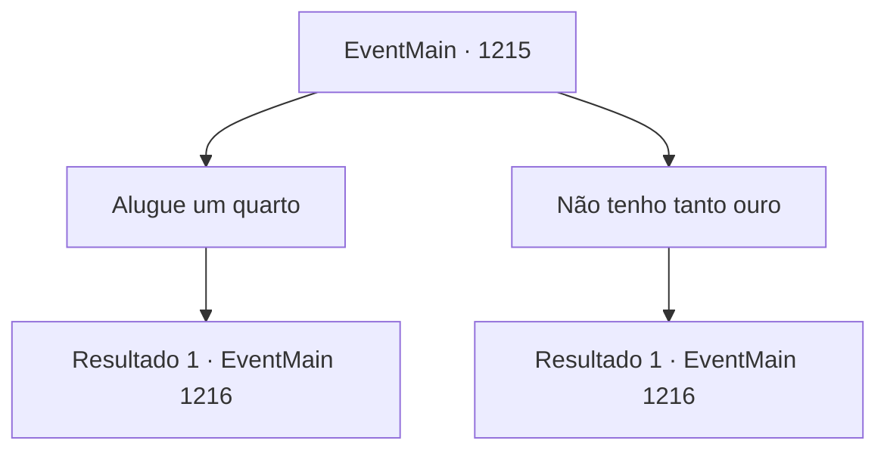

# Eventos principais · 1215

[Índice da tabela](index.md) · [Índice geral](../index.md)

ID: `pt:EventMain:1215` · Fonte: `EventMain4` · Versão: 1.2.47.

Mapeamento estático dos arquivos; a disponibilidade e a execução dependem do estado da run.

## Texto do evento

*Sem texto no arquivo.*

## Dados de entrada

```json
{
  "id": 1215,
  "grade": 1,
  "normalGoal": "",
  "required": ""
}
```

## Mapa das escolhas



## Escolhas e resultados

### Escolha 1

Alugue um quarto

Requisitos e outros campos da escolha:

```json
{
  "required": "1_4_50"
}
```

#### Resultado 1.1

Você considera a distância entre a Propriedade Greymoor e a cidade capital, decidindo pagar adiantado por uma semana. A dona da estalagem esfrega as mãos oleosas no avental e fala. 

 "Obrigada! Por aqui, por favor."

 Ela sobe as escadas de madeira e te leva a um quarto no canto do terceiro andar. 

 "Este quarto aqui é seu por uma semana. Descanse à vontade!"

 Em seguida, a dona da estalagem fecha a porta cuidadosamente. Você coloca suas coisas dentro do quarto e se deita na cama para descansar. 

 Alguns instantes depois, você abre os olhos. Deve ter cochilado. Seu estômago solta um fraco ronco. Faminto, você desce as escadas até o primeiro andar. Uma garçonete te conduz até uma mesa. Ela é uma elfa sombria, com orelhas pontudas e pele negra e bronzeada. 

 "Vocês devem estar morrendo de fome. Vou preparar sua refeição já."

 Ela vai até a cozinha, volta com um ensopado de carneiro fumegante e o coloca sobre sua mesa. 

 "Nosso ensopado é uma iguaria, até em Stephangrad."

 Ela troca mais algumas palavras antes de voltar para a cozinha.

Continuação registrada: [Evento 1216](1216.md) na mesma tabela.

```json
{
  "required": "",
  "chance": "1",
  "nextEvent": 1216,
  "type": 2,
  "reward": "0_0_1|0_4_-50"
}
```

### Escolha 2

Não tenho tanto ouro

Requisitos e outros campos da escolha:

```json
{
  "required": ""
}
```

#### Resultado 2.1

Você não tem muito ouro com você agora. Você pergunta ao estalajadeiro se pode pagar o aluguel mais tarde. O sorriso desaparece do rosto dela. Então, ela te examina dos pés à cabeça. |drawing_innKeeper| 

 "Bem, que tal..."

 Ela aponta para um quarto no canto do primeiro andar. 

 "Tem um quartinho vazio ali. É minúsculo comparado aos outros quartos, mas você o achará igualmente limpo. Use esse quarto... e claro, você pode pagar quando sair."

 Ela ainda soa gentil, mas parece um pouco diferente da recepção calorosa que te deu antes. Com uma breve reverência, ela volta para a cozinha. Você entra no quarto do primeiro andar, desempacota suas coisas e se deita na cama para descansar. O som dos clientes conversando e dos funcionários da estalagem se movendo atravessa as tábuas do chão. 

 Alguns instantes depois, você abre os olhos. Deve ter adormecido. Seu estômago solta um fraco ronco. Com fome, você abre a porta e vai ao salão de refeições. Uma garçonete te leva até uma mesa. Ela é uma elfa sombria, com orelhas pontudas e pele negra, bronzeada. 

 "Deve estar morrendo de fome. Vou preparar sua refeição agora mesmo."

 Ela vai até a cozinha, volta com um guisado de carneiro fumegante e o coloca sobre sua mesa. 

 "Nosso guisado é uma delícia, até em Stephangrad."

 Ela conversa mais um pouco antes de voltar para a cozinha.

Continuação registrada: [Evento 1216](1216.md) na mesma tabela.

```json
{
  "required": "",
  "chance": "1",
  "nextEvent": 1216,
  "type": 2,
  "reward": "0_0_1|5_935_1"
}
```

## Referências que chegam a este evento

- [Evento 1214 · escolha 1 · resultado 1](1214.md#escolha-1)
- [Evento 1214 · escolha 2 · resultado 1](1214.md#escolha-2)
