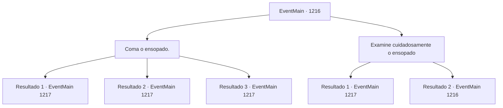

# Eventos principais · 1216

[Índice da tabela](index.md) · [Índice geral](../index.md)

ID: `pt:EventMain:1216` · Fonte: `EventMain4` · Versão: 1.2.47.

Mapeamento estático dos arquivos; a disponibilidade e a execução dependem do estado da run.

## Texto do evento

*Sem texto no arquivo.*

## Dados de entrada

```json
{
  "id": 1216,
  "grade": 1,
  "normalGoal": "",
  "required": ""
}
```

## Mapa das escolhas



## Escolhas e resultados

### Escolha 1

Coma o ensopado.

Requisitos e outros campos da escolha:

```json
{
  "required": ""
}
```

#### Resultado 1.1

Você aprecia o ensopado de carneiro. A carne está macia, e o caldo está quente — a garçonete elfa sombria não mentiu quando disse que é uma iguaria. No entanto, tem um gosto amargo no final. Você esvazia a tigela e volta para o seu quarto. Com a fome saciada, você senta em uma cadeira para descansar. Lá fora, a escuridão se instala, enquanto os postes de luz são apagados um por um. 

 Quando todos já estão dormindo, você está deitado na cama, olhos bem abertos. Você já tinha cochilado antes da refeição. Não se sente particularmente sonolento. Então, a janela do seu quarto se abre. Uma figura humanoide entra no quarto.

Continuação registrada: [Evento 1217](1217.md) na mesma tabela.

```json
{
  "required": "21_15_3",
  "chance": "1|0_13_1",
  "nextEvent": 1217,
  "type": 0,
  "reward": ""
}
```

#### Resultado 1.2

Você saboreia o ensopado de carneiro. A carne está macia, e o caldo está quente — a garçonete elfa sombria não mentiu quando disse que é uma iguaria. No entanto, tem um gosto amargo no final. Você esvazia a tigela e volta para seu quarto. Mas então, de repente, seu estômago começa a doer. Você cai no chão de dor. Você sente seu estômago convulsionar e revirar. Você começa a suar profusamente. Lá fora, a escuridão se instala, enquanto os postes de luz são apagados um por um. 

 Quando todos adormecem, você ainda está lutando com a dor de estômago. Então, a janela do seu quarto se abre. Uma figura humanoide entra no quarto.

Continuação registrada: [Evento 1217](1217.md) na mesma tabela.

```json
{
  "required": "21_15_3",
  "chance": "30",
  "nextEvent": 1217,
  "type": 1,
  "reward": "0_0_-1|5_936_1"
}
```

#### Resultado 1.3

Você aprecia o ensopado de carneiro. A carne está macia, e o caldo está quente — a garçonete elfa sombria não mentiu quando disse que é uma iguaria. No entanto, tem um gosto amargo no final. Você esvazia a tigela e volta para o seu quarto. Com a fome saciada, você senta em uma cadeira para descansar. Lá fora, a escuridão se instala, enquanto os postes de luz são apagados um por um. 

 Quando todos já estão dormindo, você está deitado na cama, olhos bem abertos. Você já tinha cochilado antes da refeição. Não se sente particularmente sonolento. Então, a janela do seu quarto se abre. Uma figura humanoide entra no quarto.

Continuação registrada: [Evento 1217](1217.md) na mesma tabela.

```json
{
  "required": "20_15_3",
  "chance": "1",
  "nextEvent": 1217,
  "type": 2,
  "reward": ""
}
```

### Escolha 2

Examine cuidadosamente o ensopado

Requisitos e outros campos da escolha:

```json
{
  "required": "5_937_0"
}
```

#### Resultado 2.1

Você olha fixamente, em silêncio, para o ensopado de carneiro. Parece uma refeição perfeitamente normal. Mas quando você se aproxima para cheirá-lo, sente algo estranho. Algo cheira... viscoso e pegajoso — algo que você jamais sentiria de um ensopado. Você decide não comer o ensopado, jogando-o pela janela enquanto a garçonete não está olhando. Então, você volta para o seu quarto. Lá fora, a escuridão se instala, enquanto os postes de luz vão sendo apagados um a um. 

 Quando todos já estão dormindo, você se deita na cama, olhos bem abertos. Você ainda está faminto. Então, a janela do seu quarto se abre. Uma figura humanoide entra no quarto.

Continuação registrada: [Evento 1217](1217.md) na mesma tabela.

```json
{
  "required": "",
  "chance": "1|0_14_1",
  "nextEvent": 1217,
  "type": 0,
  "reward": "5_937_1"
}
```

#### Resultado 2.2

Você observa em silêncio o guisado de carneiro. Parece uma refeição perfeitamente normal. Sua barriga solta outro ronco, como se implorasse que você o comesse logo.

Continuação registrada: [Evento 1216](1216.md) na mesma tabela.

```json
{
  "required": "",
  "chance": "30",
  "nextEvent": 1216,
  "type": 1,
  "reward": "5_937_9"
}
```

## Referências que chegam a este evento

- [Evento 1215 · escolha 1 · resultado 1](1215.md#escolha-1)
- [Evento 1215 · escolha 2 · resultado 1](1215.md#escolha-2)
- [Evento 1216 · escolha 2 · resultado 2](1216.md#escolha-2)
