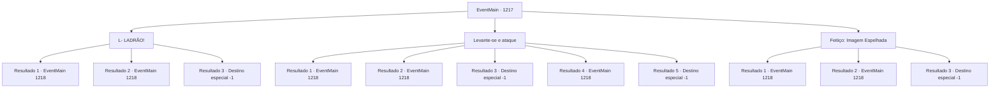

# Eventos principais · 1217

[Índice da tabela](index.md) · [Índice geral](../index.md)

ID: `pt:EventMain:1217` · Fonte: `EventMain4` · Versão: 1.2.47.

Mapeamento estático dos arquivos; a disponibilidade e a execução dependem do estado da run.

## Texto do evento

*Sem texto no arquivo.*

## Dados de entrada

```json
{
  "id": 1217,
  "grade": 1,
  "normalGoal": "",
  "required": ""
}
```

## Mapa das escolhas



## Escolhas e resultados

### Escolha 1

L- LADRÃO!

Requisitos e outros campos da escolha:

```json
{
  "required": "18_936_1"
}
```

#### Resultado 1.1

Você grita, mas o intruso tira um pequeno pergaminho e o rasga ao meio. Imediatamente, a escuridão começa a se espalhar, afogando a sala inteira em silêncio. Você percebe que é uma escuridão mágica, cegando seus olhos com um manto de trevas profundas. Então, você sente um sopro de vento perto de você. Você se abaixa imediatamente, mas algo afiado corta sua carne. O intruso — o assassino — vem atrás de você de novo, atacando a partir da escuridão.

Continuação registrada: [Evento 1218](1218.md) na mesma tabela.

```json
{
  "required": "21_27_1|21_28_1|1_0_2",
  "chance": "1",
  "nextEvent": 1218,
  "type": 2,
  "reward": "0_0_-1|6_3_203",
  "place": 4
}
```

#### Resultado 1.2

Você grita, mas o intruso puxa um pequeno pergaminho e o rasga ao meio. Imediatamente, a escuridão começa a se espalhar, mergulhando toda a sala em silêncio. Você percebe que é uma escuridão mágica, cegando seus olhos num manto completamente negro. Mas isso não lhe diz respeito nem um pouco. Você desvia facilmente da lâmina do assassino, desfere um soco no braço e revida. 

 "Tsk...!"

 Você sente que o assassino não esperava um contra-ataque. Aproveitando a chance, você continua sua investida.

Continuação registrada: [Evento 1218](1218.md) na mesma tabela.

```json
{
  "required": "-1|20_27_1|20_28_1",
  "chance": "1",
  "nextEvent": 1218,
  "type": 2,
  "reward": "6_0_203",
  "place": 4
}
```

#### Resultado 1.3

Você grita, mas o intruso puxa um pequeno pergaminho e o rasga ao meio. Imediatamente, a escuridão começa a se espalhar, afogando toda a sala em silêncio. Você percebe que é uma escuridão mágica, cegando seus olhos em um manto de breu. Nesse instante, uma lâmina nas sombras é cravada na sua garganta. Seus olhos, ajustados à escuridão tarde demais, se viram para encarar o assassino. Há uma máscara cobrindo o rosto, mas você reconhece que é a elfa sombria garçonete que lhe serviu o ensopado de carneiro. Bem, não que haja muito a ser feito sobre isso agora, de qualquer forma. Sem hesitar, a elfa sombria te decapita.

Continuação registrada: [Destino especial `-1`](../destinos-especiais.md).

```json
{
  "required": "21_27_1|21_28_1|2_0_2",
  "chance": "1",
  "nextEvent": -1,
  "type": 2,
  "reward": "0_0_-1|15_7_17|25_8_1"
}
```

### Escolha 2

Levante-se e ataque

Requisitos e outros campos da escolha:

```json
{
  "required": ""
}
```

#### Resultado 2.1

Você se levanta da cama, pega uma cadeirinha ao lado dela e a arremessa. O intruso bloqueia a cadeira com o braço. A cadeira se quebra imediatamente. 

 "Tsc...!"

 Rapidamente, você assume a postura de combate, golpeando o intruso sem hesitar.

Continuação registrada: [Evento 1218](1218.md) na mesma tabela.

```json
{
  "required": "18_936_1",
  "chance": "1|0_6_1",
  "nextEvent": 1218,
  "type": 0,
  "reward": "6_0_203",
  "place": 4
}
```

#### Resultado 2.2

Você tenta se levantar da cama, mas o intruso é mais rápido. O intruso rapidamente pula por cima de você e te imobiliza. 

 "Silêncio."

 Em seguida, o intruso aperta com mais força a adaga e a crava no seu pescoço. Você mal consegue segurar a adaga, agarrando-a com as mãos nuas. Um jorro de sangue quente escorre pelo seu braço. Com todas as suas forças, você chuta o assassino. 

 "Argh...!"

 O assassino recua um passo, puxando outra adaga. Rapidamente, você se equilibra e se levanta. Mais uma vez, o assassino aponta a adaga para você.

Continuação registrada: [Evento 1218](1218.md) na mesma tabela.

```json
{
  "required": "18_936_1|1_0_2",
  "chance": "30",
  "nextEvent": 1218,
  "type": 1,
  "reward": "6_3_203|0_0_-1",
  "place": 4
}
```

#### Resultado 2.3

Você tenta pular da cama, mas o intruso é mais rápido. O intruso rapidamente pula sobre você e te imobiliza. 

 "Silêncio."

 Então, o intruso aperta a adaga e a crava em seu pescoço. A adaga se planta profundamente em sua garganta. Seus olhos, acostumados à escuridão tarde demais, se viram para encarar o assassino. Há uma máscara cobrindo o rosto, mas você reconhece que é a elfa sombria garçonete que te deu o ensopado de carneiro. Bem, não há muito o que fazer quanto a isso agora, de qualquer forma. Sem hesitar, a elfa sombria te decapita.

Continuação registrada: [Destino especial `-1`](../destinos-especiais.md).

```json
{
  "required": "18_936_1|2_0_2",
  "chance": "30",
  "nextEvent": -1,
  "type": 1,
  "reward": "0_0_-1|15_7_17|25_8_1"
}
```

#### Resultado 2.4

Você tenta pular da cama, mas seus membros não obedecem. Enquanto você luta para se levantar, o intruso pula sobre você, te imobilizando. 

 "Silêncio."

 Então, o intruso aperta a empunhadura da adaga e a crava no seu pescoço. Você mal consegue impedir a adaga, segurando-a com as mãos nuas. Um jorro quente de sangue escorre pelo seu braço. Com todas as suas forças, você chuta o assassino. 

 "Argh...!"

 O assassino dá um passo para trás, sacando outra adaga. Rapidamente, você se equilibra e se levanta. Mais uma vez, o assassino aponta a adaga para você.

Continuação registrada: [Evento 1218](1218.md) na mesma tabela.

```json
{
  "required": "5_936_1|1_0_2",
  "chance": "1",
  "nextEvent": 1218,
  "type": 2,
  "reward": "0_0_-1|6_3_203",
  "place": 4
}
```

#### Resultado 2.5

Você tenta pular da cama, mas seus membros não obedecem. Enquanto você luta para se levantar, o intruso pula em cima de você, imobilizando-o. 

 "Silêncio."

 Então, o intruso aperta a empunhadura da adaga e a crava em seu pescoço. A adaga se enterra profundamente em sua garganta. Seus olhos, ajustados à escuridão tarde demais, se voltam para encarar o assassino. Há uma máscara cobrindo o rosto, mas você reconhece que é a elfa sombria que lhe serviu o ensopado de carneiro. Bem, não que haja muito a fazer sobre isso agora. Sem hesitar, a elfa sombria decapita você.

Continuação registrada: [Destino especial `-1`](../destinos-especiais.md).

```json
{
  "required": "5_936_1|2_0_2",
  "chance": "1",
  "nextEvent": -1,
  "type": 2,
  "reward": "0_0_-1|15_7_17|25_8_1"
}
```

### Escolha 3

Feitiço: Imagem Espelhada

Requisitos e outros campos da escolha:

```json
{
  "required": "20_0_1|1_1_2"
}
```

#### Resultado 3.1

Silenciosamente, você conjura um feitiço e deixa uma ilusão sua na cama. Então, você rola para fora da cama. O intruso pula por cima de sua imagem refletida e crava uma adaga nela. 

 "...Espera, isso é -"

 Aproveitando a confusão do assassino, você desfer um chute poderoso, com todas as suas forças. 

 "Argh...!"

 O assassino dá um passo para trás, sacando outra adaga. Rapidamente, você se equilibra e se prepara para contra-atacar.

Continuação registrada: [Evento 1218](1218.md) na mesma tabela.

```json
{
  "required": "18_936_1",
  "chance": "1",
  "nextEvent": 1218,
  "type": 2,
  "reward": "0_1_-1|6_0_203",
  "place": 4
}
```

#### Resultado 3.2

Você tenta lançar uma magia silenciosamente, mas a dor te distrai. O intruso pula em cima de você e te imobiliza. 

 "Silêncio."

 Então, o intruso aperta o punho na adaga e a crava no seu pescoço. Você mal consegue parar a adaga, segurando-a com as mãos nuas. Um fluxo quente de sangue escorre pelo seu braço. Com toda a sua força, você chuta o assassino. 

 "Argh...!"

 O assassino dá um passo para trás, puxando outra adaga. Rapidamente, você se equilibra e se levanta. Mais uma vez, o assassino aponta a adaga para você.

Continuação registrada: [Evento 1218](1218.md) na mesma tabela.

```json
{
  "required": "5_936_1|1_0_2",
  "chance": "1",
  "nextEvent": 1218,
  "type": 2,
  "reward": "0_0_-1|6_3_203",
  "place": 4
}
```

#### Resultado 3.3

Você tenta lançar um feitiço em silêncio, mas a dor te distrai. O intruso pula por cima de você e te imobiliza. 

 "Silêncio."

 Então, o intruso aperta a empunhadura do punhal e o crava no seu pescoço. O punhal se finca profundamente na sua garganta. Seus olhos, ajustados à escuridão tarde demais, se voltam para encarar o assassino. Há uma máscara cobrindo o rosto, mas você reconhece que é a elfa sombria garçonete que te serviu o ensopado de carneiro. Bem, não que haja muito a ser feito sobre isso agora, de qualquer forma. Sem hesitar, a elfa sombria te decapita.

Continuação registrada: [Destino especial `-1`](../destinos-especiais.md).

```json
{
  "required": "5_936_1|2_0_2",
  "chance": "1",
  "nextEvent": -1,
  "type": 2,
  "reward": "0_0_-1|15_7_17|25_8_1"
}
```

## Referências que chegam a este evento

- [Evento 1216 · escolha 1 · resultado 1](1216.md#escolha-1)
- [Evento 1216 · escolha 1 · resultado 2](1216.md#escolha-1)
- [Evento 1216 · escolha 1 · resultado 3](1216.md#escolha-1)
- [Evento 1216 · escolha 2 · resultado 1](1216.md#escolha-2)
