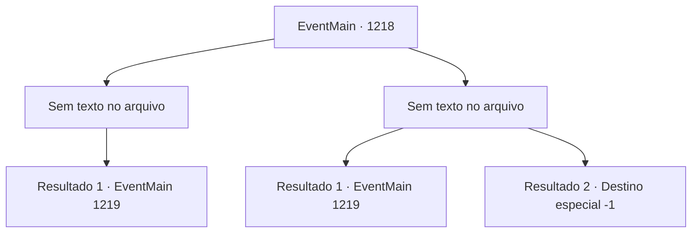

# Eventos principais · 1218

[Índice da tabela](index.md) · [Índice geral](../index.md)

ID: `pt:EventMain:1218` · Fonte: `EventMain4` · Versão: 1.2.47.

Mapeamento estático dos arquivos; a disponibilidade e a execução dependem do estado da run.

## Texto do evento

*Sem texto no arquivo.*

## Dados de entrada

```json
{
  "id": 1218,
  "grade": 1,
  "normalGoal": "",
  "required": ""
}
```

## Mapa das escolhas



## Escolhas e resultados

### Escolha 1

*Sem texto no arquivo; o papel dessa opção depende da interface do jogo.*

Requisitos e outros campos da escolha:

```json
{
  "required": ""
}
```

#### Resultado 1.1

Seus olhos, acostumados à escuridão, viram-se para encarar o assassino. Há uma máscara cobrindo o rosto, mas você reconhece que é a elfa sombria garçonete que lhe deu o ensopado de carneiro. Encurralada, a assassina elfa sombria lança uma bomba de fumaça. Fumaça densa enche o quarto. Quando você consegue ver de novo, a assassina não está em lugar nenhum. 

 Algumas horas depois, chega a manhã. Um galo solta um canto poderoso — você supõe que ele teve uma boa noite de sono, ao contrário de você. Você sai do quarto e procura o estalajadeiro.

Continuação registrada: [Evento 1219](1219.md) na mesma tabela.

```json
{
  "required": "",
  "chance": "1",
  "nextEvent": 1219,
  "type": 2,
  "reward": ""
}
```

### Escolha 2

*Sem texto no arquivo; o papel dessa opção depende da interface do jogo.*

Requisitos e outros campos da escolha:

```json
{
  "required": ""
}
```

#### Resultado 2.1

Seus olhos, ajustados à escuridão, se voltam para a assassina. Há uma máscara cobrindo o rosto, mas você reconhece que é a elfa sombria garçonete que lhe serviu o ensopado de carneiro. Apertando uma adaga de aço, ela investe contra você. Algo cintila diante dos seus olhos, e você percebe que seu cotovelo esquerdo está sangrando. Você se move para desviar dos ataques da elfa sombria. Vendo uma brecha, você a chuta para fora da janela. 

 *TUM* *BAM* 

 Você olha apressadamente pela janela. A assassina não está em lugar algum. 

 Algumas horas depois, chega a manhã. Um galo solta um canto potente — você supõe que ele dormiu bem, ao contrário de você. Você sai do quarto e procura o estalajadeiro.

Continuação registrada: [Evento 1219](1219.md) na mesma tabela.

```json
{
  "required": "1_0_2|1_1_2",
  "chance": "1",
  "nextEvent": 1219,
  "type": 2,
  "reward": "0_0_-1|0_1_-1"
}
```

#### Resultado 2.2

Seus olhos, ajustados à escuridão, se voltam para o assassino. Há uma máscara cobrindo o rosto, mas você reconhece que é a elfa negra garçonete que lhe deu o ensopado de carneiro. Apertando uma adaga de aço, ela investe contra você. Algo cintila diante dos seus olhos, e você percebe que seu abdômen esquerdo está sangrando. Uma dor aguda se espalha pelo seu corpo. O assassino não para por aí, brandindo sua adaga sem piedade. Ela desfere golpes, cortando suas coxas, peito, pescoço e torso. Sua vida chega ao fim antes dos golpes frenéticos do assassino.

Continuação registrada: [Destino especial `-1`](../destinos-especiais.md).

```json
{
  "required": "-1|2_0_2|2_1_2",
  "chance": "1",
  "nextEvent": -1,
  "type": 2,
  "reward": "0_0_-1|0_1_-1|15_7_17|25_8_1"
}
```

## Referências que chegam a este evento

- [Evento 1217 · escolha 1 · resultado 1](1217.md#escolha-1)
- [Evento 1217 · escolha 1 · resultado 2](1217.md#escolha-1)
- [Evento 1217 · escolha 2 · resultado 1](1217.md#escolha-2)
- [Evento 1217 · escolha 2 · resultado 2](1217.md#escolha-2)
- [Evento 1217 · escolha 2 · resultado 4](1217.md#escolha-2)
- [Evento 1217 · escolha 3 · resultado 1](1217.md#escolha-3)
- [Evento 1217 · escolha 3 · resultado 2](1217.md#escolha-3)
