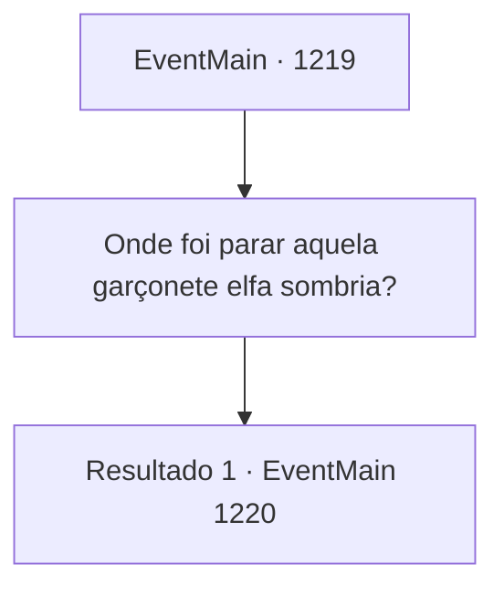

# Eventos principais · 1219

[Índice da tabela](index.md) · [Índice geral](../index.md)

ID: `pt:EventMain:1219` · Fonte: `EventMain4` · Versão: 1.2.47.

Mapeamento estático dos arquivos; a disponibilidade e a execução dependem do estado da run.

## Texto do evento

*Sem texto no arquivo.*

## Dados de entrada

```json
{
  "id": 1219,
  "grade": 1,
  "normalGoal": "",
  "required": ""
}
```

## Mapa das escolhas



## Escolhas e resultados

### Escolha 1

Onde foi parar aquela garçonete elfa sombria?

Requisitos e outros campos da escolha:

```json
{
  "required": ""
}
```

#### Resultado 1.1


 "Hein...? Uma garçonete elfa sombria?"

 O dono da estalagem pergunta de volta, confuso. 

 "...Nem uma única elfa sombria trabalha aqui. Não faço ideia por que você procuraria uma assim, de repente..."


Continuação registrada: [Evento 1220](1220.md) na mesma tabela.

```json
{
  "required": "",
  "chance": "1",
  "nextEvent": 1220,
  "type": 2,
  "reward": ""
}
```

## Referências que chegam a este evento

- [Evento 1218 · escolha 1 · resultado 1](1218.md#escolha-1)
- [Evento 1218 · escolha 2 · resultado 1](1218.md#escolha-2)
