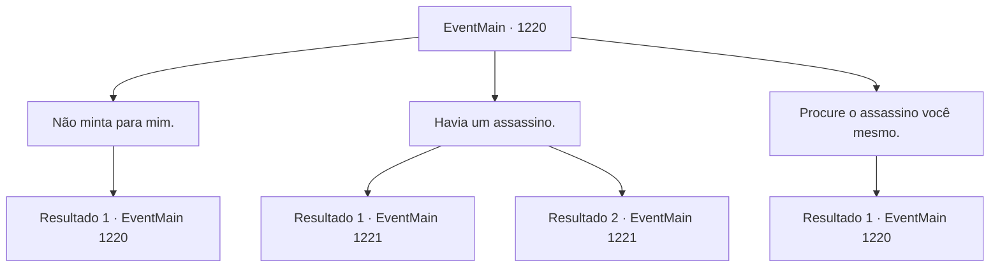

# Eventos principais · 1220

[Índice da tabela](index.md) · [Índice geral](../index.md)

ID: `pt:EventMain:1220` · Fonte: `EventMain4` · Versão: 1.2.47.

Mapeamento estático dos arquivos; a disponibilidade e a execução dependem do estado da run.

## Texto do evento

*Sem texto no arquivo.*

## Dados de entrada

```json
{
  "id": 1220,
  "grade": 1,
  "normalGoal": "",
  "required": ""
}
```

## Mapa das escolhas



## Escolhas e resultados

### Escolha 1

Não minta para mim.

Requisitos e outros campos da escolha:

```json
{
  "required": "5_938_0"
}
```

#### Resultado 1.1

Você grita com a estalajadeira, exigindo que ela diga a verdade. Ela coloca as mãos na cintura, franze o cenho e responde. 

 "Ora, a verdade é que não temos elfos sombrios trabalhando aqui! Não fui clara o suficiente?"

 Ela aponta para a cozinha e para o salão de refeições e continua. 

 "Ora, você entra e procura por conta própria. Ou pode apenas esperar no salão, aguardando que um apareça."


Continuação registrada: [Evento 1220](1220.md) na mesma tabela.

```json
{
  "required": "",
  "chance": "1",
  "nextEvent": 1220,
  "type": 2,
  "reward": "5_938_1"
}
```

### Escolha 2

Havia um assassino.

Requisitos e outros campos da escolha:

```json
{
  "required": ""
}
```

#### Resultado 2.1

A dona da estalagem responde, visivelmente abalada. 

 "Meu Deus, um assassino?! Bem aqui, na cidade capital do reino?!"

 Ela parece arrependida de repente e continua. 

 "Duvido que você tenha dormido! Não vou cobrar por isso. Aqui — ah, e devo avisar os guardas também..."

 A dona da estalagem lhe entrega 10 moedas de ouro, sai da estalagem e se dirige à Guarda da Cidade.

Continuação registrada: [Evento 1221](1221.md) na mesma tabela.

```json
{
  "required": "18_935_1",
  "chance": "1",
  "nextEvent": 1221,
  "type": 2,
  "reward": "0_4_10"
}
```

#### Resultado 2.2

A dona da estalagem responde, visivelmente abalada. 

 "Meu Deus, um assassino?! Bem aqui, na capital do reino?!"

 De repente ela parece desculpativa e continua. 

 "Duvido que você tenha dormido! Eu não vou cobrar por isso. Ah, e eu deveria avisar os guardas também..."

 A dona da estalagem sai da hospedaria e vai em direção à Guarda da Cidade.

Continuação registrada: [Evento 1221](1221.md) na mesma tabela.

```json
{
  "required": "5_935_1",
  "chance": "1",
  "nextEvent": 1221,
  "type": 2,
  "reward": ""
}
```

### Escolha 3

Procure o assassino você mesmo.

Requisitos e outros campos da escolha:

```json
{
  "required": "5_938_1"
}
```

#### Resultado 3.1

Você entra na cozinha para examinar a equipe de cozinha. Um homem humano calvo e rechonchudo... uma mulher meio-elfa com aparência cansada, e uma gnoma correndo pela cozinha, mas nem um único elfo negro. Os três dizem que não sabem nada sobre um trabalhador elfo negro. Você sai da cozinha e segue para o salão de jantar para checar os garçons. Você lhes pergunta se há um elfo negro entre a equipe, mas eles também respondem que não. Infelizmente, você não consegue descobrir nada sobre o assassino.

Continuação registrada: [Evento 1220](1220.md) na mesma tabela.

```json
{
  "required": "",
  "chance": "1",
  "nextEvent": 1220,
  "type": 2,
  "reward": "5_938_2"
}
```

## Referências que chegam a este evento

- [Evento 1219 · escolha 1 · resultado 1](1219.md#escolha-1)
- [Evento 1220 · escolha 1 · resultado 1](1220.md#escolha-1)
- [Evento 1220 · escolha 3 · resultado 1](1220.md#escolha-3)
