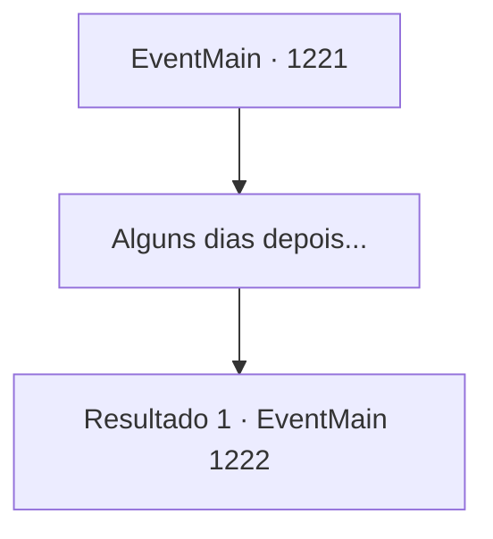

# Eventos principais · 1221

[Índice da tabela](index.md) · [Índice geral](../index.md)

ID: `pt:EventMain:1221` · Fonte: `EventMain4` · Versão: 1.2.47.

Mapeamento estático dos arquivos; a disponibilidade e a execução dependem do estado da run.

## Texto do evento

*Sem texto no arquivo.*

## Dados de entrada

```json
{
  "id": 1221,
  "grade": 1,
  "normalGoal": "",
  "required": ""
}
```

## Mapa das escolhas



## Escolhas e resultados

### Escolha 1

Alguns dias depois...

Requisitos e outros campos da escolha:

```json
{
  "required": ""
}
```

#### Resultado 1.1

Você decide passar mais dias na estalagem. Guardas reais são posicionados ao redor da estalagem, para ficar de vigia. Outra noite chega, mas o assassino não vem mais atrás de você. Passam-se mais alguns dias. Um mensageiro da corte real chega à estalagem e procura por você. Ele o cumprimenta educadamente. 

 "O julgamento está prestes a começar, e sua presença é esperada. Siga-me, por favor."

 O mensageiro o acompanha de volta à corte real, e para dentro da sala do julgamento. Uma porta alta se abre, e um teto ainda mais alto lhe dá as boas-vindas. Alinhados ao longo das paredes estão nobres e servos reais. O trono fica na frente. A câmara é estruturada para que o rei possa olhar lá de cima, de um ponto elevado. 

 "Por aqui."

 Um servo o guia até seu assento. Logo, Katrin aparece e senta-se do outro lado, encarando você diretamente. Um cavaleiro, que parece ser seu guarda-costas, senta-se ao lado de Katrin. 

 "Vossa Majestade está entrando no tribunal, agora."

 O rei entra na sala do julgamento assim que o servo termina. Todos na sala se levantam brevemente, e só se sentam novamente depois que o Rei Rothar o faz. 

 "Vamos prosseguir. Briovich, você pode começar."


Continuação registrada: [Evento 1222](1222.md) na mesma tabela.

```json
{
  "required": "",
  "chance": "1",
  "nextEvent": 1222,
  "type": 2,
  "reward": "0_0_1|0_1_1"
}
```

## Referências que chegam a este evento

- [Evento 1220 · escolha 2 · resultado 1](1220.md#escolha-2)
- [Evento 1220 · escolha 2 · resultado 2](1220.md#escolha-2)
