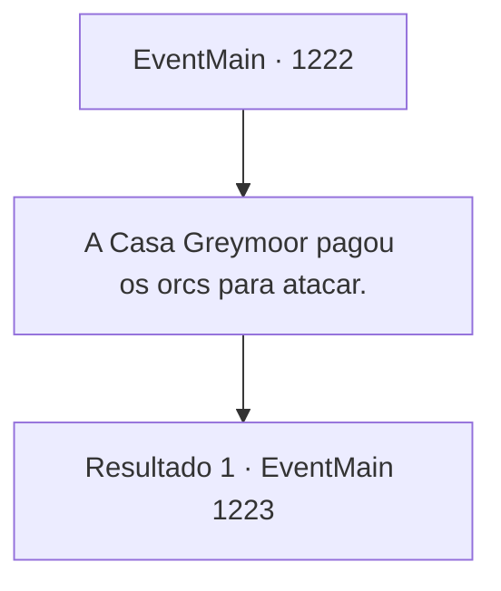

# Eventos principais · 1222

[Índice da tabela](index.md) · [Índice geral](../index.md)

ID: `pt:EventMain:1222` · Fonte: `EventMain4` · Versão: 1.2.47.

Mapeamento estático dos arquivos; a disponibilidade e a execução dependem do estado da run.

## Texto do evento

*Sem texto no arquivo.*

## Dados de entrada

```json
{
  "id": 1222,
  "grade": 1,
  "normalGoal": "",
  "required": ""
}
```

## Mapa das escolhas



## Escolhas e resultados

### Escolha 1

A Casa Greymoor pagou os orcs para atacar.

Requisitos e outros campos da escolha:

```json
{
  "required": ""
}
```

#### Resultado 1.1

Você alega que a Condessa Greymoor fez um acordo com a tribo orc de Zaraid e deliberadamente os fez atacar a Fazenda Briovich. Você acrescenta que os registros das transações entre os dois foram apresentados ao tribunal real. A nobreza começa a murmurar. O rei se vira para olhar para Katrin. 

 "Condessa Greymoor, a senhora pode refutar."

 Katrin se levanta de sua cadeira. 

 "Tudo isso não passa de acusações feitas pela Casa Briovich. Também existe a possibilidade de o livro de registros apresentado ser falsificado."

 Ela mantém a calma. 

 "O que devemos confirmar primeiro é o que aconteceu dentro da Fazenda Briovich."

 O olhar de Katrin se volta para você. 

 "Um necromante esteve em ação, reanimando os mortos na Fazenda Briovich. Alguns desses mortos-vivos se deslocaram para algumas propriedades vizinhas."

 Katrin faz uma breve pausa para respirar, e então continua. 

 "A Fazenda Greymoor não foi exceção. Incontáveis moradores inocentes perderam suas casas, ou pior, suas vidas."

 Alguns dos nobres começam a acenar em sinal de concordância. Katrin olha ao redor e continua. 

 "Nós, Casa Greymoor, buscamos maneiras de resolver esse problema dos mortos-vivos. Conseguimos rastrear o necromante até as Florestas Rugarden. Alguns de nossos cavaleiros mais talentosos foram enviados para pôr fim a esse pesadelo."

 Ela se volta para encarar seu cavaleiro ao lado, e acrescenta. 

 "E o que acontece depois?! Nossos cavaleiros são atacados por Briovich!"

 O murmúrio no salão começa a crescer.

Continuação registrada: [Evento 1223](1223.md) na mesma tabela.

```json
{
  "required": "",
  "chance": "1",
  "nextEvent": 1223,
  "type": 2,
  "reward": ""
}
```

## Referências que chegam a este evento

- [Evento 1221 · escolha 1 · resultado 1](1221.md#escolha-1)
