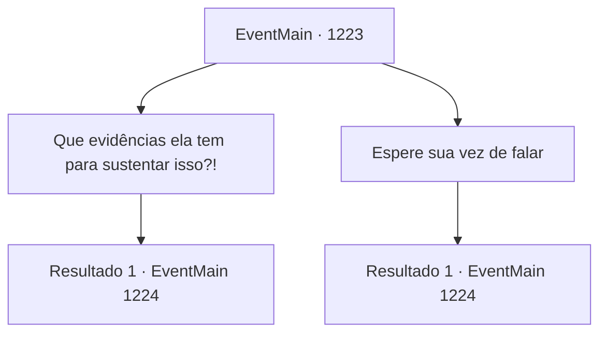

# Eventos principais · 1223

[Índice da tabela](index.md) · [Índice geral](../index.md)

ID: `pt:EventMain:1223` · Fonte: `EventMain4` · Versão: 1.2.47.

Mapeamento estático dos arquivos; a disponibilidade e a execução dependem do estado da run.

## Texto do evento

*Sem texto no arquivo.*

## Dados de entrada

```json
{
  "id": 1223,
  "grade": 1,
  "normalGoal": "",
  "required": ""
}
```

## Mapa das escolhas



## Escolhas e resultados

### Escolha 1

Que evidências ela tem para sustentar isso?!

Requisitos e outros campos da escolha:

```json
{
  "required": ""
}
```

#### Resultado 1.1

Você se levanta do seu assento e pergunta a Katrin se ela tem alguma prova. 

 "Silêncio. Ainda não é sua vez de falar."

 O rei o impede. 

 "Condessa Greymoor. Continue."

 Katrin faz um gesto para que o cavaleiro ao lado dela se levante e fala. 

 "Este é Sir Imre. Ele foi encarregado de investigar a Floresta Rugarden."

 Sir Imre se aproxima do banco das testemunhas. 

 "Vossa Majestade. Eu fui um dos cavaleiros enviados à Floresta Rugarden para encontrar e eliminar o necromante."

 Você percebe que a voz dele está tremendo um pouco. 

 "Éramos uma equipe de três cavaleiros e vinte soldados. Ao investigar o forte abandonado na Floresta Rugarden, descobrimos um porão onde o necromante estava se escondendo."

 Rugas aparecem em sua testa. 

 "Ele era astuto. Armou armadilhas letais e usou necromancia para nos enviar todo tipo de espectros e monstros."

 Imre coloca a mão no peito, como se tentasse se acalmar. 

 "Lutamos contra ele, valentemente... mas perdemos dois cavaleiros e dezesseis homens."

 Seu olhar cai para o chão. 

 "...Isso é tudo, Vossa Majestade. Tudo o que testemunhei e experimentei."

 Imre senta-se de novo, e você vê os lábios de Katrin se erguerem num leve sorriso. O rei Rothar se volta para você. 

 "Pois bem, você tem algo a dizer contra isso?"


Continuação registrada: [Evento 1224](1224.md) na mesma tabela.

```json
{
  "required": "",
  "chance": "1",
  "nextEvent": 1224,
  "type": 2,
  "reward": ""
}
```

### Escolha 2

Espere sua vez de falar

Requisitos e outros campos da escolha:

```json
{
  "required": "1_14_14"
}
```

#### Resultado 2.1

Você espera pacientemente sua vez. Katrin faz um sinal para o cavaleiro ao lado dela se levantar, e fala. 

 "Este é Sir Imre. Ele foi encarregado de investigar as Florestas de Rugarden."

 Sir Imre se dirige ao banco das testemunhas. 

 "Vossa Majestade. Fui um dos cavaleiros enviados às Florestas de Rugarden para encontrar e eliminar o necromante."

 Você percebe que a voz dele está tremendo um pouco. 

 "Fomos uma equipe de três cavaleiros e vinte soldados. Enquanto investigávamos o forte abandonado nas Florestas de Rugarden, descobrimos um porão onde o necromante estava escondido."

 Rugas aparecem em sua testa. 

 "Era um astuto. Ele armou armadilhas letais e usou necromancia para nos enviar todo tipo de espectros e monstros."

 Imre põe a mão no peito, como para se acalmar. 

 "Lutamos contra ele, com bravura... mas perdemos dois cavaleiros e dezesseis homens."

 Seu olhar cai para o chão. 

 "...Isso é tudo, Vossa Majestade. Tudo o que testemunhei e experimentei."

 Imre volta a se sentar, e você vê os lábios de Katrin se levantando em um leve sorriso. O rei Rothar se volta para você. 

 "Bem, você tem algo a dizer contra isso?"


Continuação registrada: [Evento 1224](1224.md) na mesma tabela.

```json
{
  "required": "",
  "chance": "1",
  "nextEvent": 1224,
  "type": 2,
  "reward": ""
}
```

## Referências que chegam a este evento

- [Evento 1222 · escolha 1 · resultado 1](1222.md#escolha-1)
