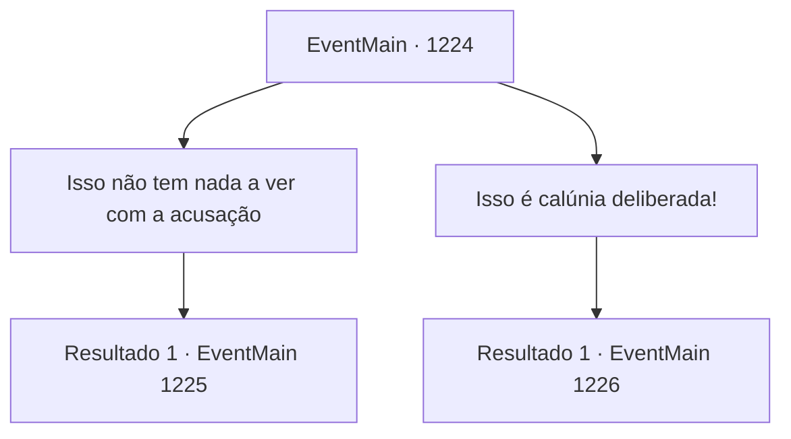

# Eventos principais · 1224

[Índice da tabela](index.md) · [Índice geral](../index.md)

ID: `pt:EventMain:1224` · Fonte: `EventMain4` · Versão: 1.2.47.

Mapeamento estático dos arquivos; a disponibilidade e a execução dependem do estado da run.

## Texto do evento

*Sem texto no arquivo.*

## Dados de entrada

```json
{
  "id": 1224,
  "grade": 1,
  "normalGoal": "",
  "required": ""
}
```

## Mapa das escolhas



## Escolhas e resultados

### Escolha 1

Isso não tem nada a ver com a acusação

Requisitos e outros campos da escolha:

```json
{
  "required": ""
}
```

#### Resultado 1.1

Você alega que sua acusação foi feita em nome de fechar um acordo com a tribo dos orcs, o que significa que esse argumento sobre o problema dos mortos-vivos é irrelevante neste julgamento. O Rei Rothar repousa o queixo na mão, coçando a barba. 

 "Hm... Esse é um ponto válido. Condessa Greymoor, a senhora pode falar."

 É a vez de Katrin novamente. 

 "Acredito que seja um assunto de igual importância, senão maior. Se vamos levantar o tema de traição contra o reino, como poderíamos descartar o problema dos mortos-vivos tão facilmente?"

 Ela continua com voz calma e contida. 

 "Além disso, realizamos um banquete e enviamos um convite oficial à Casa Briovich. Também lhes enviamos parte de nossos suprimentos, como um gesto de gratidão por terem repelido os orcs. Trouxe alguém que também poderia testemunhar favoravelmente."

 Assim que ela termina, um homem se levanta lá atrás. É um homem loiro, ostentando cabelos bem penteados e jogados para o lado. Ele se aproxima do banco das testemunhas e se curva educadamente. 

 "Conde Bathory. Eu compareci pessoalmente ao banquete dos Greymoor. A Casa Bathory também enviou à Casa Briovich um pouco de trigo, a pedido da Condessa Greymoor."

 Ele limpa a garganta e continua. 

 "Se a Condessa Greymoor realmente manipulou os orcs para atacar a Propriedade Briovich, por que ela enviaria suprimentos para eles ao mesmo tempo? Parece muito contraditório."

 O Conde Bathory se volta para você e acrescenta. 

 "Isto é realmente sem vergonha. Retribuir tal bondade com um ato de traição?! Nem mesmo uma besta pensaria em fazer tal coisa!"

 O Rei Rothar se volta para você.

Continuação registrada: [Evento 1225](1225.md) na mesma tabela.

```json
{
  "required": "",
  "chance": "1",
  "nextEvent": 1225,
  "type": 2,
  "reward": ""
}
```

### Escolha 2

Isso é calúnia deliberada!

Requisitos e outros campos da escolha:

```json
{
  "required": "1_7_10"
}
```

#### Resultado 2.1

Você critica o uso deliberadamente ambíguo das palavras.
 'Atacado por Briovich.'
 Dependendo de como se interpreta, esse 'Briovich' poderia se referir a você, a outro membro da Casa Briovich ou a alguém que trabalha para a Casa Briovich. Você aponta isso, e o rei se volta para Imre. 

 "Senhor Imre. Sejamos claros. Quem <b>realmente</b> atacou você e seus homens nas Matas de Rugarden?"

 Imre responde. 

 "Sim, Vossa Majestade. Foi Kalman Briovich - o irmão do Conde Laszlo Briovich - que nos atacou com necromancia. Também o vi conversando com o atual governante dos Briovich, que está sentado diante de nós neste momento."

 Assim que Imre termina, Katrin intervém apressadamente. 

 "Vê, Vossa Majestade! Aquele que compartilhou uma conversa amistosa com o necromante deve ser o conivente com ele!"

 Os nobres no salão começam a murmurar. O rei Rothar balança a cabeça e responde. 

 "Não podemos concluir isso. Uma conversa não significa automaticamente cooperação."

 Katrin fica em silêncio. O rei se volta para você e pergunta. 

 "Você cooperou deliberadamente com Kalman para causar dano ao reino?"


Continuação registrada: [Evento 1226](1226.md) na mesma tabela.

```json
{
  "required": "",
  "chance": "1",
  "nextEvent": 1226,
  "type": 2,
  "reward": ""
}
```

## Referências que chegam a este evento

- [Evento 1223 · escolha 1 · resultado 1](1223.md#escolha-1)
- [Evento 1223 · escolha 2 · resultado 1](1223.md#escolha-2)
