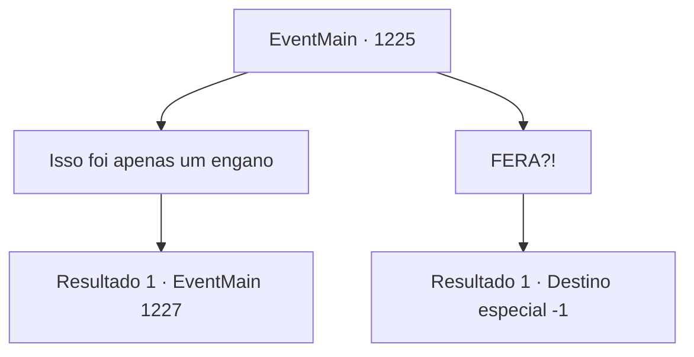

# Eventos principais · 1225

[Índice da tabela](index.md) · [Índice geral](../index.md)

ID: `pt:EventMain:1225` · Fonte: `EventMain4` · Versão: 1.2.47.

Mapeamento estático dos arquivos; a disponibilidade e a execução dependem do estado da run.

## Texto do evento

*Sem texto no arquivo.*

## Dados de entrada

```json
{
  "id": 1225,
  "grade": 1,
  "normalGoal": "",
  "required": ""
}
```

## Mapa das escolhas



## Escolhas e resultados

### Escolha 1

Isso foi apenas um engano

Requisitos e outros campos da escolha:

```json
{
  "required": ""
}
```

#### Resultado 1.1

Você menciona que os suprimentos enviados tinham a intenção de enganar, alegando que não era nada comparado ao que foi enviado aos orcs. Você também aponta que a Casa Greymoor enviou aos orcs apenas o suficiente para que continuassem lutando. 

 "Esse é o verdadeiro objetivo da Condessa Greymoor — mantê‑los em luta pelo maior tempo possível, para que ambos os lados enfraqueçam. E quando chegar a hora certa, ela engolirá os dois."

 Quando você termina, percebe Katrin franzindo a testa. Os lábios dela tremem, mas logo ela recupera a compostura. 

 "Uma conjectura interessante. Mas... são todas apenas teorias na sua cabeça, não são?"

 O rei esfrega as têmporas. 

 "Chega."

 Silenciosamente, o rei olha para você e para Katrin. O salão do julgamento fica em silêncio. O rei Rothar se levanta lentamente de seu assento. 

 "As evidências apresentadas diante de mim são, de fato, eficazes. Mas não são suficientemente eficazes para que o tribunal confirme a culpa da Condessa Greymoor. A Condessa Greymoor também falhou em anular completamente as acusações feitas contra ela. Concluí que este assunto é de extrema importância, diretamente relacionado à segurança do reino. Seria imprudente da minha parte adiar o veredito — portanto, seguindo o código de leis do Reino de Rothar, ordeno por meio deste um julgamento por combate. Que os Deuses estejam ao seu lado."


Continuação registrada: [Evento 1227](1227.md) na mesma tabela.

```json
{
  "required": "",
  "chance": "1",
  "nextEvent": 1227,
  "type": 2,
  "reward": ""
}
```

### Escolha 2

FERA?!

Requisitos e outros campos da escolha:

```json
{
  "required": "2_14_8|2_3_-14"
}
```

#### Resultado 2.1

Você encara o Conde Bathory. Ele sorri de volta para você com arrogância, como se tentasse provocá-lo ainda mais. Algo dentro da sua cabeça estoura. Você se levanta do assento e desferre um chute poderoso no rosto do Conde. Sangue jorra enquanto seus dentes são expelidos da boca. 

 "UCK-!"

 O corpo do Conde Bathory jaz no chão, imóvel. Ele espuma pela boca ensanguentada. Em seguida, você parte para a Condessa Greymoor. 

 "S- PARE!"

 Katrin grita, horrorizada, mas seus punhos são mais rápidos. Seu punho esquerdo acerta o nariz dela. A cabeça dela é lançada para trás — você emenda imediatamente com o direito, golpeando-a bem entre os olhos. Katrin rola pelo chão, enquanto os nobres nas arquibancadas se afastam. Imediatamente, guardas reais investem contra você. Os nobres o encaram com um olhar atônito. Katrin mal consegue se levantar, tossindo. 

 "*tosse*...! V- VOCÊ FERA...!!"

 O rei Rothar bate o apoio do trono, gritando. <link=shake>

 "OSAS VOCÊS MOSTRAREM TAL INSOLÊNCIA, AQUI, NA MINHA CORTE, PERANTE MEUS OLHOS?!"

</link> Seu rosto já está vermelho, e a barba tremendo. Devido aos guardas reais que o contêm, você nem consegue responder. O rei ordena ao seu servo. 

 "Por meio deste, ordeno que todos os títulos detidos pela Casa Briovich sejam revogados, e que a Propriedade Briovich seja recuperada e colocada sob controle real!"

 Ele aponta para você e continua. 

 "E PONHAM ESTE BRUTO NA CADEIA!"

 Os guardas reais o puxam e arrastam seu corpo pelo tapete. Você se vira para olhar Katrin, uma última vez. Ela está em pé, cambaleando, segurando o nariz com as duas mãos. Sangue jorra através do aperto, por ambas as narinas. Seu olho direito está totalmente inchado, quase incapaz de ser aberto. Ela está franzindo o cenho de tanta dor. Os olhares dos nobres o seguem enquanto é escoltado para fora da sala de julgamento, seus rostos cheios de desprezo, choque e risos. A porta dupla da sala de julgamento se fecha atrás de você.

Continuação registrada: [Destino especial `-1`](../destinos-especiais.md).

```json
{
  "required": "",
  "chance": "1",
  "nextEvent": -1,
  "type": 2,
  "reward": "15_7_4"
}
```

## Referências que chegam a este evento

- [Evento 1224 · escolha 1 · resultado 1](1224.md#escolha-1)
