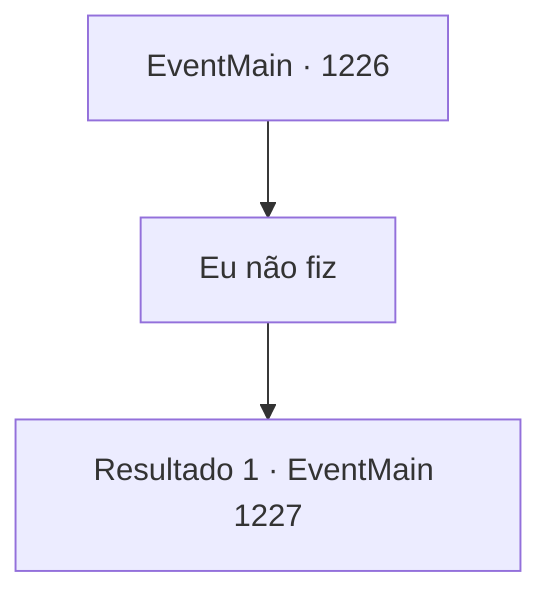

# Eventos principais · 1226

[Índice da tabela](index.md) · [Índice geral](../index.md)

ID: `pt:EventMain:1226` · Fonte: `EventMain4` · Versão: 1.2.47.

Mapeamento estático dos arquivos; a disponibilidade e a execução dependem do estado da run.

## Texto do evento

*Sem texto no arquivo.*

## Dados de entrada

```json
{
  "id": 1226,
  "grade": 1,
  "normalGoal": "",
  "required": ""
}
```

## Mapa das escolhas



## Escolhas e resultados

### Escolha 1

Eu não fiz

Requisitos e outros campos da escolha:

```json
{
  "required": ""
}
```

#### Resultado 1.1

Você diz ao rei que nunca cooperou com Kalman, acrescentando que a única razão pela qual o procurou foi tentar deter o problema dos mortos-vivos. Sobre Kalman ser um Briovich, informa que Kalman Briovich foi exilado da família há muito tempo de qualquer forma, o que significa que ele não é mais membro da Casa Briovich. O rei afaga a barba. 

 "Sobre Kalman Briovich... O problema dos mortos-vivos começou em sua propriedade, e a falha em lidar com ele seria sua responsabilidade. No entanto, levarei em conta o fato de que suas mãos já estavam atadas pelos orcs."

 Seu olhar se volta para Katrin. 

 "Registros de negociações entre a Casa Greymoor e os orcs da tribo Zaraid foram apresentados ao tribunal. E a mesma tribo atacou a Fazenda Briovich."

 O rosto de Katrin escurece. 

 "Contudo... ela está correta ao apontar a possibilidade de o livro-razão ser uma falsificação desde o início..."

 Silenciosamente, o rei começa a tamborilar com os dedos no apoio de braço. O salão do julgamento fica em silêncio. O rei Rothar levanta-se devagar de seu assento. 

 "As provas apresentadas perante mim são, de fato, convincentes. Mas não são convincentes o bastante para o tribunal confirmar a culpa da Condessa Greymoor. A Condessa Greymoor também falhou em anular completamente as acusações feitas contra ela. Concluí que este assunto é de grave importância, diretamente relacionado à segurança do reino. Seria imprudente de minha parte postergar o veredito — portanto, nos termos do código de leis do Reino de Rothar, ordeno pelo presente um julgamento por combate. Que os Deuses estejam ao vosso lado."


Continuação registrada: [Evento 1227](1227.md) na mesma tabela.

```json
{
  "required": "",
  "chance": "1",
  "nextEvent": 1227,
  "type": 2,
  "reward": ""
}
```

## Referências que chegam a este evento

- [Evento 1224 · escolha 2 · resultado 1](1224.md#escolha-2)
