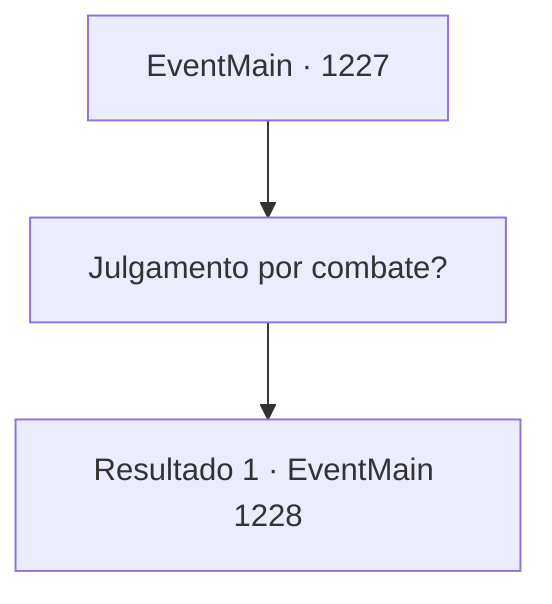

# Eventos principais · 1227

[Índice da tabela](index.md) · [Índice geral](../index.md)

ID: `pt:EventMain:1227` · Fonte: `EventMain4` · Versão: 1.2.47.

Mapeamento estático dos arquivos; a disponibilidade e a execução dependem do estado da run.

## Texto do evento

*Sem texto no arquivo.*

## Dados de entrada

```json
{
  "id": 1227,
  "grade": 1,
  "normalGoal": "",
  "required": ""
}
```

## Mapa das escolhas



## Escolhas e resultados

### Escolha 1

Julgamento por combate?

Requisitos e outros campos da escolha:

```json
{
  "required": ""
}
```

#### Resultado 1.1

Você vira a cabeça curioso. O rei percebe isso e grita ordens para seu servo. O servo abre um pergaminho de papel e começa a lê-lo. 

 "Agora anunciarei as regras do julgamento por combate."

 A voz do servo ecoa pelo salão do julgamento. 

 "Um. Apenas armas de treino deverão ser apresentadas a ambos os lados. Qualquer outra arma é proibida."

 Lentamente, ele percorre as outras regras. 

 "Dois. Apenas armaduras acolchoadas, destinadas a lutas de prática, deverão ser apresentadas a ambos os lados. Qualquer outro equipamento, como armaduras de aço e escudos, é proibido."

 "Três. O primeiro a sangrar ou largar sua arma perde."

 "Quatro. Ambos os lados têm o direito de contratar ou encontrar um campeão. Esse campeão pode ser enviado para lutar em seu lugar."

 O servo respira antes de continuar. 

 "Cinco. Assassinato premeditado do oponente é estritamente proibido, e o não cumprimento desta regra tornará o infrator culpado de homicídio culposo."

 "Seis. O local do combate será 'a Praça da Grande Catedral de Belun'. O horário do combate será decidido por ordem imperial, escolhido pelo Rei Rothar."


Continuação registrada: [Evento 1228](1228.md) na mesma tabela.

```json
{
  "required": "",
  "chance": "1",
  "nextEvent": 1228,
  "type": 2,
  "reward": ""
}
```

## Referências que chegam a este evento

- [Evento 1225 · escolha 1 · resultado 1](1225.md#escolha-1)
- [Evento 1226 · escolha 1 · resultado 1](1226.md#escolha-1)
