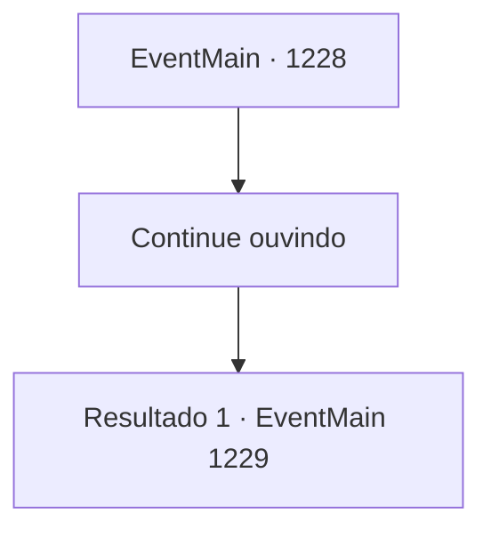

# Eventos principais · 1228

[Índice da tabela](index.md) · [Índice geral](../index.md)

ID: `pt:EventMain:1228` · Fonte: `EventMain4` · Versão: 1.2.47.

Mapeamento estático dos arquivos; a disponibilidade e a execução dependem do estado da run.

## Texto do evento

*Sem texto no arquivo.*

## Dados de entrada

```json
{
  "id": 1228,
  "grade": 1,
  "normalGoal": "",
  "required": ""
}
```

## Mapa das escolhas



## Escolhas e resultados

### Escolha 1

Continue ouvindo

Requisitos e outros campos da escolha:

```json
{
  "required": ""
}
```

#### Resultado 1.1

O servo dobra o pergaminho. O rei Rothar acrescenta. 

 "O combate será realizado em cinco dias. Os sinos da catedral que anunciam o nascer do sol serão o sinal."

 Ele olha para você, e então para Katrin. 

 "Se qualquer um dos lados não chegar à praça até o terceiro toque dos sinos, será considerado abandonado pelos deuses."

 Com isso, o rei sai do salão do julgamento. O mago real o segue, e o mesmo fazem os demais nos lugares da plateia.

Continuação registrada: [Evento 1229](1229.md) na mesma tabela.

```json
{
  "required": "",
  "chance": "1",
  "nextEvent": 1229,
  "type": 2,
  "reward": ""
}
```

## Referências que chegam a este evento

- [Evento 1227 · escolha 1 · resultado 1](1227.md#escolha-1)
