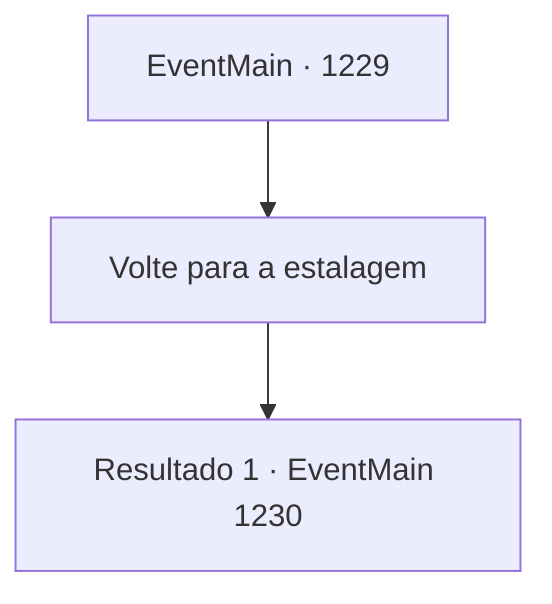

# Eventos principais · 1229

[Índice da tabela](index.md) · [Índice geral](../index.md)

ID: `pt:EventMain:1229` · Fonte: `EventMain4` · Versão: 1.2.47.

Mapeamento estático dos arquivos; a disponibilidade e a execução dependem do estado da run.

## Texto do evento

*Sem texto no arquivo.*

## Dados de entrada

```json
{
  "id": 1229,
  "grade": 1,
  "normalGoal": "",
  "required": ""
}
```

## Mapa das escolhas



## Escolhas e resultados

### Escolha 1

Volte para a estalagem

Requisitos e outros campos da escolha:

```json
{
  "required": ""
}
```

#### Resultado 1.1

Katrin olha para você uma última vez antes de partir, retornando à Mansão Greymoor na capital. O guarda-costas dela a segue. Sozinho, você sai do palácio real e se dirige à estalagem. Você abre a porta da frente e nota que o estalajadeiro de meia-idade não está lá. Em vez da mulher, um homem com uma barba rala está atrás do balcão. Ele está segurando um caneco, lavando-o com um pano. 

 "Você pretende estender sua estadia aqui?"

 Ele coloca o caneco no balcão com indiferença e continua. 

 "Bem... considerando tudo o que você teve de passar na noite passada..."

 Então, ele pega outro caneco por perto. 

 "Você pode ficar por mais uma semana, se quiser. É por conta da casa, não se preocupe."


Continuação registrada: [Evento 1230](1230.md) na mesma tabela.

```json
{
  "required": "",
  "chance": "1",
  "nextEvent": 1230,
  "type": 2,
  "reward": ""
}
```

## Referências que chegam a este evento

- [Evento 1228 · escolha 1 · resultado 1](1228.md#escolha-1)
