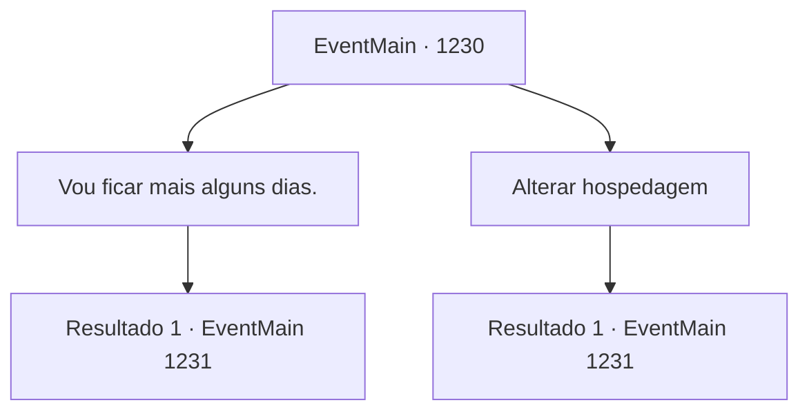

# Eventos principais · 1230

[Índice da tabela](index.md) · [Índice geral](../index.md)

ID: `pt:EventMain:1230` · Fonte: `EventMain4` · Versão: 1.2.47.

Mapeamento estático dos arquivos; a disponibilidade e a execução dependem do estado da run.

## Texto do evento

*Sem texto no arquivo.*

## Dados de entrada

```json
{
  "id": 1230,
  "grade": 1,
  "normalGoal": "",
  "required": ""
}
```

## Mapa das escolhas



## Escolhas e resultados

### Escolha 1

Vou ficar mais alguns dias.

Requisitos e outros campos da escolha:

```json
{
  "required": ""
}
```

#### Resultado 1.1

Você responde que vai ficar mais alguns dias. Você retorna ao seu quarto. A janela quebrada é substituída por uma nova. Os móveis foram organizados novamente, cada um em seu devido lugar. A trilha de sangue no chão foi lavada, mas uma silhueta tênue ainda pode ser vista. Você se aproxima da janela e olha para fora. A cúpula branca da grande catedral no final da avenida brilha em vermelho, banhada pela luz do sol. Daqui a cinco dias, aquela praça se tornará uma arena.

Continuação registrada: [Evento 1231](1231.md) na mesma tabela.

```json
{
  "required": "",
  "chance": "1",
  "nextEvent": 1231,
  "type": 2,
  "reward": ""
}
```

### Escolha 2

Alterar hospedagem

Requisitos e outros campos da escolha:

```json
{
  "required": ""
}
```

#### Resultado 2.1

Você decide não ficar na Estalagem do Esturjão Prateado. O homem responde com um aceno de cabeça. 

 "Entendo. Qualquer pessoa racional escolheria o mesmo."

 Com isso, ele volta às suas tarefas. Você sai da estalagem e caminha pela estrada principal. A cúpula branca da grande catedral no fim da estrada principal brilha em vermelho, banhada pela luz do sol. Daqui a cinco dias, aquela praça se tornará uma arena.

Continuação registrada: [Evento 1231](1231.md) na mesma tabela.

```json
{
  "required": "",
  "chance": "1",
  "nextEvent": 1231,
  "type": 2,
  "reward": "5_939_1"
}
```

## Referências que chegam a este evento

- [Evento 1229 · escolha 1 · resultado 1](1229.md#escolha-1)
