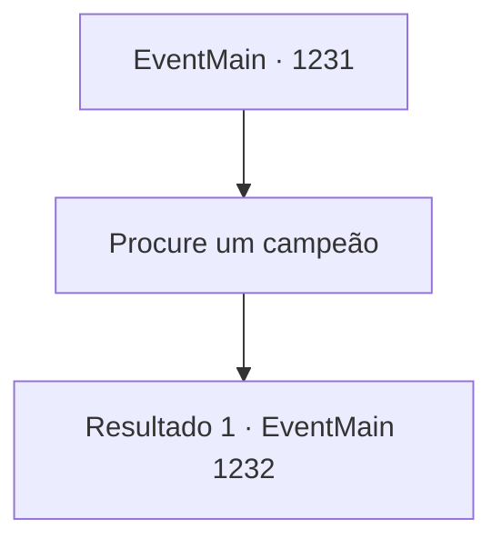

# Eventos principais · 1231

[Índice da tabela](index.md) · [Índice geral](../index.md)

ID: `pt:EventMain:1231` · Fonte: `EventMain4` · Versão: 1.2.47.

Mapeamento estático dos arquivos; a disponibilidade e a execução dependem do estado da run.

## Texto do evento

*Sem texto no arquivo.*

## Dados de entrada

```json
{
  "id": 1231,
  "grade": 1,
  "normalGoal": "",
  "required": ""
}
```

## Mapa das escolhas



## Escolhas e resultados

### Escolha 1

Procure um campeão

Requisitos e outros campos da escolha:

```json
{
  "required": ""
}
```

#### Resultado 1.1

Na rua principal da capital existe um distrito povoado por campeões profissionais. Você decide ir até lá e procurar um por conta própria. Você segue pela estrada e chega à parte leste da cidade capital. Quase toda casa aqui tem uma placa pendurada, para avisar que um campeão está disponível para contratação. Você bate em uma das casas. A porta se abre, e um homem de cabelo azul aparece. 

 "Prazer. Sou Kato."

 Você diz quem é e pergunta se ele poderia ser seu campeão para a prova. O olhar dele fixa-se em você por um instante. 

 "Ah, peço desculpas. Receio que já tenho outra luta marcada para esse dia."

 Ele dá um passo para trás e fecha a porta. Você vai para outra casa. Desta vez, é um velho de cabelo branco. Ele te encara dos pés à cabeça, e recusa mesmo antes de você dizer qualquer coisa. 

 "Sinto muito, mas não posso. Não para essa luta. Todos os outros campeões daqui provavelmente diriam o mesmo."


Continuação registrada: [Evento 1232](1232.md) na mesma tabela.

```json
{
  "required": "",
  "chance": "1",
  "nextEvent": 1232,
  "type": 2,
  "reward": ""
}
```

## Referências que chegam a este evento

- [Evento 1230 · escolha 1 · resultado 1](1230.md#escolha-1)
- [Evento 1230 · escolha 2 · resultado 1](1230.md#escolha-2)
