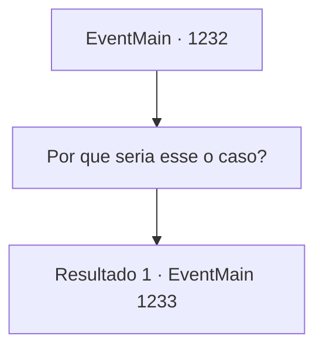

# Eventos principais · 1232

[Índice da tabela](index.md) · [Índice geral](../index.md)

ID: `pt:EventMain:1232` · Fonte: `EventMain4` · Versão: 1.2.47.

Mapeamento estático dos arquivos; a disponibilidade e a execução dependem do estado da run.

## Texto do evento

*Sem texto no arquivo.*

## Dados de entrada

```json
{
  "id": 1232,
  "grade": 1,
  "normalGoal": "",
  "required": ""
}
```

## Mapa das escolhas



## Escolhas e resultados

### Escolha 1

Por que seria esse o caso?

Requisitos e outros campos da escolha:

```json
{
  "required": ""
}
```

#### Resultado 1.1

Em vez de responder à sua pergunta, o velho diz outra coisa. 

 "Cuidado. Haverá outros perigos esperando no caminho para a Grande Catedral."

 Com isso, o velho fecha a porta. Você vai à terceira, à quarta e até à quinta casa, mas é tudo igual. Nenhum dos campeões está disposto a lutar por você. Infelizmente, incapaz de encontrar um campeão, você encontra um banco ao lado de uma clareira e se senta.

Continuação registrada: [Evento 1233](1233.md) na mesma tabela.

```json
{
  "required": "",
  "chance": "1",
  "nextEvent": 1233,
  "type": 2,
  "reward": ""
}
```

## Referências que chegam a este evento

- [Evento 1231 · escolha 1 · resultado 1](1231.md#escolha-1)
