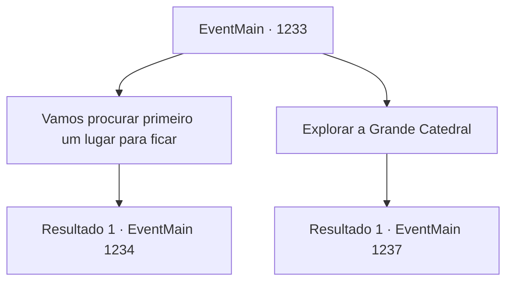

# Eventos principais · 1233

[Índice da tabela](index.md) · [Índice geral](../index.md)

ID: `pt:EventMain:1233` · Fonte: `EventMain4` · Versão: 1.2.47.

Mapeamento estático dos arquivos; a disponibilidade e a execução dependem do estado da run.

## Texto do evento

*Sem texto no arquivo.*

## Dados de entrada

```json
{
  "id": 1233,
  "grade": 1,
  "normalGoal": "",
  "required": ""
}
```

## Mapa das escolhas



## Escolhas e resultados

### Escolha 1

Vamos procurar primeiro um lugar para ficar

Requisitos e outros campos da escolha:

```json
{
  "required": "5_939_1"
}
```

#### Resultado 1.1

Primeiro as coisas — você precisa encontrar um lugar para ficar. Você decide procurar uma nova estalagem perto da Grande Catedral. Você evita deliberadamente lugares luxuosos, onde nobres podem estar hospedados. Você se mistura com o povo comum, seguindo por becos estreitos e pelo mercado. Lá, você encontra uma estalagem surrada chamada a Gaivota Branca. Você nota alguns clientes comendo no primeiro andar. A maioria parece mercadores ou marinheiros. A estalajadeira é uma mulher idosa e magra. Ela te vê entrando e pergunta. 

 "Procurando um quarto? 6 de ouro por noite."


Continuação registrada: [Evento 1234](1234.md) na mesma tabela.

```json
{
  "required": "",
  "chance": "1",
  "nextEvent": 1234,
  "type": 2,
  "reward": ""
}
```

### Escolha 2

Explorar a Grande Catedral

Requisitos e outros campos da escolha:

```json
{
  "required": ""
}
```

#### Resultado 2.1

Você decide explorar a área ao redor da Grande Catedral. Você sai do distrito dos campeões, vai a uma estalagem e de lá à Grande Catedral. Ao passar pelas lojas alinhadas em cada lado da rua principal, aparece um canal que atravessa a cidade. Sobre ele há uma ponte de pedra, arqueando-se sobre o canal. Você atravessa a ponte para o outro lado do canal — o distrito dos nobres. Mansões luxuosas decoram a área. Você também costumava possuir uma mansão aqui, uma vez. Você sacode a cabeça, livrando-se de pensamentos vazios, e chega à escadaria da Grande Catedral. Você olha para cima e encontra a cúpula branca da Grande Catedral ao fim das escadas. Degrau por degrau, você sobe a escadaria. Pequenos arbustos cobrem cada lado do caminho. Mais ou menos na metade, você encontra um pequeno trecho de terreno plano. Você nota um par de bancos colocados ali, provavelmente para as pessoas descansarem.

Continuação registrada: [Evento 1237](1237.md) na mesma tabela.

```json
{
  "required": "",
  "chance": "1",
  "nextEvent": 1237,
  "type": 2,
  "reward": ""
}
```

## Referências que chegam a este evento

- [Evento 1232 · escolha 1 · resultado 1](1232.md#escolha-1)
