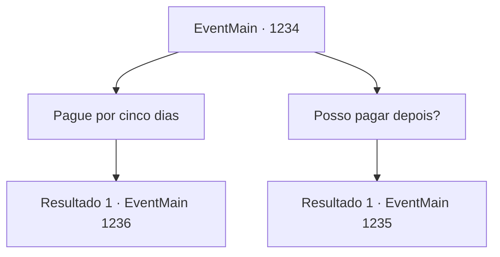

# Eventos principais · 1234

[Índice da tabela](index.md) · [Índice geral](../index.md)

ID: `pt:EventMain:1234` · Fonte: `EventMain4` · Versão: 1.2.47.

Mapeamento estático dos arquivos; a disponibilidade e a execução dependem do estado da run.

## Texto do evento

*Sem texto no arquivo.*

## Dados de entrada

```json
{
  "id": 1234,
  "grade": 1,
  "normalGoal": "",
  "required": ""
}
```

## Mapa das escolhas



## Escolhas e resultados

### Escolha 1

Pague por cinco dias

Requisitos e outros campos da escolha:

```json
{
  "required": "1_4_30"
}
```

#### Resultado 1.1

Você entrega 30 peças de ouro à estalajadeira, pagando por cinco dias. Ela conta as peças de ouro uma por uma e te devolve três. 

 "...Isso é um serviço. Me acompanhe."

 Ela leva as mãos aos joelhos e te conduz até o segundo andar. Você a segue até o segundo andar, para um quarto localizado bem ao lado da escada. 

 "Aqui. Seu quarto."

 A estalajadeira desce imediatamente. O quarto é um pouco estreito, mas bem organizado. Você desempacota suas coisas e olha para fora. A Grande Catedral ergue-se alta e orgulhosa em meio à selva de edifícios.

Continuação registrada: [Evento 1236](1236.md) na mesma tabela.

```json
{
  "required": "",
  "chance": "1",
  "nextEvent": 1236,
  "type": 2,
  "reward": "0_4_-27"
}
```

### Escolha 2

Posso pagar depois?

Requisitos e outros campos da escolha:

```json
{
  "required": ""
}
```

#### Resultado 2.1

Você pergunta se pode pagar o aluguel depois. A dona da estalagem te corta imediatamente. 

 "Nem pensar. Não vai rolar."

 Os braços dela tremulam. 

 "Mas, vai saber. Posso até deixar, se você cortar lenha para a estalagem."


Continuação registrada: [Evento 1235](1235.md) na mesma tabela.

```json
{
  "required": "",
  "chance": "1",
  "nextEvent": 1235,
  "type": 2,
  "reward": ""
}
```

## Referências que chegam a este evento

- [Evento 1233 · escolha 1 · resultado 1](1233.md#escolha-1)
