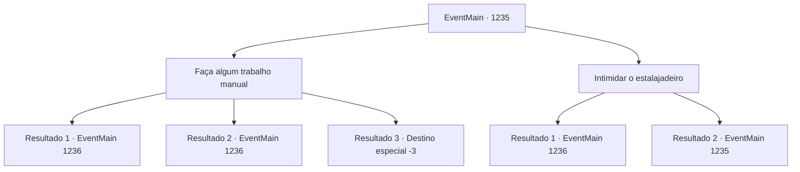

# Eventos principais · 1235

[Índice da tabela](index.md) · [Índice geral](../index.md)

ID: `pt:EventMain:1235` · Fonte: `EventMain4` · Versão: 1.2.47.

Mapeamento estático dos arquivos; a disponibilidade e a execução dependem do estado da run.

## Texto do evento

*Sem texto no arquivo.*

## Dados de entrada

```json
{
  "id": 1235,
  "grade": 1,
  "normalGoal": "",
  "required": ""
}
```

## Mapa das escolhas



## Escolhas e resultados

### Escolha 1

Faça algum trabalho manual

Requisitos e outros campos da escolha:

```json
{
  "required": ""
}
```

#### Resultado 1.1

Você vai para uma pequena clareira atrás da estalagem, segurando um machado de lenhador. Lá, você começa a trabalhar, cortando lenha. Isso é algo que você nunca fez no castelo. O rosto de Rennart passa pelos seus pensamentos. Os troncos se partem ao meio com um estalo alto. Quanto mais você corta, mais fácil fica. 

 Você termina seu trabalho em breve, juntando a lenha em um único monte. Seus ombros e costas doem de todo o esforço. 

 "Ah, o dom da juventude."

 Você escuta o que deve ter sido a estalajadeira falando sozinha. Ela se aproxima de você. 

 "Vamos. Vou te mostrar seu quarto."

 Você a segue até o segundo andar, para um quarto localizado bem ao lado da escada. 

 "Aqui. Seu quarto. Espero a mesma vitalidade amanhã, hein?"

 A estalajadeira desce as escadas imediatamente. O quarto é um pouco estreito, mas bem organizado. Você desfaz suas coisas e olha para fora. A Grande Catedral ergue-se alta e orgulhosa em meio ao emaranhado de prédios.

Continuação registrada: [Evento 1236](1236.md) na mesma tabela.

```json
{
  "required": "",
  "chance": "1|0_5_1|0_13_1",
  "nextEvent": 1236,
  "type": 0,
  "reward": ""
}
```

#### Resultado 1.2

Você vai para uma pequena clareira atrás da estalagem, segurando um machado de lenhador. Lá, você começa a trabalhar, cortando lenha. É algo que você nunca fez no castelo. O rosto de Rennart passa pelos seus pensamentos. Os troncos se partem ao meio com um estalo alto. Quanto mais você corta, mais fácil fica. 

 Você termina seu trabalho em breve, reunindo a lenha em uma pilha. Seus ombros e costas doem por todo o esforço. A empunhadura do machado arde — seus dedos e pulsos começam a doer também. 

 "Você não costumava cortar lenha muito, né?"

 A estalajadeira faz um som com a língua, olhando para você. 

 "Bem, pelo menos você tentou. Vamos. Eu te mostro seu quarto."

 Você a segue até o segundo andar, para um quarto localizado bem ao lado da escada. 

 "Aqui. Seu quarto. Espero a mesma disposição amanhã, hein?"

 A estalajadeira desce as escadas na hora. O quarto é um pouco estreito, mas arrumado. Você desfaz suas coisas e olha para fora. A Grande Catedral se ergue alta e orgulhosa em meio à selva de prédios.

Continuação registrada: [Evento 1236](1236.md) na mesma tabela.

```json
{
  "required": "1_0_2",
  "chance": "30",
  "nextEvent": 1236,
  "type": 1,
  "reward": "0_0_-1"
}
```

#### Resultado 1.3

Você vai para uma pequena clareira atrás da estalagem, segurando um machado de lenhador. Lá, você começa a trabalhar, cortando lenha. É algo que você nunca fez no castelo. Os troncos se partem ao meio com um estrondo alto. Então, uma das peças de lenha partida é arremessada diretamente na sua testa. Você perde a consciência imediatamente após ser atingido.

Continuação registrada: [Destino especial `-3`](../destinos-especiais.md).

```json
{
  "required": "2_0_2",
  "chance": "30",
  "nextEvent": -3,
  "type": 1,
  "reward": "0_0_-1"
}
```

### Escolha 2

Intimidar o estalajadeiro

Requisitos e outros campos da escolha:

```json
{
  "required": "2_3_0|5_972_0"
}
```

#### Resultado 2.1

Você empurra a dona da estalagem contra a parede, ameaçando-a. Os clientes se viram para olhar para você. A mulher idosa te examina dos pés à cabeça, então obedece. 

 "Hm... Tudo bem. Vamos."

 Ela apoia as mãos nos joelhos e te conduz ao segundo andar. Você a acompanha até o segundo andar, a um quarto localizado bem ao lado da escada. 

 "Aqui. Seu quarto."

 A dona da estalagem desce as escadas imediatamente. O quarto é um pouco estreito, mas bem organizado. Você desempacota suas coisas e olha para fora. A Grande Catedral ergue-se alta e orgulhosa em meio à selva de edifícios.

Continuação registrada: [Evento 1236](1236.md) na mesma tabela.

```json
{
  "required": "",
  "chance": "1|0_12_1",
  "nextEvent": 1236,
  "type": 0,
  "reward": "0_3_-1"
}
```

#### Resultado 2.2

Você encosta a dona da estalagem numa parede, ameaçando-a. Os clientes se viram para olhar para você. Mas a mulher idosa não se intimida com você nem um pouco. Ela te observa dos pés à cabeça e responde. 

 "Hum... Vai cortar lenha, ou então cai fora."


Continuação registrada: [Evento 1235](1235.md) na mesma tabela.

```json
{
  "required": "",
  "chance": "15",
  "nextEvent": 1235,
  "type": 1,
  "reward": "5_972_9|0_3_-1"
}
```

## Referências que chegam a este evento

- [Evento 1234 · escolha 2 · resultado 1](1234.md#escolha-2)
- [Evento 1235 · escolha 2 · resultado 2](1235.md#escolha-2)
