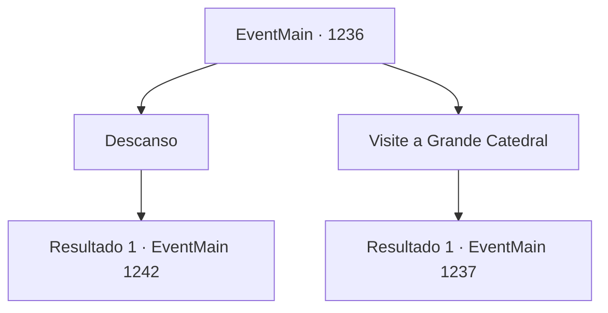

# Eventos principais · 1236

[Índice da tabela](index.md) · [Índice geral](../index.md)

ID: `pt:EventMain:1236` · Fonte: `EventMain4` · Versão: 1.2.47.

Mapeamento estático dos arquivos; a disponibilidade e a execução dependem do estado da run.

## Texto do evento

*Sem texto no arquivo.*

## Dados de entrada

```json
{
  "id": 1236,
  "grade": 1,
  "normalGoal": "",
  "required": ""
}
```

## Mapa das escolhas



## Escolhas e resultados

### Escolha 1

Descanso

Requisitos e outros campos da escolha:

```json
{
  "required": ""
}
```

#### Resultado 1.1

Você se deita na cama. O som de crianças brincando lá fora vai desaparecendo aos poucos. 

 Passam-se mais dois dias. Nada de especial acontece. A quarta noite chega. Como de costume, você faz uma boa refeição na estalagem, depois começa a se alongar no quintal, preparando-se para o duelo. Então, você sente alguém por perto. Você olha para cima — uma assassina está empoleirada no telhado de um prédio próximo, olhando para baixo para você. É a elfa sombria de antes. E desta vez, ela não está sozinha. Mais duas assassinas aparecem, à sua esquerda e à sua direita. Elas iniciam o ataque simultaneamente.

Continuação registrada: [Evento 1242](1242.md) na mesma tabela.

```json
{
  "required": "",
  "chance": "1",
  "nextEvent": 1242,
  "type": 2,
  "reward": "0_0_1|6_3_203",
  "place": 4
}
```

### Escolha 2

Visite a Grande Catedral

Requisitos e outros campos da escolha:

```json
{
  "required": ""
}
```

#### Resultado 2.1

Você desfaz suas coisas na estalagem e segue rumo à Grande Catedral. Após caminhar um quarteirão desde a estalagem, você chega à praça do mercado. Caixas de madeira cheias de mercadorias ocupam a área, com as vozes altas dos comerciantes as anunciando. Você atravessa a multidão, pelo mercado. Onde o mercado termina, surge um beco estreito, caminho central cercado por pequenas construções. Varais pendem delas, formando sombras. Você continua adiante. O beco também chega ao fim, e então aparece um canal, sobre o qual há uma ponte de pedra. Você atravessa a ponte para o outro lado do canal — o bairro dos nobres. Mansões luxuosas decoram a área. Você costumava ter uma casa senhorial aqui também, um dia. Você balança a cabeça, livrando-se de pensamentos ociosos, e chega à escadaria da Grande Catedral. Você olha para cima e encontra a cúpula branca da Grande Catedral ao fim da escadaria. Degrau a degrau, você sobe a escadaria. Pequenos arbustos cobrem cada lado do caminho. Mais ou menos na metade, você encontra um pequeno trecho de terreno plano. Você nota um par de bancos colocados ali, provavelmente postos para as pessoas descansarem.

Continuação registrada: [Evento 1237](1237.md) na mesma tabela.

```json
{
  "required": "",
  "chance": "1",
  "nextEvent": 1237,
  "type": 2,
  "reward": ""
}
```

## Referências que chegam a este evento

- [Evento 1234 · escolha 1 · resultado 1](1234.md#escolha-1)
- [Evento 1235 · escolha 1 · resultado 1](1235.md#escolha-1)
- [Evento 1235 · escolha 1 · resultado 2](1235.md#escolha-1)
- [Evento 1235 · escolha 2 · resultado 1](1235.md#escolha-2)
