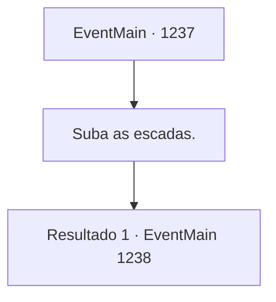

# Eventos principais · 1237

[Índice da tabela](index.md) · [Índice geral](../index.md)

ID: `pt:EventMain:1237` · Fonte: `EventMain4` · Versão: 1.2.47.

Mapeamento estático dos arquivos; a disponibilidade e a execução dependem do estado da run.

## Texto do evento

*Sem texto no arquivo.*

## Dados de entrada

```json
{
  "id": 1237,
  "grade": 1,
  "normalGoal": "",
  "required": ""
}
```

## Mapa das escolhas



## Escolhas e resultados

### Escolha 1

Suba as escadas.

Requisitos e outros campos da escolha:

```json
{
  "required": ""
}
```

#### Resultado 1.1

|drawing_belunChapel| Você alcança o final da escadaria e finalmente chega à Praça da Grande Catedral de Belun, situada no topo de uma colina. No centro da praça retangular há uma fonte. A Grande Catedral fica além dela. Sua porta de latão é decorada com cacos pontiagudos, e uma janela circular brilha intensamente, refletindo a luz do sol. Um enorme sino pende do topo da torre da catedral. Você dá uma volta pela praça. Cerca de trinta minutos se passaram desde que você deixou a estalagem.

Continuação registrada: [Evento 1238](1238.md) na mesma tabela.

```json
{
  "required": "",
  "chance": "1",
  "nextEvent": 1238,
  "type": 2,
  "reward": ""
}
```

## Referências que chegam a este evento

- [Evento 1233 · escolha 2 · resultado 1](1233.md#escolha-2)
- [Evento 1236 · escolha 2 · resultado 1](1236.md#escolha-2)
