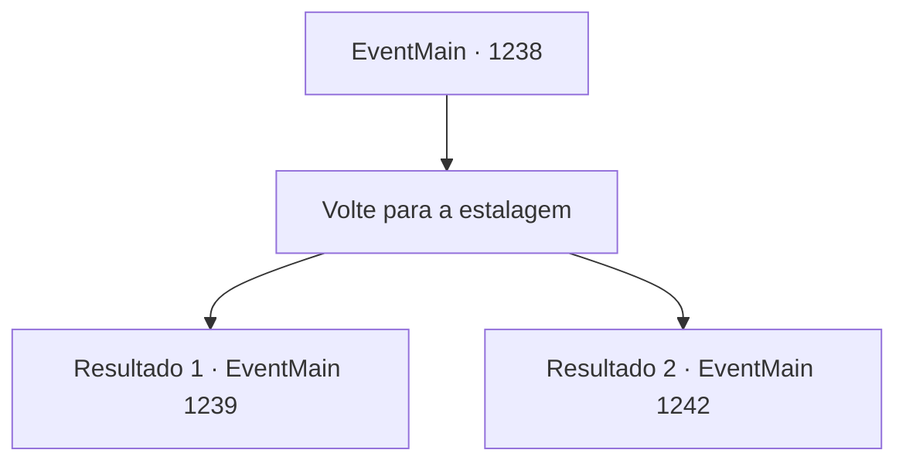

# Eventos principais · 1238

[Índice da tabela](index.md) · [Índice geral](../index.md)

ID: `pt:EventMain:1238` · Fonte: `EventMain4` · Versão: 1.2.47.

Mapeamento estático dos arquivos; a disponibilidade e a execução dependem do estado da run.

## Texto do evento

*Sem texto no arquivo.*

## Dados de entrada

```json
{
  "id": 1238,
  "grade": 1,
  "normalGoal": "",
  "required": ""
}
```

## Mapa das escolhas



## Escolhas e resultados

### Escolha 1

Volte para a estalagem

Requisitos e outros campos da escolha:

```json
{
  "required": ""
}
```

#### Resultado 1.1

Você retorna à Estalagem Cação Prateado. O estalajadeiro nota sua presença e então segue para a cozinha. Logo, ouve-se o som de ingredientes sendo preparados. Você vai até seu quarto e se atira na cadeira. Em seguida, fecha os olhos. O barulho da cidade vai ficando cada vez menor. 

 Passam-se mais dois dias. Nada de particular acontece. A quarta noite chega. Você é despertado pelo cheiro de algo queimando. Você se levanta da cama e logo percebe fumaça saindo por uma pequena fresta no chão. Além da queima, a estalagem parece estar silenciosa.

Continuação registrada: [Evento 1239](1239.md) na mesma tabela.

```json
{
  "required": "18_939_1",
  "chance": "1",
  "nextEvent": 1239,
  "type": 2,
  "reward": ""
}
```

#### Resultado 1.2

Você volta para a Estalagem Gaivota Branca. O dono da estalagem nota você e então vai para a cozinha, Logo, ouve-se o som de ingredientes sendo preparados. Você sobe as escadas, entra no seu quarto e deita-se na cama. 

 Passam-se mais dois dias. Nada de especial acontece. Chega a quarta noite. Como de costume, você saboreia uma boa refeição na estalagem, depois começa a se alongar no quintal, preparando-se para o duelo. Então, você sente alguém por perto. Você olha para cima — uma assassina está empoleirada no telhado de um prédio próximo, olhando para baixo para você. É a elfa sombria de antes. E desta vez, ela não está sozinha. Dois outros assassinos aparecem, à sua esquerda e à sua direita. Eles começam seu ataque simultaneamente.

Continuação registrada: [Evento 1242](1242.md) na mesma tabela.

```json
{
  "required": "5_939_1",
  "chance": "1",
  "nextEvent": 1242,
  "type": 2,
  "reward": "0_0_1|6_3_203",
  "place": 4
}
```

## Referências que chegam a este evento

- [Evento 1237 · escolha 1 · resultado 1](1237.md#escolha-1)
