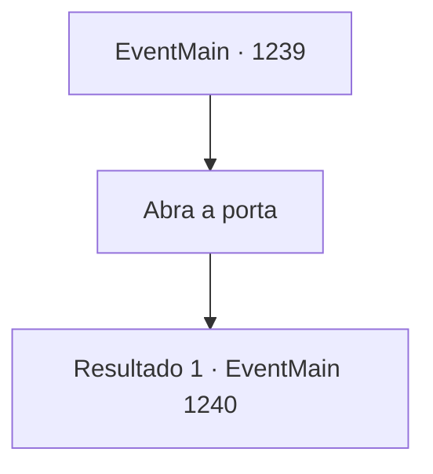

# Eventos principais · 1239

[Índice da tabela](index.md) · [Índice geral](../index.md)

ID: `pt:EventMain:1239` · Fonte: `EventMain4` · Versão: 1.2.47.

Mapeamento estático dos arquivos; a disponibilidade e a execução dependem do estado da run.

## Texto do evento

*Sem texto no arquivo.*

## Dados de entrada

```json
{
  "id": 1239,
  "grade": 1,
  "normalGoal": "",
  "required": ""
}
```

## Mapa das escolhas



## Escolhas e resultados

### Escolha 1

Abra a porta

Requisitos e outros campos da escolha:

```json
{
  "required": ""
}
```

#### Resultado 1.1

Você corre para a porta. Mas a maçaneta já está ficando incandescente. Puxá-la não parece uma opção. Enquanto isso, a fumaça no seu quarto começa a ficar mais densa.

Continuação registrada: [Evento 1240](1240.md) na mesma tabela.

```json
{
  "required": "",
  "chance": "1",
  "nextEvent": 1240,
  "type": 2,
  "reward": ""
}
```

## Referências que chegam a este evento

- [Evento 1238 · escolha 1 · resultado 1](1238.md#escolha-1)
