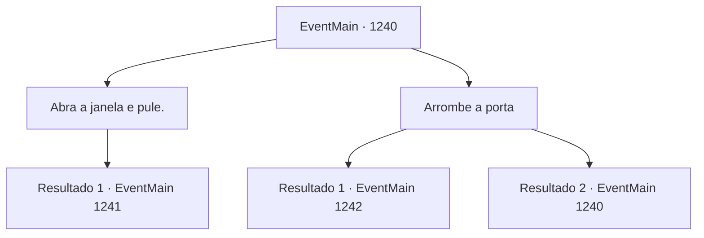

# Eventos principais · 1240

[Índice da tabela](index.md) · [Índice geral](../index.md)

ID: `pt:EventMain:1240` · Fonte: `EventMain4` · Versão: 1.2.47.

Mapeamento estático dos arquivos; a disponibilidade e a execução dependem do estado da run.

## Texto do evento

*Sem texto no arquivo.*

## Dados de entrada

```json
{
  "id": 1240,
  "grade": 1,
  "normalGoal": "",
  "required": ""
}
```

## Mapa das escolhas



## Escolhas e resultados

### Escolha 1

Abra a janela e pule.

Requisitos e outros campos da escolha:

```json
{
  "required": ""
}
```

#### Resultado 1.1

Você abre a janela e pula para fora. Você percebe chamas subindo do primeiro andar da estalagem. Ao descer, você olha para seu local de aterrissagem. O chão está coberto por caltrops afiados, como se seus movimentos tivessem sido previstos.

Continuação registrada: [Evento 1241](1241.md) na mesma tabela.

```json
{
  "required": "",
  "chance": "1",
  "nextEvent": 1241,
  "type": 2,
  "reward": ""
}
```

### Escolha 2

Arrombe a porta

Requisitos e outros campos da escolha:

```json
{
  "required": "5_940_0"
}
```

#### Resultado 2.1

Você investe contra a porta, arrebentando-a. Quando você sai, percebe que alguém colocou deliberadamente barris de madeira ao lado da porta. Mas dois barris não foram páreo para sua investida. Chamas e fumaça começam a tomar conta da estalagem. Você molha sua capa com cerveja de um dos barris. Tapando o nariz e a boca, você corre para fora. Então, você percebe alguém por perto. Você olha para cima — uma assassina está empoleirada no telhado de um prédio próximo, olhando para você. É a elfa sombria de antes. E desta vez, ela não está sozinha. Mais duas assassinas aparecem, à sua esquerda e à sua direita. Elas começam o ataque simultaneamente.

Continuação registrada: [Evento 1242](1242.md) na mesma tabela.

```json
{
  "required": "",
  "chance": "1|0_5_1",
  "nextEvent": 1242,
  "type": 0,
  "reward": "5_940_1|6_3_203",
  "place": 4
}
```

#### Resultado 2.2

Você investe contra a porta para arrombá-la, mas algo a está bloqueando do lado de fora. Ela não cede.

Continuação registrada: [Evento 1240](1240.md) na mesma tabela.

```json
{
  "required": "",
  "chance": "16",
  "nextEvent": 1240,
  "type": 1,
  "reward": "5_940_9"
}
```

## Referências que chegam a este evento

- [Evento 1239 · escolha 1 · resultado 1](1239.md#escolha-1)
- [Evento 1240 · escolha 2 · resultado 2](1240.md#escolha-2)
