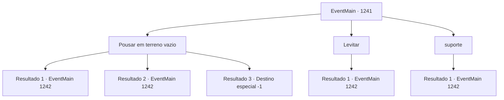

# Eventos principais · 1241

[Índice da tabela](index.md) · [Índice geral](../index.md)

ID: `pt:EventMain:1241` · Fonte: `EventMain4` · Versão: 1.2.47.

Mapeamento estático dos arquivos; a disponibilidade e a execução dependem do estado da run.

## Texto do evento

*Sem texto no arquivo.*

## Dados de entrada

```json
{
  "id": 1241,
  "grade": 1,
  "normalGoal": "",
  "required": ""
}
```

## Mapa das escolhas



## Escolhas e resultados

### Escolha 1

Pousar em terreno vazio

Requisitos e outros campos da escolha:

```json
{
  "required": ""
}
```

#### Resultado 1.1

Com destreza, você consegue pousar no espaço vazio ao lado das estrelas de arremesso. Você chuta as estrelas de arremesso para longe. Então, você sente alguém por perto. Você olha para cima - uma assassina está empoleirada no telhado de um prédio próximo, olhando para você. É a elfa sombria de antes. E desta vez, ela não está sozinha. Mais duas assassinas aparecem, à sua esquerda e à sua direita. Elas começam o ataque simultaneamente.

Continuação registrada: [Evento 1242](1242.md) na mesma tabela.

```json
{
  "required": "",
  "chance": "1|0_5_1",
  "nextEvent": 1242,
  "type": 0,
  "reward": "6_3_203",
  "place": 4
}
```

#### Resultado 1.2

Você tenta pousar em um espaço vazio ao lado dos espinhos. Mas você tropeça, mergulhando direto nos espinhos. Uma dor aguda se espalha pelo seu corpo enquanto os espinhos se cravam na sua carne. Você os tira rapidamente. Então, você sente alguém por perto. Você olha para cima — uma assassina está empoleirada no telhado de um prédio próximo, olhando para você. É a elfa sombria de antes. E desta vez, ela não está sozinha. Mais dois assassinos aparecem, à sua esquerda e à sua direita. Eles começam o ataque simultaneamente.

Continuação registrada: [Evento 1242](1242.md) na mesma tabela.

```json
{
  "required": "1_0_2",
  "chance": "22",
  "nextEvent": 1242,
  "type": 1,
  "reward": "0_0_-1|6_3_203",
  "place": 4
}
```

#### Resultado 1.3

Você tenta pousar em um espaço vazio ao lado dos caltrops. Mas você tropeça, mergulhando direto nos caltrops. Uma dor aguda se espalha pelo seu corpo enquanto os caltrops se cravam na sua carne. Você tenta se levantar de novo, mas seus membros não obedecem. Então, alguém se aproxima de você. É a elfa das trevas de antes. Bem, não que haja muito o que fazer sobre isso agora, de qualquer forma. Sem hesitar, a elfa das trevas decapita você com sua adaga.

Continuação registrada: [Destino especial `-1`](../destinos-especiais.md).

```json
{
  "required": "2_0_2",
  "chance": "22",
  "nextEvent": -1,
  "type": 1,
  "reward": "0_0_-1|15_7_17|25_8_1"
}
```

### Escolha 2

Levitar

Requisitos e outros campos da escolha:

```json
{
  "required": "-1|20_0_1|20_10_1"
}
```

#### Resultado 2.1

Você paira no ar por mais alguns segundos, aterrissando em segurança no chão sem pisar nos espinhos. Então, se ouve um curto estalo de língua. Você olha para cima — um assassino está empoleirado no telhado de um prédio próximo, olhando para você. É a elfa sombria de antes. E desta vez, ela não está sozinha. Dois outros assassinos aparecem, à sua esquerda e à sua direita. Eles começam o ataque simultaneamente.

Continuação registrada: [Evento 1242](1242.md) na mesma tabela.

```json
{
  "required": "",
  "chance": "1",
  "nextEvent": 1242,
  "type": 2,
  "reward": "6_3_203",
  "place": 4
}
```

### Escolha 3

suporte

Requisitos e outros campos da escolha:

```json
{
  "required": "20_9_1"
}
```

#### Resultado 3.1

Você mergulha direto nos caltrops, mas se levanta sem muitos danos. Então, ouve-se um curto estalo de língua. Você olha para cima — uma assassina está empoleirada no telhado de um prédio próximo, olhando para baixo para você. É a elfa sombria de antes. E desta vez, ela não está sozinha. Mais dois assassinos aparecem, à sua esquerda e à sua direita. Eles começam o ataque simultaneamente.

Continuação registrada: [Evento 1242](1242.md) na mesma tabela.

```json
{
  "required": "",
  "chance": "1",
  "nextEvent": 1242,
  "type": 2,
  "reward": "6_3_203",
  "place": 4
}
```

## Referências que chegam a este evento

- [Evento 1240 · escolha 1 · resultado 1](1240.md#escolha-1)
