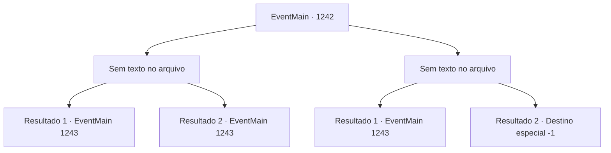

# Eventos principais · 1242

[Índice da tabela](index.md) · [Índice geral](../index.md)

ID: `pt:EventMain:1242` · Fonte: `EventMain4` · Versão: 1.2.47.

Mapeamento estático dos arquivos; a disponibilidade e a execução dependem do estado da run.

## Texto do evento

*Sem texto no arquivo.*

## Dados de entrada

```json
{
  "id": 1242,
  "grade": 1,
  "normalGoal": "",
  "required": ""
}
```

## Mapa das escolhas



## Escolhas e resultados

### Escolha 1

*Sem texto no arquivo; o papel dessa opção depende da interface do jogo.*

Requisitos e outros campos da escolha:

```json
{
  "required": ""
}
```

#### Resultado 1.1

Você derrota os assassinos. Aproximando-se da única que ainda está consciente, você exige que ela diga o nome do cliente. Mas então, você ouve algo duro quebrar dentro da boca dela. De repente, a assassina começa a espumar pela boca. O corpo dela convulsiona e então fica imóvel. Logo, cidadãos das casas próximas e guardas se aproximam do local. Enquanto os cidadãos correm para recolher água para apagar as chamas, um dos guardas se aproxima de você. 

 "Um incidente dessa magnitude exige investigação. Por favor, você poderia nos acompanhar por um momento?"


Continuação registrada: [Evento 1243](1243.md) na mesma tabela.

```json
{
  "required": "18_939_1",
  "chance": "1",
  "nextEvent": 1243,
  "type": 2,
  "reward": ""
}
```

#### Resultado 1.2

Você derrota os assassinos. Aproximando-se da única que ainda está consciente, você exige que ela diga o nome do contratante. Mas então, você ouve algo quebrar dentro da boca dela. De repente, a assassina começa a cuspir espuma pela boca. O corpo dela convulsiona e depois fica imóvel. Logo, cidadãos das casas próximas e guardas se aproximam da cena. Alguém deve ter testemunhado sua luta e chamado os guardas. Um dos guardas se aproxima de você. 

 "Você está bem? Há uma investigação a ser feita — por favor, viria conosco por um momento?"


Continuação registrada: [Evento 1243](1243.md) na mesma tabela.

```json
{
  "required": "5_939_1",
  "chance": "1",
  "nextEvent": 1243,
  "type": 2,
  "reward": ""
}
```

### Escolha 2

*Sem texto no arquivo; o papel dessa opção depende da interface do jogo.*

Requisitos e outros campos da escolha:

```json
{
  "required": ""
}
```

#### Resultado 2.1

Os assassinos falham na missão, pois cidadãos e guardas chegam ao local. Alguém deve ter testemunhado sua luta e chamado os guardas. Os assassinos elfos sombrios desaparecem nas sombras. Enquanto os cidadãos conversam e murmuram, um dos guardas se aproxima de você. 

 "Você está bem? Há uma investigação a ser feita — por favor, você vem conosco por um momento?"


Continuação registrada: [Evento 1243](1243.md) na mesma tabela.

```json
{
  "required": "1_0_2|1_1_2",
  "chance": "1",
  "nextEvent": 1243,
  "type": 2,
  "reward": "0_0_-1|0_1_-1"
}
```

#### Resultado 2.2

A adaga da assassina atinge seu abdômen. Você cai de joelhos. A assassina elfa sombria se aproxima de você e então crava a adaga no seu pescoço.

Continuação registrada: [Destino especial `-1`](../destinos-especiais.md).

```json
{
  "required": "-1|2_0_2|2_1_2",
  "chance": "1",
  "nextEvent": -1,
  "type": 2,
  "reward": "0_0_-1|0_1_-1|15_7_17|25_8_1"
}
```

## Referências que chegam a este evento

- [Evento 1236 · escolha 1 · resultado 1](1236.md#escolha-1)
- [Evento 1238 · escolha 1 · resultado 2](1238.md#escolha-1)
- [Evento 1240 · escolha 2 · resultado 1](1240.md#escolha-2)
- [Evento 1241 · escolha 1 · resultado 1](1241.md#escolha-1)
- [Evento 1241 · escolha 1 · resultado 2](1241.md#escolha-1)
- [Evento 1241 · escolha 2 · resultado 1](1241.md#escolha-2)
- [Evento 1241 · escolha 3 · resultado 1](1241.md#escolha-3)
