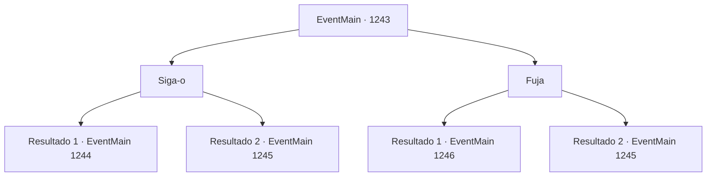

# Eventos principais · 1243

[Índice da tabela](index.md) · [Índice geral](../index.md)

ID: `pt:EventMain:1243` · Fonte: `EventMain4` · Versão: 1.2.47.

Mapeamento estático dos arquivos; a disponibilidade e a execução dependem do estado da run.

## Texto do evento

*Sem texto no arquivo.*

## Dados de entrada

```json
{
  "id": 1243,
  "grade": 1,
  "normalGoal": "",
  "required": ""
}
```

## Mapa das escolhas



## Escolhas e resultados

### Escolha 1

Siga-o

Requisitos e outros campos da escolha:

```json
{
  "required": ""
}
```

#### Resultado 1.1

Você segue os guardas. Um deles lhe faz uma pergunta. 

 "Há alguém que possa guardar rancor de você por algo?"

 Você responde às perguntas, examinando-os mais de perto. Eles usam capas azuis e um símbolo. O equipamento deles é o mesmo dos guardas. Mas algo definitivamente está errado aqui, sua intuição lhe diz. Então, você baixa o olhar. Os 'guardas' têm uma adaga amarrada dentro das mangas. Pelo que você sabe, os guardas não estão armados com adagas.

Continuação registrada: [Evento 1244](1244.md) na mesma tabela.

```json
{
  "required": "",
  "chance": "1|0_14_1",
  "nextEvent": 1244,
  "type": 0,
  "reward": ""
}
```

#### Resultado 1.2

Você segue os guardas. Um deles te faz uma pergunta. 

 "Existe alguém que possa guardar rancor de você por algo?"

 Você responde às perguntas deles, examinando-os mais de perto. Tudo parece estar em ordem. Os guardas te escoltam pela ponte sobre o canal, Mais ou menos na metade, o guarda real da frente se vira para te encarar. 

 "Este lugar aqui serve."

 Antes que você perceba, ele está armado com uma lâmina. Então, os 'guardas' se livram do uniforme e começam a te atacar.

Continuação registrada: [Evento 1245](1245.md) na mesma tabela.

```json
{
  "required": "",
  "chance": "20",
  "nextEvent": 1245,
  "type": 1,
  "reward": "6_3_25",
  "place": 4
}
```

### Escolha 2

Fuja

Requisitos e outros campos da escolha:

```json
{
  "required": ""
}
```

#### Resultado 2.1

Você afasta a guarda real e foge. 

 "Droga...! Vai, vai, vai!"

 Os assassinos vêm atrás de você, mas não conseguem alcançá-lo. Você escapa por um beco para despistá-los. Então, você segue para a Grande Catedral. Ainda é noite, mas em breve nascerá o dia. Você passa pelo distrito do mercado, pelo canal, e chega à escadaria da Grande Catedral. Lá, você avista uma barricada de madeira e alguém esperando por você. 

 "Salve, Briovich."

 Ele se levanta, apoiando-se na ponta do martelo. Ele te observa dos pés à cabeça, então fala. 

 "Desista do duelo, por que não?"


Continuação registrada: [Evento 1246](1246.md) na mesma tabela.

```json
{
  "required": "",
  "chance": "1|0_6_1",
  "nextEvent": 1246,
  "type": 0,
  "reward": ""
}
```

#### Resultado 2.2

Você empurra o guarda real e corre. 

 "Droga...! Vai, vai, vai!"

 Os assassinos te alcançam e lançam uma rede. Você fica preso na rede e cai no chão. Você consegue se libertar rapidamente, mas agora os assassinos estão cercando você. Os guardas começam a atacá-lo imediatamente.

Continuação registrada: [Evento 1245](1245.md) na mesma tabela.

```json
{
  "required": "",
  "chance": "26",
  "nextEvent": 1245,
  "type": 1,
  "reward": "6_3_25",
  "place": 4
}
```

## Referências que chegam a este evento

- [Evento 1242 · escolha 1 · resultado 1](1242.md#escolha-1)
- [Evento 1242 · escolha 1 · resultado 2](1242.md#escolha-1)
- [Evento 1242 · escolha 2 · resultado 1](1242.md#escolha-2)
