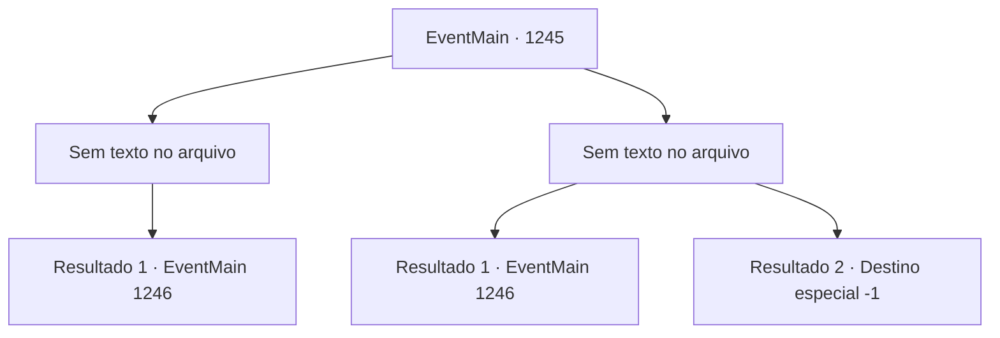

# Eventos principais · 1245

[Índice da tabela](index.md) · [Índice geral](../index.md)

ID: `pt:EventMain:1245` · Fonte: `EventMain4` · Versão: 1.2.47.

Mapeamento estático dos arquivos; a disponibilidade e a execução dependem do estado da run.

## Texto do evento

*Sem texto no arquivo.*

## Dados de entrada

```json
{
  "id": 1245,
  "grade": 1,
  "normalGoal": "",
  "required": ""
}
```

## Mapa das escolhas



## Escolhas e resultados

### Escolha 1

*Sem texto no arquivo; o papel dessa opção depende da interface do jogo.*

Requisitos e outros campos da escolha:

```json
{
  "required": ""
}
```

#### Resultado 1.1

Você derrota os inimigos, disfarçado de guardas. Três deles estão inconscientes, e um consegue fugir. Você prende o que restou e exige que ele diga quem é o cliente. Com a voz tremendo de medo, o assassino responde. 

 "T- o cliente estava usando um capuz, então eu não sei ao certo, mas..."

 Ele acrescenta rapidamente, tentando não te deixar irritado. 

 "A- tudo que eu sei é que nosso cliente era riquíssimo. Sério!"

 Você o solta, então segue para a Grande Catedral. Ainda é noite, mas logo amanhecerá. Você passa pelo bairro do mercado, pelo canal, e chega à escadaria da Grande Catedral. Lá, você nota uma barricada de madeira e alguém esperando por você. 

 "Saiam, Briovich."

 Ele se levanta, usando a ponta do martelo como apoio. Ele te olha de cima a baixo, então fala. 

 "Desista do duelo, por que não?"


Continuação registrada: [Evento 1246](1246.md) na mesma tabela.

```json
{
  "required": "",
  "chance": "1",
  "nextEvent": 1246,
  "type": 2,
  "reward": ""
}
```

### Escolha 2

*Sem texto no arquivo; o papel dessa opção depende da interface do jogo.*

Requisitos e outros campos da escolha:

```json
{
  "required": ""
}
```

#### Resultado 2.1

Você luta valentemente contra os caçadores de recompensa, mas está em grande desvantagem numérica. Você afasta um deles e corre em direção ao beco. 

 "Droga...! Vai, vai, vai!"

 Os caçadores de recompensa vêm atrás de você, mas não conseguem alcançá-lo. Você escapa por um beco para despistá-los. Então, você se dirige à Grande Catedral. Ainda é noite, mas em breve será amanhecer. Você passa pelo distrito do mercado, pelo canal, e chega à escadaria da Grande Catedral. Lá, você nota uma barricada de madeira e alguém esperando por você. 

 "Salve, Briovich."

 Ele se levanta, usando a ponta do martelo como apoio. Ele olha você de cima a baixo, e então fala. 

 "Desista do duelo, por que não?"


Continuação registrada: [Evento 1246](1246.md) na mesma tabela.

```json
{
  "required": "1_0_2|1_1_2",
  "chance": "1",
  "nextEvent": 1246,
  "type": 2,
  "reward": "0_0_-1|0_1_-1"
}
```

#### Resultado 2.2

Um dos caçadores de recompensas acerta suas costas com a maça. Você ouve algo estalar, então sua cabeça começa a zunir e sua visão fica turva. 

 "Eh...?! Droga! Precisamos dele vivo...!"

 "Que droga...!"

 Você bate a cabeça no chão. Infelizmente, tudo fica escuro enquanto as vozes dos caçadores de recompensas se afastam.

Continuação registrada: [Destino especial `-1`](../destinos-especiais.md).

```json
{
  "required": "-1|2_0_2|2_1_2",
  "chance": "1",
  "nextEvent": -1,
  "type": 2,
  "reward": "0_0_-1|0_1_-1|15_7_17|25_8_1"
}
```

## Referências que chegam a este evento

- [Evento 1243 · escolha 1 · resultado 2](1243.md#escolha-1)
- [Evento 1243 · escolha 2 · resultado 2](1243.md#escolha-2)
- [Evento 1244 · escolha 1 · resultado 1](1244.md#escolha-1)
- [Evento 1244 · escolha 1 · resultado 2](1244.md#escolha-1)
- [Evento 1244 · escolha 2 · resultado 2](1244.md#escolha-2)
