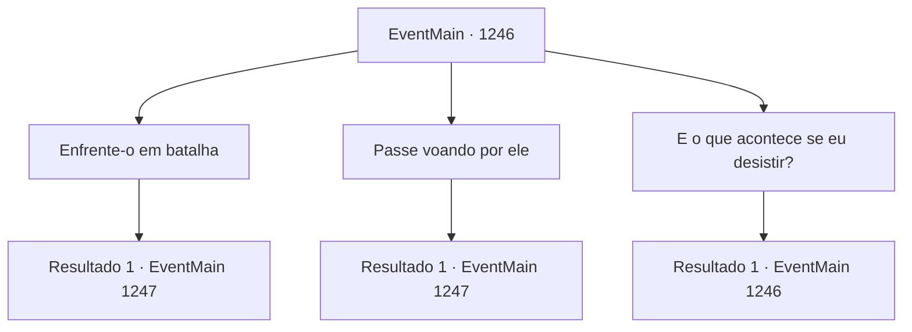

# Eventos principais · 1246

[Índice da tabela](index.md) · [Índice geral](../index.md)

ID: `pt:EventMain:1246` · Fonte: `EventMain4` · Versão: 1.2.47.

Mapeamento estático dos arquivos; a disponibilidade e a execução dependem do estado da run.

## Texto do evento

*Sem texto no arquivo.*

## Dados de entrada

```json
{
  "id": 1246,
  "grade": 1,
  "normalGoal": "",
  "required": ""
}
```

## Mapa das escolhas



## Escolhas e resultados

### Escolha 1

Enfrente-o em batalha

Requisitos e outros campos da escolha:

```json
{
  "required": ""
}
```

#### Resultado 1.1

Você decide enfrentá-lo de frente. Ele sorri em resposta. 

 "Entendido. Pois bem. Manda ver."

 Ele pega seu martelo e se prepara para atacar.

Continuação registrada: [Evento 1247](1247.md) na mesma tabela.

```json
{
  "required": "",
  "chance": "1",
  "nextEvent": 1247,
  "type": 2,
  "reward": "6_0_26",
  "place": 4
}
```

### Escolha 2

Passe voando por ele

Requisitos e outros campos da escolha:

```json
{
  "required": "-1|20_0_1|20_10_1"
}
```

#### Resultado 2.1

Você tenta passar por ele, mas ele está bem preparado. Ele lança um laço nas suas pernas, trazendo você de volta ao chão. 

 "Onde você pensa que está indo?"

 Você cai de volta ao chão, e logo em seguida ele ataca com o martelo.

Continuação registrada: [Evento 1247](1247.md) na mesma tabela.

```json
{
  "required": "",
  "chance": "1",
  "nextEvent": 1247,
  "type": 2,
  "reward": "6_0_26",
  "place": 4
}
```

### Escolha 3

E o que acontece se eu desistir?

Requisitos e outros campos da escolha:

```json
{
  "required": "5_941_0"
}
```

#### Resultado 3.1

O homem responde com indiferença. 

 "Bem, isso significa que você não terá que lutar comigo aqui. Você também será liberto dos perigos que enfrentará quando subir essas escadas."

 Ele encosta o martelo no ombro. 

 "Bem, você perderá a prova, mas terá muitas oportunidades para se recuperar, contanto que esteja vivo."


Continuação registrada: [Evento 1246](1246.md) na mesma tabela.

```json
{
  "required": "",
  "chance": "1",
  "nextEvent": 1246,
  "type": 2,
  "reward": "5_941_1"
}
```

## Referências que chegam a este evento

- [Evento 1243 · escolha 2 · resultado 1](1243.md#escolha-2)
- [Evento 1244 · escolha 2 · resultado 1](1244.md#escolha-2)
- [Evento 1245 · escolha 1 · resultado 1](1245.md#escolha-1)
- [Evento 1245 · escolha 2 · resultado 1](1245.md#escolha-2)
- [Evento 1246 · escolha 3 · resultado 1](1246.md#escolha-3)
