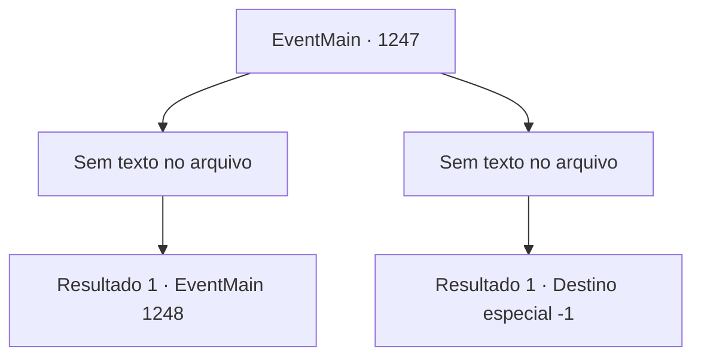

# Eventos principais · 1247

[Índice da tabela](index.md) · [Índice geral](../index.md)

ID: `pt:EventMain:1247` · Fonte: `EventMain4` · Versão: 1.2.47.

Mapeamento estático dos arquivos; a disponibilidade e a execução dependem do estado da run.

## Texto do evento

*Sem texto no arquivo.*

## Dados de entrada

```json
{
  "id": 1247,
  "grade": 1,
  "normalGoal": "",
  "required": ""
}
```

## Mapa das escolhas



## Escolhas e resultados

### Escolha 1

*Sem texto no arquivo; o papel dessa opção depende da interface do jogo.*

Requisitos e outros campos da escolha:

```json
{
  "required": ""
}
```

#### Resultado 1.1

Você derrota o homem que bloqueava seu caminho. Ele cai no chão e larga seu martelo. 

 "*ofegante*... Bem, que se dane. Você venceu."

 Ele se afasta. 

 "Você pode passar. Mas não abaixe sua guarda."

 Você passa por ele e sobe as escadas. Logo, você chega a um pequeno trecho de terra plana, cerca de metade do caminho das escadas. Lá, Sir Imre, um cavaleiro da Casa Greymoor, está sentado em um banco. O céu a leste vai se iluminando devagar. A luz do sol brilha de forma um pouco apagada em sua armadura. 

 "Bom encontro. Uma honra enfrentá-lo neste lugar, nesta ocasião."

 Ele abaixa a viseira e estende a mão para sua espada. 

 "Você terá que me ceder um tempo também antes de subir, Briovich."

 Assim que termina, uma dúzia de homens armados surge dos becos próximos.

Continuação registrada: [Evento 1248](1248.md) na mesma tabela.

```json
{
  "required": "",
  "chance": "1",
  "nextEvent": 1248,
  "type": 2,
  "reward": "6_3_197",
  "place": 4
}
```

### Escolha 2

*Sem texto no arquivo; o papel dessa opção depende da interface do jogo.*

Requisitos e outros campos da escolha:

```json
{
  "required": ""
}
```

#### Resultado 2.1

Você é jogado no chão depois de ser atingido pelo martelo do homem. Os ferimentos dificultam sua respiração. 

 "Isto também deve ser a vontade dos deuses, não é?"

 Ele se aproxima e atinge suas costas com o cabo do martelo. Infelizmente, você perde a consciência. 

 Quando você abre os olhos, o sol já nasceu. Você sobe as escadas às pressas e chega à Praça da Grande Catedral. Lá, você encontra os cavaleiros reais. 

 "O julgamento acabou, Briovich. Você não compareceu no horário designado, e a Condessa Greymoor prevaleceu."

 Eles então algemam você. Você é arrastado para a prisão.

Continuação registrada: [Destino especial `-1`](../destinos-especiais.md).

```json
{
  "required": "",
  "chance": "1",
  "nextEvent": -1,
  "type": 2,
  "reward": "0_0_-1|0_1_-1|15_7_4"
}
```

## Referências que chegam a este evento

- [Evento 1246 · escolha 1 · resultado 1](1246.md#escolha-1)
- [Evento 1246 · escolha 2 · resultado 1](1246.md#escolha-2)
