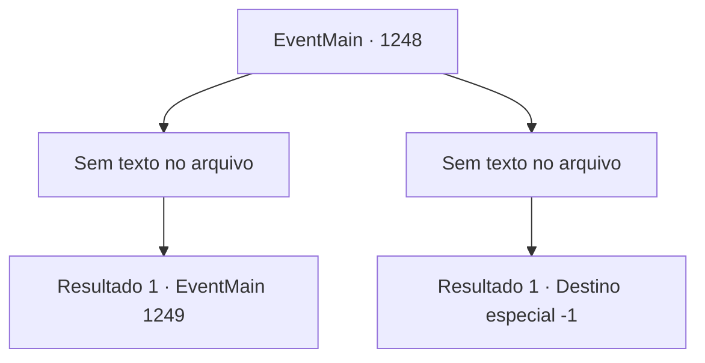

# Eventos principais · 1248

[Índice da tabela](index.md) · [Índice geral](../index.md)

ID: `pt:EventMain:1248` · Fonte: `EventMain4` · Versão: 1.2.47.

Mapeamento estático dos arquivos; a disponibilidade e a execução dependem do estado da run.

## Texto do evento

*Sem texto no arquivo.*

## Dados de entrada

```json
{
  "id": 1248,
  "grade": 1,
  "normalGoal": "",
  "required": ""
}
```

## Mapa das escolhas



## Escolhas e resultados

### Escolha 1

*Sem texto no arquivo; o papel dessa opção depende da interface do jogo.*

Requisitos e outros campos da escolha:

```json
{
  "required": ""
}
```

#### Resultado 1.1

Você derrota o cavaleiro Greymoor e seus capangas, fazendo seus corpos inconscientes rolar escada abaixo. Suas armaduras tilintam enquanto rolam. Então, o sino da Grande Catedral toca.
 'DING--'
 Você sobe correndo as escadas.
 'DING--'
 Você está no último degrau da escadaria quando o segundo sino toca. A praça se abre à sua frente. A cúpula branca da Grande Catedral brilha sob a luz da manhã. Você nota uma linha desenhada no centro da praça marcando a área de duelo. Katrin e Sir Wojciech, seu cavaleiro, já estão parados ali. O supervisor da corte real também está lá. Você entra na área de duelo.
 'DING--'
 O terceiro sino toca. As sobrancelhas de Katrin se contraem. O supervisor real abre um baú ao lado dele. 

 "Agora, ambos os lados devem escolher uma arma de sua preferência."

 Dentro do baú há dois tipos de armas. Uma é uma espada longa com a lâmina propositalmente embotada, e a outra é um cajado com tampas circulares de borracha presas em cada extremidade. O supervisor olha para você. 

 "Sua vez de escolher."


Continuação registrada: [Evento 1249](1249.md) na mesma tabela.

```json
{
  "required": "",
  "chance": "1",
  "nextEvent": 1249,
  "type": 2,
  "reward": ""
}
```

### Escolha 2

*Sem texto no arquivo; o papel dessa opção depende da interface do jogo.*

Requisitos e outros campos da escolha:

```json
{
  "required": ""
}
```

#### Resultado 2.1

A lâmina de Sir Imre te coloca de joelhos. Sangue escorre de suas feridas e cai no chão. Homens armados circulam ao seu redor, forçando-o para baixo. Então, Imre se aproxima de você. 

 "Agora, se me dá licença."

 Você luta, criticando como são sem vergonha, mas ele não parece se importar nem um pouco. 

 "Servir meu senhor é minha honra. Por quaisquer meios."

 Ele atinge seu pescoço com o pomo de sua espada. Ai de você, perde a consciência. 

 Quando você abre os olhos, o sol já nasceu. Você sobe às pressas as escadas e chega à Praça da Grande Catedral. Lá, encontra os cavaleiros reais. 

 "O julgamento acabou, Briovich. Você não compareceu no horário designado, e a Condessa Greymoor prevaleceu."

 Eles procedem a algemar você. Você é arrastado para a prisão.

Continuação registrada: [Destino especial `-1`](../destinos-especiais.md).

```json
{
  "required": "",
  "chance": "1",
  "nextEvent": -1,
  "type": 2,
  "reward": "0_0_-1|0_1_-1|15_7_4"
}
```

## Referências que chegam a este evento

- [Evento 1247 · escolha 1 · resultado 1](1247.md#escolha-1)
