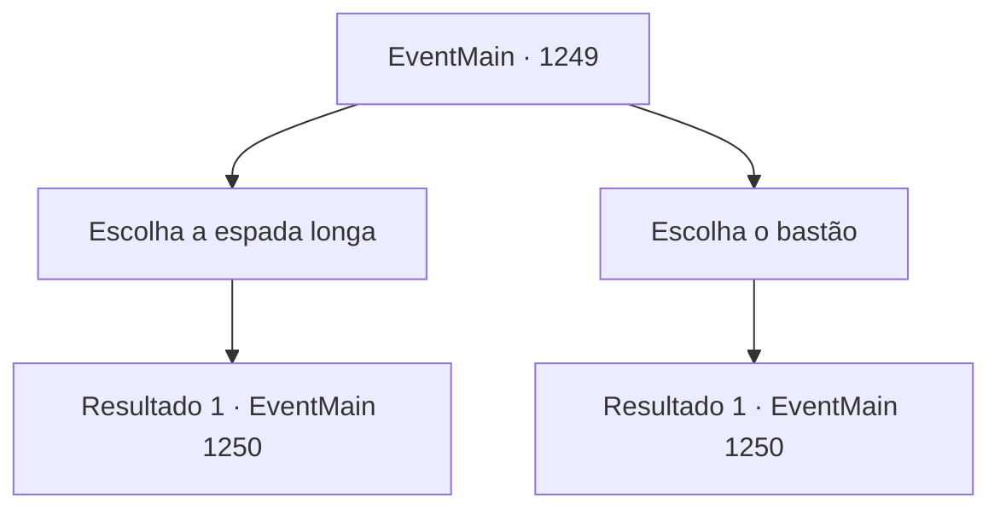

# Eventos principais · 1249

[Índice da tabela](index.md) · [Índice geral](../index.md)

ID: `pt:EventMain:1249` · Fonte: `EventMain4` · Versão: 1.2.47.

Mapeamento estático dos arquivos; a disponibilidade e a execução dependem do estado da run.

## Texto do evento

*Sem texto no arquivo.*

## Dados de entrada

```json
{
  "id": 1249,
  "grade": 1,
  "normalGoal": "",
  "required": ""
}
```

## Mapa das escolhas



## Escolhas e resultados

### Escolha 1

Escolha a espada longa

Requisitos e outros campos da escolha:

```json
{
  "required": ""
}
```

#### Resultado 1.1

Você pega a espada longa. As bordas cegadas tornam a arma muito menos letal, mas ela parece igualmente pesada. O supervisor lhe entrega uma armadura acolchoada. 

 "Aqui. Coloque isto, por favor."

 Você veste a armadura acolchoada e fica frente a frente com Sir Wojciech. Ele escolheu a espada longa, assim como você. O supervisor fica entre vocês dois. Numa mão, ele segura um pergaminho. 

 "Agora, iniciaremos o julgamento por combate."

 A voz dele ecoa pela praça. Alguns nobres se reuniram na beirada da praça para assistir ao duelo. Perto da torre do sino, você nota dois padres terminando algum tipo de ritual. 

 "Você jura aceitar o juízo divino e engajar-se no combate com veracidade e honra?"

 Você toca seu peito com a espada longa. Wojciech faz o mesmo. 

 "Eu juro."

 O supervisor acena com a cabeça. 

 "Repassaremos as regras uma última vez. O primeiro a sangrar, a largar a arma ou a se render perde. Matar o oponente de propósito é estritamente proibido."

 Em seguida, ele guarda o pergaminho. 

 "Que os deuses revelem a verdade."

 O supervisor afasta-se bastante da área de duelo. Com isso, o combate começa.

Continuação registrada: [Evento 1250](1250.md) na mesma tabela.

```json
{
  "required": "",
  "chance": "1",
  "nextEvent": 1250,
  "type": 2,
  "reward": "16_385_1|16_387_1|6_0_201",
  "place": 4
}
```

### Escolha 2

Escolha o bastão

Requisitos e outros campos da escolha:

```json
{
  "required": ""
}
```

#### Resultado 2.1

Você pega o bastão. É resistente, mas mais leve do que você esperava. O supervisor lhe entrega uma armadura acolchoada. 

 "Aqui. Vista isto, por favor."

 Você veste a armadura acolchoada e fica frente a frente com Sir Wojciech. Ele escolheu a espada longa. O supervisor fica entre vocês dois. Com uma das mãos, ele segura um pergaminho. 

 "Agora, daremos início ao julgamento por combate."

 A voz dele ecoa pela praça. Alguns nobres se reuniram na borda da praça para assistir ao duelo. Perto da torre do sino, você percebe dois padres terminando algum tipo de ritual. 

 "Você jura aceitar o julgamento divino e envolver-se no combate com veracidade e honra?"

 Você bate no peito com sua espada longa. Wojciech faz o mesmo. 

 "Juro."

 O supervisor acena com a cabeça. 

 "Vamos rever as regras pela última vez. O primeiro que sangrar, largar sua arma ou se render, perde. Matar intencionalmente o oponente é estritamente proibido."

 Então, ele guarda o pergaminho. 

 "Que os deuses revelem a verdade."

 O supervisor afasta-se da área do duelo. Com isso, o combate começa.

Continuação registrada: [Evento 1250](1250.md) na mesma tabela.

```json
{
  "required": "",
  "chance": "1",
  "nextEvent": 1250,
  "type": 2,
  "reward": "16_387_1|16_386_1|6_0_201",
  "place": 4
}
```

## Referências que chegam a este evento

- [Evento 1248 · escolha 1 · resultado 1](1248.md#escolha-1)
