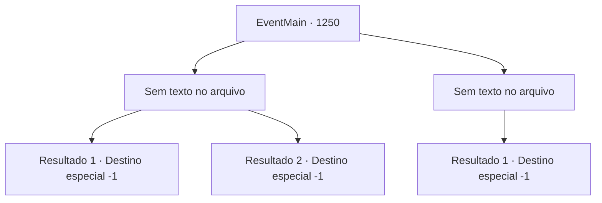

# Eventos principais · 1250

[Índice da tabela](index.md) · [Índice geral](../index.md)

ID: `pt:EventMain:1250` · Fonte: `EventMain4` · Versão: 1.2.47.

Mapeamento estático dos arquivos; a disponibilidade e a execução dependem do estado da run.

## Texto do evento

*Sem texto no arquivo.*

## Dados de entrada

```json
{
  "id": 1250,
  "grade": 1,
  "normalGoal": "",
  "required": ""
}
```

## Mapa das escolhas



## Escolhas e resultados

### Escolha 1

*Sem texto no arquivo; o papel dessa opção depende da interface do jogo.*

Requisitos e outros campos da escolha:

```json
{
  "required": ""
}
```

#### Resultado 1.1

Um duelo temível se segue. Vocês dois continuam a atacar, bloquear, aparar e esquivar, movendo-se freneticamente dentro das linhas. Você nota que a respiração de Wojciech está mais pesada. Logo após bloquear sua espada longa, você muda o ângulo do ataque, acertando seu pulso. Então, a espada longa de Wojciech escorrega de suas mãos.
 CLANK-!
 A praça fica em silêncio. O supervisor entra na área de duelo. 

 "Vitória vai para a Casa Briovich. Parece que os deuses estão ao seu lado."

 Murmúrios começam a preencher a praça. Katrin dá um passo para trás. Seu rosto empalidece. 

 "N- não... Isso não está certo. Isso não é-"

 O supervisor a interrompe. 

 "O resultado do julgamento por combate não pode ser revertido nem anulado."

 Os guardas reais se aproximam de Katrin, agarrando seus braços. 

 "L- ME SOLTEM! EU SOU KATRIN GREYMOOR, CONDESSA DE MEU DOMÍNIO!"

 Sua voz desesperada ecoa pela praça, mas isso não detém os guardas. O supervisor puxa um pedaço de pergaminho e o lê. 

 "Por ordem imperial, o título de Condessa é revogado de Katrin Greymoor. Todos os direitos sobre sua propriedade são agora confiscados, e ela deve ser trancada na prisão real."

 Assim que ele termina, Katrin desaparece, arrastada para fora da praça. Você percebe que o céu a leste ficou mais claro. A cúpula branca da Grande Catedral brilha intensamente sob o sol da manhã.

Continuação registrada: [Destino especial `-1`](../destinos-especiais.md).

```json
{
  "required": "23_13_1",
  "chance": "1",
  "nextEvent": -1,
  "type": 2,
  "reward": "15_7_3"
}
```

#### Resultado 1.2

Você usou um item proibido durante o duelo. Assim que o supervisor vê isso, ele intervém e te para. 

 "Parem! PAREM! O que você está fazendo, em um duelo sagrado?!"

 Os guardas reais te agarram pelos braços. O supervisor continua, furioso. 

 "Você está desclassificado, Briovich. Isso naturalmente significa que a vitória vai para a Condessa Greymoor."

 Katrin dá um passo à frente. 

 "Todos conseguem ver agora o quão desprezível Briovich é?"

 A voz dela ecoa pela praça. O supervisor puxa um pedaço de pergaminho e o lê. 

 "Por ordem imperial, o título de Conde é por meio desta revogado da Casa Briovich. Todos os direitos sobre a Propriedade Briovich estão agora perdidos, e o Chefe da Casa deve ser trancado na prisão real."

 Os guardas reais te arrastam pela praça. Os olhares dos nobres te acompanham. Você sente tanto simpatia quanto escárnio vindo deles. Katrin fica de pé na praça. Ao passar por ela, ela sussurra no seu ouvido. 

 "Adeus, {1}."


Continuação registrada: [Destino especial `-1`](../destinos-especiais.md).

```json
{
  "required": "24_13_1",
  "chance": "1",
  "nextEvent": -1,
  "type": 2,
  "reward": "15_7_4"
}
```

### Escolha 2

*Sem texto no arquivo; o papel dessa opção depende da interface do jogo.*

Requisitos e outros campos da escolha:

```json
{
  "required": ""
}
```

#### Resultado 2.1

A espada longa de Sir Wojciech voa na sua direção. Você a bloqueia, mas o peso do impacto se espalha pelos seus pulsos e ombros. Suas mãos começam a tremer. Wojciech imediatamente aproveita a oportunidade. Com outro golpe de sua arma, ele atinge seus pulsos.
 'CLANK-!'
 Sua arma escorrega das suas mãos. O supervisor entra na área de duelo. 

 "A vitória vai para a Casa Greymoor. Parece que os deuses estão ao seu lado."

 Katrin dá um passo à frente. 

 "Agora todos veem, a única e verdadeira verdade?"

 A voz dela ecoa pela praça. O supervisor tira um pedaço de pergaminho e o lê. 

 "Por ordem imperial, o título de Conde fica revogado da Casa Briovich. Todos os direitos sobre a Propriedade Briovich estão agora perdidos, e o Chefe da Casa deve ser trancado na prisão real."

 Os guardas reais arrastam você pela praça. Os olhares dos nobres seguem você. Você sente tanto simpatia quanto escárnio vindo deles. Katrin permanece na praça. Ao passar por ela, ela sussurra em seu ouvido. 

 "Adeus, {1}."


Continuação registrada: [Destino especial `-1`](../destinos-especiais.md).

```json
{
  "required": "",
  "chance": "1",
  "nextEvent": -1,
  "type": 2,
  "reward": "15_7_4"
}
```

## Referências que chegam a este evento

- [Evento 1249 · escolha 1 · resultado 1](1249.md#escolha-1)
- [Evento 1249 · escolha 2 · resultado 1](1249.md#escolha-2)
