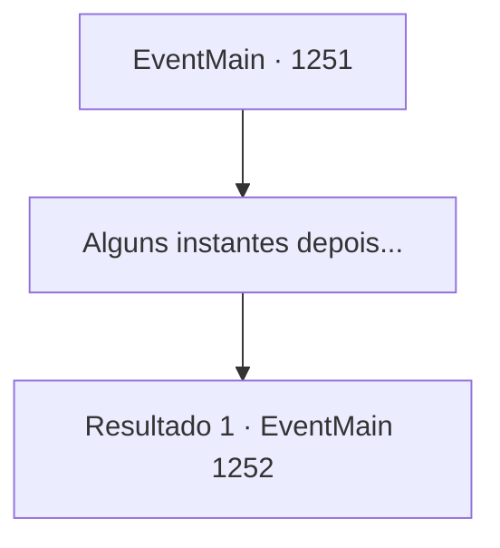

# Eventos principais · 1251

[Índice da tabela](index.md) · [Índice geral](../index.md)

ID: `pt:EventMain:1251` · Fonte: `EventMain4` · Versão: 1.2.47.

Mapeamento estático dos arquivos; a disponibilidade e a execução dependem do estado da run.

## Texto do evento

Um fedor pútrido toma conta do ar. Você para por um momento para localizar a fonte do fedor. Um exército inteiro de criaturas mortas-vivas — esqueletos, carniçais e até aparições — está em formação. Liderando o exército na linha de frente está Kalman, que espera por você. Você segue lentamente até ele. Kalman desce do cavalo e começa a falar. 

 "Você está atrasado... Bem, eu soube do que aconteceu. Você conseguiu defender a propriedade contra aqueles orcs imbecis?"

 Segue-se um breve silêncio. Kalman olha você de cima a baixo e continua. 

 "Você se saiu bem."

 Ele se vira para encarar seu exército de mortos-vivos. 

 "Este é o meu exército, que preparei do zero enquanto você estava ocupado lutando contra os orcs."

 Seus braços se abrem em direção aos mortos-vivos. 

 "Agora, estou bem ciente de que conquistar o Castelo Greymoor exigiria uma quantidade muito maior. Mas eles vão mantê-los distraídos o suficiente."

 Ele volta o olhar para você. Um sorriso distorcido se espalha por seu rosto. 

 "À noite, marcharei com os mortos-vivos até o portão principal."

 Kalman dá um passo à frente. 

 "Enquanto isso, você e eu vamos nos esgueirar para dentro do castelo pelo outro lado. Conheço a estrutura do Castelo Greymoor de cabo a rabo. Afinal, eu era um frequentador assíduo de lá."

 Seus olhos brilham na escuridão. 

 "Lá, capturamos a Condessa Greymoor. Simples assim."


## Dados de entrada

```json
{
  "id": 1251,
  "grade": 1,
  "normalGoal": "",
  "required": "13_6_8|1_2_100"
}
```

## Mapa das escolhas



## Escolhas e resultados

### Escolha 1

Alguns instantes depois...

Requisitos e outros campos da escolha:

```json
{
  "required": ""
}
```

#### Resultado 1.1


 "Bem, já está mais do que na hora de agirmos."

 O sol começa a descer pelas montanhas do oeste. O crepúsculo começa a cair sobre as planícies. Kalman estala os dedos, murmurando algo para si mesmo. Os mortos-vivos começam a se mover novamente, um a um. A horda inicia sua marcha, passo a passo, tropeçando e rangendo os ossos. Você olha para cima para ver a direção para a qual estão indo. Sob o sol vermelho, as torres do Castelo Greymoor erguem-se ao longe. 

 "Eles terão chegado ao castelo até a meia-noite."

 Kalman continua. 

 "Tempo é essencial neste plano. Devemos nos apressar também."

 Ele se vira e segue em direção à porta dos fundos do Castelo Greymoor. Você segue seu exemplo. 

 O portão do Castelo Greymoor está trancado firmemente. Escondido atrás de uma grande árvore, você observa as muralhas do castelo envoltas em densa escuridão. As muralhas do castelo se erguem sobre você, com pelo menos 9 metros de altura. No topo das muralhas, soldados com tochas patrulham. A luz das tochas surge e se vai, em intervalos regulares. Kalman sussurra para você. 

 "Minhas forças já deveriam ter chegado aos portões agora."

 Seu olhar está fixo no portão da frente. 

 "Quando eles avistarem a horda de mortos-vivos, toda a atenção estará voltada ao portão principal. É aí que nós entramos furtivamente."

 Ele olha para você. Seus olhos brilham na escuridão. 

 "Pense em uma maneira de infiltrar o castelo."


Continuação registrada: [Evento 1252](1252.md) na mesma tabela.

```json
{
  "required": "",
  "chance": "1",
  "nextEvent": 1252,
  "type": 2,
  "reward": ""
}
```

## Referências que chegam a este evento

Nenhum `nextEvent` positivo da mesma tabela aponta para este nó. Isso não prova que seja inacessível: sorteio e estado de história podem selecioná-lo.

