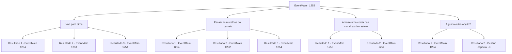

# Eventos principais · 1252

[Índice da tabela](index.md) · [Índice geral](../index.md)

ID: `pt:EventMain:1252` · Fonte: `EventMain4` · Versão: 1.2.47.

Mapeamento estático dos arquivos; a disponibilidade e a execução dependem do estado da run.

## Texto do evento

*Sem texto no arquivo.*

## Dados de entrada

```json
{
  "id": 1252,
  "grade": 1,
  "normalGoal": "",
  "required": ""
}
```

## Mapa das escolhas



## Escolhas e resultados

### Escolha 1

Voe para cima

Requisitos e outros campos da escolha:

```json
{
  "required": "-1|20_10_1|20_0_1"
}
```

#### Resultado 1.1

Você voa pelo ar, pairando sobre as muralhas do castelo. Então, você se esconde nas sombras, mantendo-se oculto. Você olha para baixo e localiza o pátio do castelo externo. Algumas tochas nas paredes lançam luz apenas forte o suficiente para distinguir sua forma. 

 <link=shake>DING DING DING DING!</link> 

 Então, o sino de alarme da torre do castelo externo toca alto. O exército de mortos-vivos começou seu ataque. 

 "Todos, peguem seus equipamentos e subam as muralhas do castelo!"

 "São mortos-vivos! Não sejam mordidos!"

 Soldados saem correndo do castelo interno e correm para os portões principais. Kalman, pairando no ar com seu feitiço, olha para baixo e acrescenta. 

 "Eles estão entrando em pânico. Bom. Tudo o que temos que fazer agora é entrar."


Continuação registrada: [Evento 1254](1254.md) na mesma tabela.

```json
{
  "required": "21_5_4|21_43",
  "chance": "1|0_6_1",
  "nextEvent": 1254,
  "type": 0,
  "reward": ""
}
```

#### Resultado 1.2

Você voa pelo ar, pairando sobre as muralhas do castelo Talvez você tenha voado alto demais — um soldado de Greymoor patrulhando as muralhas nota você imediatamente. 

 "Hã?! Um intruso!"

 Ele imediatamente pega sua lança e a aponta para você.

Continuação registrada: [Evento 1253](1253.md) na mesma tabela.

```json
{
  "required": "21_5_4|21_43",
  "chance": "16",
  "nextEvent": 1253,
  "type": 1,
  "reward": "6_0_197",
  "place": 4
}
```

#### Resultado 1.3

Você voa pelo ar, pairando sobre as muralhas do castelo. Então, você se mantém nas sombras, mantendo-se oculto. Você olha lá embaixo e localiza o pátio do castelo exterior. Algumas tochas nas paredes lançam luz apenas forte o suficiente para distinguir sua forma. 

 <link=shake>'DING DING DING DING!'</link> 

 Então, o sino de alarme da torre do castelo exterior toca alto. O exército morto-vivo iniciou seu ataque. 

 "Todos, peguem seus equipamentos e subam nas muralhas do castelo!"

 "São os mortos-vivos! Não sejam mordidos!"

 Soldados correm do castelo interior em direção aos portões frontais. Kalman, pairando no ar com seu feitiço, olha lá embaixo e acrescenta. 

 "Eles estão em pânico. Bom. Tudo o que precisamos fazer agora é entrar."


Continuação registrada: [Evento 1254](1254.md) na mesma tabela.

```json
{
  "required": "-1|20_5_4|20_43",
  "chance": "1",
  "nextEvent": 1254,
  "type": 2,
  "reward": ""
}
```

### Escolha 2

Escale as muralhas do castelo

Requisitos e outros campos da escolha:

```json
{
  "required": "5_943_0"
}
```

#### Resultado 2.1

Você escala as muralhas do castelo, equilibrando-se em pequenos buracos entre elas. Logo, você alcança o topo. Você cuidadosamente enfia a cabeça acima das paredes. Você olha lá embaixo e localiza o pátio do castelo exterior. Alguns suportes de tochas nas paredes iluminam o suficiente para distinguir sua forma. 

 <link=shake>'DING DING DING DING!'</link> 

 Então, o sino de alarme da torre do castelo exterior toca alto. O exército morto-vivo começou seu ataque. 

 "Todos, peguem seu equipamento e subam pelas muralhas do castelo!"

 "São mortos-vivos! Não sejam mordidos!"

 Soldados correm do castelo interior e vão para os portões da frente. Kalman, pairando no ar com seu feitiço, olha lá embaixo e acrescenta. 

 "Estão entrando em pânico. Bom. Tudo o que temos a fazer agora é entrar."


Continuação registrada: [Evento 1254](1254.md) na mesma tabela.

```json
{
  "required": "21_5_4|21_43",
  "chance": "1|0_5_1|0_6_1",
  "nextEvent": 1254,
  "type": 0,
  "reward": ""
}
```

#### Resultado 2.2

Você tenta escalar as muralhas do castelo, equilibrando-se em pequenos buracos entre elas. Mas as muralhas se mostram altas demais. Infelizmente, você perde a firmeza e cai da parede, no chão. Suas mãos tremem. Você tenta agarrar a parede e subir de novo, mas não tem mais energia para isso. Kalman observa você escorregar da parede e estala a língua em desapontamento. 

 "Tsc tsc..."


Continuação registrada: [Evento 1252](1252.md) na mesma tabela.

```json
{
  "required": "21_5_4|21_43",
  "chance": "32",
  "nextEvent": 1252,
  "type": 1,
  "reward": "5_943_9"
}
```

#### Resultado 2.3

Você escala as muralhas do castelo, equilibrando-se em pequenos buracos entre elas. Logo, você alcança o topo. Você cuidadosamente enfia a cabeça acima das paredes. Você olha lá embaixo e localiza o pátio do castelo exterior. Alguns suportes de tochas nas paredes iluminam o suficiente para distinguir sua forma. 

 <link=shake>'DING DING DING DING!'</link> 

 Então, o sino de alarme da torre do castelo exterior toca alto. O exército morto-vivo começou seu ataque. 

 "Todos, peguem seu equipamento e subam pelas muralhas do castelo!"

 "São mortos-vivos! Não sejam mordidos!"

 Soldados correm do castelo interior e vão para os portões da frente. Kalman, pairando no ar com seu feitiço, olha lá embaixo e acrescenta. 

 "Estão entrando em pânico. Bom. Tudo o que temos a fazer agora é entrar."


Continuação registrada: [Evento 1254](1254.md) na mesma tabela.

```json
{
  "required": "-1|20_5_4|20_43",
  "chance": "1",
  "nextEvent": 1254,
  "type": 2,
  "reward": ""
}
```

### Escolha 3

Amarre uma corda nas muralhas do castelo

Requisitos e outros campos da escolha:

```json
{
  "required": "8_39_1"
}
```

#### Resultado 3.1

Você dá um nó na ponta da corda, transformando-a em um laço, e o lança com toda a força.   Felizmente, o nó prende em uma saliência da muralha do castelo.   Você começa a escalar a parede, segurando a corda.   Você está quase no topo quando um soldado em patrulha se vira e te percebe.   

 "Hã?! Um intruso!"

   Ele imediatamente pega sua lança e investe contra você.

Continuação registrada: [Evento 1253](1253.md) na mesma tabela.

```json
{
  "required": "21_5_4|21_43",
  "chance": "1",
  "nextEvent": 1253,
  "type": 2,
  "reward": "6_0_197|4_39_1",
  "place": 4
}
```

#### Resultado 3.2

Você dá um nó na ponta da corda, transformando-a no formato de um laço, então a joga com toda a força que pode. Felizmente, o nó cai em uma saliência das muralhas do castelo. Você começa a subir pela parede, segurando a corda. Logo, você alcança o topo. Você cuidadosamente espreita a cabeça acima das muralhas. Você olha lá embaixo e localiza o pátio do castelo externo. Alguns suportes de tochas nas paredes lançam uma luz apenas forte o suficiente para distinguir sua forma. 

 <link=shake>’DING DING DING DING!’</link> 

 Então, o sino de alarme da torre do castelo externo toca alto. O exército de mortos-vivos iniciou seu ataque. 

 "Todos, peguem seus equipamentos e subam nas muralhas do castelo!"

 "São os mortos-vivos! Não deixem que mordam vocês!"

 Soldados correm do castelo interno em direção aos portões frontais. Kalman, pairando no ar com seu feitiço, olha para baixo e acrescenta. 

 "Eles estão em pânico. Bom. Tudo o que temos que fazer agora é entrar."


Continuação registrada: [Evento 1254](1254.md) na mesma tabela.

```json
{
  "required": "-1|20_5_4|20_43",
  "chance": "1",
  "nextEvent": 1254,
  "type": 2,
  "reward": "4_39_1"
}
```

### Escolha 4

Alguma outra opção?

Requisitos e outros campos da escolha:

```json
{
  "required": "5_943_9"
}
```

#### Resultado 4.1

Você pergunta a Kalman se há algum outro caminho que leve para dentro do castelo. Ele anda em círculos, falando. 

 "Você poderia pegar os esgotos. Eles foram feitos para drenar a chuva e a água usada da cozinha."

 Você encontra o ralo escondido sob uma inclinação, abaixo das muralhas do castelo. A entrada está coberta de ervas daninhas, lama e uma enorme rocha. Você teria perdido completamente se não tivesse sido informado de sua existência com antecedência. Kalman move a rocha com um gesto da mão, então ri em tom de brincadeira, olhando para dentro do esgoto. 

 "Pois vá, entre, antes que o cheiro piore. Eu te encontro do outro lado."

 Você faz o possível para resistir ao fedor horrível e entra no esgoto. Você mal consegue não vomitar. Logo, se encontra no pátio externo do castelo. 

 <link=shake>'DING DING DING DING!'</link> 

 Então, o sino de alarme da torre externa do castelo toca alto. O exército de mortos-vivos começou seu ataque. 

 "Todos, peguem seus equipamentos e subam as muralhas do castelo!"

 "São os mortos-vivos! Não deixem ser mordidos!"

 Soldados correm do castelo interno e se dirigem para os portões frontais. Kalman, pairando no ar com seu feitiço, olha lá embaixo e acrescenta. 

 "Eles estão entrando em pânico. Bom. Tudo o que temos a fazer agora é entrar."


Continuação registrada: [Evento 1254](1254.md) na mesma tabela.

```json
{
  "required": "1_0_2",
  "chance": "1|0_13_1",
  "nextEvent": 1254,
  "type": 0,
  "reward": "0_0_-1|5_944_1"
}
```

#### Resultado 4.2

Você pergunta a Kalman se existe algum outro caminho que leve para dentro do castelo. Ele anda em círculos, falando. 

 "Você poderia pegar o esgoto. Eles foram feitos para drenar a chuva e a água usada da cozinha."

 Você encontra o ralo escondido sob uma inclinação, sob os muros do castelo. A entrada está coberta de ervas daninhas, lama e um enorme penedo. Você o teria perdido completamente se não tivesse sido informado de sua existência com antecedência. Kalman move o penedo com um estalar de mão, então ri de brincadeira, encarando o esgoto. 

 "Bem, entre logo, antes que o cheiro piore. Eu te encontro do outro lado."

 Você faz o possível para suportar o cheiro horrível e entra no esgoto. Mas o cheiro horrível do esgoto não é algo com que você consiga lidar. Você vomita imediatamente, enquanto o mundo ao seu redor gira. Você cai de cabeça sobre uma mistura do seu próprio vômito e do esgoto. Você perde a consciência.

Continuação registrada: [Destino especial `-3`](../destinos-especiais.md).

```json
{
  "required": "2_0_2",
  "chance": "12",
  "nextEvent": -3,
  "type": 1,
  "reward": "0_0_-1"
}
```

## Referências que chegam a este evento

- [Evento 1251 · escolha 1 · resultado 1](1251.md#escolha-1)
- [Evento 1252 · escolha 2 · resultado 2](1252.md#escolha-2)
