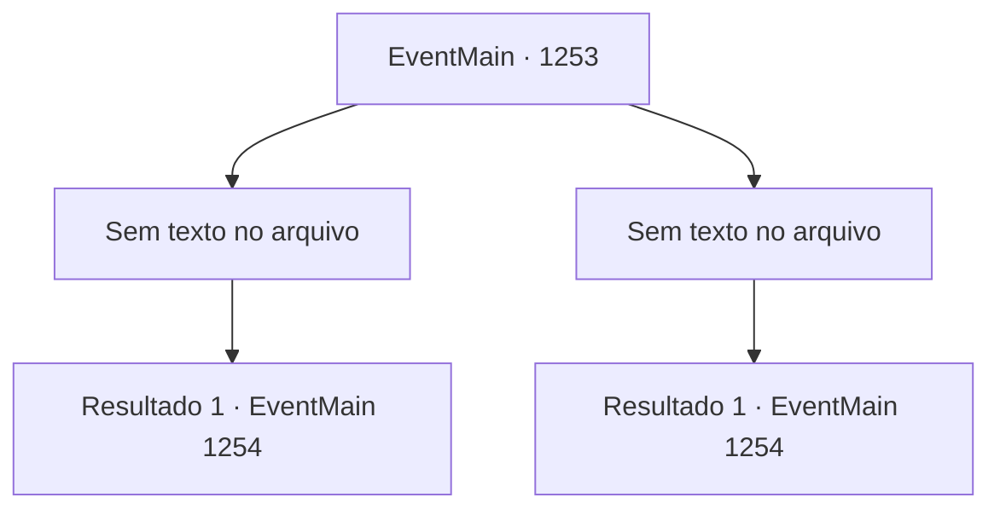

# Eventos principais · 1253

[Índice da tabela](index.md) · [Índice geral](../index.md)

ID: `pt:EventMain:1253` · Fonte: `EventMain4` · Versão: 1.2.47.

Mapeamento estático dos arquivos; a disponibilidade e a execução dependem do estado da run.

## Texto do evento

*Sem texto no arquivo.*

## Dados de entrada

```json
{
  "id": 1253,
  "grade": 1,
  "normalGoal": "",
  "required": ""
}
```

## Mapa das escolhas



## Escolhas e resultados

### Escolha 1

*Sem texto no arquivo; o papel dessa opção depende da interface do jogo.*

Requisitos e outros campos da escolha:

```json
{
  "required": ""
}
```

#### Resultado 1.1

Você rapidamente lida com o guarda de patrulha e espia por cima da borda. Você olha lá embaixo e localiza o pátio do castelo exterior. Algumas tochas nas paredes iluminam apenas o suficiente para distinguir sua forma. 

 <link=shake>'DING DING DING DING!'</link> 

 Então, o sino de alarme da torre do castelo exterior toca alto. O exército morto-vivo começou seu ataque. 

 "Todos, peguem seus equipamentos e subam nas muralhas do castelo!"

 "São os mortos-vivos! Não deixem que mordam vocês!"

 Soldados correm do castelo interior em direção aos portões da frente. Kalman, pairando no ar com seu feitiço, olha lá embaixo e acrescenta. 

 "Eles estão entrando em pânico. Bom. Tudo que temos que fazer agora é entrar."


Continuação registrada: [Evento 1254](1254.md) na mesma tabela.

```json
{
  "required": "",
  "chance": "1",
  "nextEvent": 1254,
  "type": 2,
  "reward": ""
}
```

### Escolha 2

*Sem texto no arquivo; o papel dessa opção depende da interface do jogo.*

Requisitos e outros campos da escolha:

```json
{
  "required": ""
}
```

#### Resultado 2.1

De repente, o guarda larga sua lança no chão e começa a tremer. Ele então cai no chão e não se levanta mais. Você vira o olhar. Kalman, pairando no ar com seu feitiço, olha lá embaixo para você. Uma aura negra emana de suas pontas dos dedos. 

 "Eu simplesmente não consigo deixar você em paz por muito tempo, consigo, pequenino?"

 Você cuidadosamente espreita por cima das muralhas. Você olha lá embaixo e localiza o pátio do castelo externo. Algumas arandelas de tochas nas paredes iluminam o suficiente para distinguir sua forma. 

 <link=shake>'DING DING DING DING!'</link> 

 Então, o sino de alarme da torre do castelo externo toca alto. O exército de mortos-vivos começou seu ataque. 

 "Todos, peguem seu equipamento e subam nas muralhas do castelo!"

 "São os mortos-vivos! Não sejam mordidos!"

 Soldados correm do castelo interior e vão em direção aos portões principais. Kalman, pairando no ar com seu feitiço, olha lá embaixo e acrescenta. 

 "Eles estão em pânico. Bom. Tudo o que precisamos fazer agora é entrar."


Continuação registrada: [Evento 1254](1254.md) na mesma tabela.

```json
{
  "required": "",
  "chance": "1",
  "nextEvent": 1254,
  "type": 2,
  "reward": ""
}
```

## Referências que chegam a este evento

- [Evento 1252 · escolha 1 · resultado 2](1252.md#escolha-1)
- [Evento 1252 · escolha 3 · resultado 1](1252.md#escolha-3)
