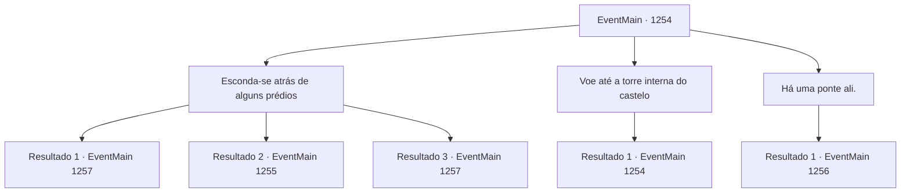

# Eventos principais · 1254

[Índice da tabela](index.md) · [Índice geral](../index.md)

ID: `pt:EventMain:1254` · Fonte: `EventMain4` · Versão: 1.2.47.

Mapeamento estático dos arquivos; a disponibilidade e a execução dependem do estado da run.

## Texto do evento

*Sem texto no arquivo.*

## Dados de entrada

```json
{
  "id": 1254,
  "grade": 1,
  "normalGoal": "",
  "required": ""
}
```

## Mapa das escolhas



## Escolhas e resultados

### Escolha 1

Esconda-se atrás de alguns prédios

Requisitos e outros campos da escolha:

```json
{
  "required": ""
}
```

#### Resultado 1.1

Você desce os degraus do castelo externo. Em seguida, se esconde nas sombras dos prédios próximos. Você se move com cuidado. De sombra em sombra, avança em direção ao castelo interno. O castelo interno é muito mais alto que o castelo externo, com um número maior de torres de vigia. Tochas estão colocadas próximas ao longo das muralhas do castelo. Você olha para cima. Os soldados se movimentam agitadamente, ajustando suas armaduras, colocando as aljavas e checando suas bestas. Apesar do pânico no castelo externo, o castelo interno parece ter mantido a calma. Na verdade, suas defesas parecem mais sólidas. Kalman encara o castelo interno, parado ao seu lado. 

 "Hm. Isso não aconteceu com o castelo externo..."

 Ele murmura para si mesmo. Parece estar estimando a altura das muralhas e a distância entre cada torre de vigia. 

 "Eles mantiveram os soldados estacionados no castelo interno. Deve significar que estão protegendo seu senhor feudal aqui."

 Ele passa a mão no queixo. 

 "Agora, encontrar um jeito de ultrapassar as muralhas do castelo interno."


Continuação registrada: [Evento 1257](1257.md) na mesma tabela.

```json
{
  "required": "21_5_4|21_43",
  "chance": "1|0_6_1",
  "nextEvent": 1257,
  "type": 0,
  "reward": ""
}
```

#### Resultado 1.2

Você desce os degraus do castelo exterior. Então, você se esconde nas sombras dos prédios próximos. Você se move com cuidado. De sombra em sombra, você segue em direção ao castelo interior. Você já está quase nas muralhas do castelo interior quando tropeça em algo. É um pequeno carro, deixado no escuro. O carro é empurrado, enquanto suas rodas de aço rangem contra o chão de pedra. Um dos barris vazios bate no chão, quebrando o silêncio. Mais e mais pancadas seguem uma após a outra. 

 "Quem vem aí!"

 Você ouve um guarda em patrulha gritando. A luz das tochas começa a iluminar você. 

 "INTRUSO! TEMOS UM INTRUSO AQUI!"

 Mais soldados se aproximam de você, cada um segurando uma tocha nas mãos. Kalman estala a língua. 

 "...Fomos comprometidos."

 Ele levanta os braços. As pontas dos seus dedos brilham em roxo. 

 "Nós não temos mais escolha. Abrimos caminho através deles."

 Quatro soldados se aproximam das sombras, suas armas em punho.

Continuação registrada: [Evento 1255](1255.md) na mesma tabela.

```json
{
  "required": "21_5_4|21_43",
  "chance": "20",
  "nextEvent": 1255,
  "type": 1,
  "reward": "6_0_197",
  "place": 4
}
```

#### Resultado 1.3

Você desce os degraus do castelo externo. Em seguida, se esconde nas sombras dos prédios próximos. Você se move com cuidado. De sombra em sombra, avança em direção ao castelo interno. O castelo interno é muito mais alto que o castelo externo, com um número maior de torres de vigia. Tochas estão colocadas próximas ao longo das muralhas do castelo. Você olha para cima. Os soldados se movimentam agitadamente, ajustando suas armaduras, colocando as aljavas e checando suas bestas. Apesar do pânico no castelo externo, o castelo interno parece ter mantido a calma. Na verdade, suas defesas parecem mais sólidas. Kalman encara o castelo interno, parado ao seu lado. 

 "Hm. Isso não aconteceu com o castelo externo..."

 Ele murmura para si mesmo. Parece estar estimando a altura das muralhas e a distância entre cada torre de vigia. 

 "Eles mantiveram os soldados estacionados no castelo interno. Deve significar que estão protegendo seu senhor feudal aqui."

 Ele passa a mão no queixo. 

 "Agora, encontrar um jeito de ultrapassar as muralhas do castelo interno."


Continuação registrada: [Evento 1257](1257.md) na mesma tabela.

```json
{
  "required": "-1|20_5_4|20_43",
  "chance": "1",
  "nextEvent": 1257,
  "type": 2,
  "reward": ""
}
```

### Escolha 2

Voe até a torre interna do castelo

Requisitos e outros campos da escolha:

```json
{
  "required": "5_926_0|20_10_1"
}
```

#### Resultado 2.1

Você tenta voar até a torre interna do castelo. 

 "Pare."

 Kalman te detém, exclamando. Ele indica o portão da frente com o queixo. Soldados carregando tochas ainda se movem pelo pátio. 

 "Vocês estão tentando fazer uma entrada triunfal ou algo assim? No momento em que você chegar lá em cima eles vão te perceber num instante."

 Kalman examina através das paredes internas do castelo. 

 "Fique perto das paredes. As sombras nos cobrirão. E então podemos subir."


Continuação registrada: [Evento 1254](1254.md) na mesma tabela.

```json
{
  "required": "",
  "chance": "1",
  "nextEvent": 1254,
  "type": 2,
  "reward": "5_926_1"
}
```

### Escolha 3

Há uma ponte ali.

Requisitos e outros campos da escolha:

```json
{
  "required": ""
}
```

#### Resultado 3.1

Você olha ao redor. Entre as muralhas internas e externas do castelo, você avista uma ponte de madeira conectando as duas. Ela é usada para movimentar suprimentos e soldados - normalmente, a ponte teria sido guardada por soldados em cada extremidade. Mas está vazia agora, presumivelmente porque todos os soldados foram para o portão principal. Você aponta para a ponte. Kalman também a vê e acena com a cabeça. Você e Kalman seguem para a ponte. Assim que você pisa nela, a ponte treme. Quando você está mais ou menos na metade, um soldado aparece de um canto na outra extremidade. 

 "Quem vai lá?!"

 O soldado grita. A luz de sua tocha revela você. 

 "INTRUSO! TEMOS UM INTRUSO AQUI!"

 Mais soldados se aproximam, cada um segurando uma tocha na mão. Kalman estala a língua. 

 "...Fomos descobertos."

 Ele levanta os braços. As pontas dos seus dedos brilham em roxo. 

 "Não temos escolha. Abrimos caminho por eles."

 Quatro soldados surgem das sombras, com as armas em punho.

Continuação registrada: [Evento 1256](1256.md) na mesma tabela.

```json
{
  "required": "",
  "chance": "1",
  "nextEvent": 1256,
  "type": 2,
  "reward": "6_0_197",
  "place": 4
}
```

## Referências que chegam a este evento

- [Evento 1252 · escolha 1 · resultado 1](1252.md#escolha-1)
- [Evento 1252 · escolha 1 · resultado 3](1252.md#escolha-1)
- [Evento 1252 · escolha 2 · resultado 1](1252.md#escolha-2)
- [Evento 1252 · escolha 2 · resultado 3](1252.md#escolha-2)
- [Evento 1252 · escolha 3 · resultado 2](1252.md#escolha-3)
- [Evento 1252 · escolha 4 · resultado 1](1252.md#escolha-4)
- [Evento 1253 · escolha 1 · resultado 1](1253.md#escolha-1)
- [Evento 1253 · escolha 2 · resultado 1](1253.md#escolha-2)
- [Evento 1254 · escolha 2 · resultado 1](1254.md#escolha-2)
