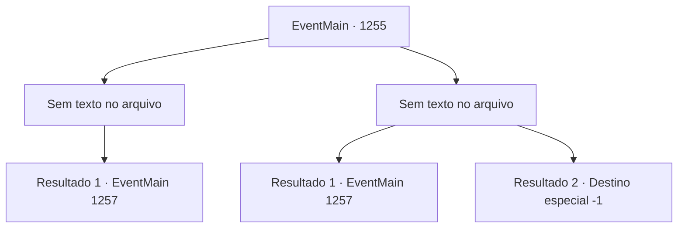

# Eventos principais · 1255

[Índice da tabela](index.md) · [Índice geral](../index.md)

ID: `pt:EventMain:1255` · Fonte: `EventMain4` · Versão: 1.2.47.

Mapeamento estático dos arquivos; a disponibilidade e a execução dependem do estado da run.

## Texto do evento

*Sem texto no arquivo.*

## Dados de entrada

```json
{
  "id": 1255,
  "grade": 1,
  "normalGoal": "",
  "required": ""
}
```

## Mapa das escolhas



## Escolhas e resultados

### Escolha 1

*Sem texto no arquivo; o papel dessa opção depende da interface do jogo.*

Requisitos e outros campos da escolha:

```json
{
  "required": ""
}
```

#### Resultado 1.1

Você e Kalman derrotam os guardas e ficam próximos às muralhas internas do castelo. Você olha para cima, de costas para a parede. As muralhas internas do castelo são mais altas que as da parte externa. Ainda mais torres de vigia alinham-se às muralhas, com soldados se movimentando por elas. Apesar do pânico no portão principal, a parte interna do castelo parece estar em alerta total. Kalman olha para cima. 

 "Bem, pelo menos chegamos até aqui."

 Seu olhar fixa-se nas lacunas entre as torres de vigia. 

 "Mas não podemos simplesmente escalar aquela muralha. Muitos olhos observando."

 Ele se vira para você. 

 "Precisamos encontrar uma maneira de subir as muralhas internas do castelo."


Continuação registrada: [Evento 1257](1257.md) na mesma tabela.

```json
{
  "required": "",
  "chance": "1",
  "nextEvent": 1257,
  "type": 2,
  "reward": ""
}
```

### Escolha 2

*Sem texto no arquivo; o papel dessa opção depende da interface do jogo.*

Requisitos e outros campos da escolha:

```json
{
  "required": ""
}
```

#### Resultado 2.1

Você é atingido pelo porrete do soldado e cai no chão. Enquanto isso, Kalman atira um espeto de osso no soldado, perfurando seu peito. 

 "Levante-se. Não temos tempo a perder."

 Ele agarra seu braço e o puxa de volta para ficar de pé. Você e Kalman se mantêm próximos às paredes. As muralhas internas do castelo são mais altas do que as externas. Ainda mais torres de vigia se alinham ao longo das muralhas, com soldados se movendo por elas. Apesar do pânico no portão principal, o castelo interno parece estar em alerta máximo. Kalman olha para cima. 

 "Bom, pelo menos chegamos até aqui."

 Seu olhar se fixa nas brechas entre as torres de vigia. 

 "Mas não podemos simplesmente escalar aquela parede. Muitos olhos nos observando."

 Ele se vira para você. 

 "Precisamos encontrar uma maneira de subir as muralhas internas do castelo."


Continuação registrada: [Evento 1257](1257.md) na mesma tabela.

```json
{
  "required": "1_0_2|1_1_2",
  "chance": "1",
  "nextEvent": 1257,
  "type": 2,
  "reward": "0_0_-1|0_1_-1"
}
```

#### Resultado 2.2

Você é atingido pelo porrete do soldado e cai no chão. Você perde a consciência imediatamente. Kalman se vira e foge. As costas dele são a última coisa que você vê antes de tudo ficar escuro.

Continuação registrada: [Destino especial `-1`](../destinos-especiais.md).

```json
{
  "required": "-1|2_0_2|2_1_2",
  "chance": "1",
  "nextEvent": -1,
  "type": 2,
  "reward": "0_0_-1|0_1_-1|15_7_18|15_7_13|25_8_1"
}
```

## Referências que chegam a este evento

- [Evento 1254 · escolha 1 · resultado 2](1254.md#escolha-1)
