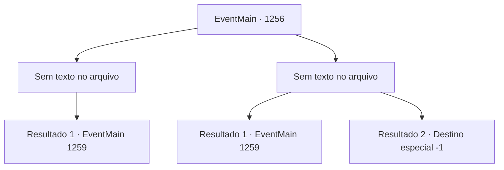

# Eventos principais · 1256

[Índice da tabela](index.md) · [Índice geral](../index.md)

ID: `pt:EventMain:1256` · Fonte: `EventMain4` · Versão: 1.2.47.

Mapeamento estático dos arquivos; a disponibilidade e a execução dependem do estado da run.

## Texto do evento

*Sem texto no arquivo.*

## Dados de entrada

```json
{
  "id": 1256,
  "grade": 1,
  "normalGoal": "",
  "required": ""
}
```

## Mapa das escolhas



## Escolhas e resultados

### Escolha 1

*Sem texto no arquivo; o papel dessa opção depende da interface do jogo.*

Requisitos e outros campos da escolha:

```json
{
  "required": ""
}
```

#### Resultado 1.1


 "*ofega*... Argh...!"

 Você tapa a boca do soldado com a mão. Então, você agarra seu pescoço e o torce com força. Sua luta é curta. O soldado logo cai imóvel. Você olha para trás e vê Kalman acabando com outro soldado. Ele drena a essência vital da vítima, fazendo-a definhar como uma múmia. 

 "Pronto. Vamos."

 Você e Kalman chegam ao fim da ponte e seguem para o topo das muralhas internas do castelo. Você olha para baixo e encontra um amplo pátio. Um estábulo fica em um canto, com soldados se movendo atarefados. Além do pátio fica o edifício principal - a Fortaleza de Greymoor. Uma larga escadaria liga a fortaleza ao pátio. Jardins decoram a área ao lado. Qualquer espaço vazio está sendo patrulhado por soldados. Perto da entrada da fortaleza, cavaleiros fortemente armados vigiam. Kalman encara a fortaleza e murmura para si. 

 "A fortaleza está protegida por um feitiço. Qualquer magia hostil de fora será bloqueada."

 Seus olhos se estreitam. 

 "Não ficaremos totalmente incapazes de lançar feitiços, mas... será pesado. Algo para o qual não temos tempo."

 Ele se vira para você. 

 "Se você tiver alguma ideia, sinta-se à vontade para compartilhá-la."


Continuação registrada: [Evento 1259](1259.md) na mesma tabela.

```json
{
  "required": "",
  "chance": "1",
  "nextEvent": 1259,
  "type": 2,
  "reward": ""
}
```

### Escolha 2

*Sem texto no arquivo; o papel dessa opção depende da interface do jogo.*

Requisitos e outros campos da escolha:

```json
{
  "required": ""
}
```

#### Resultado 2.1


 "*tosse*.... ARGH!"

 A lâmina afiada para bem diante dos seus olhos. Então, o soldado cospe sangue e cai no chão. Você respira fundo e olha para trás. Kalman te encara com desagrado depois de te salvar com seu espeto ósseo. 

 "Não me desaponte mais."

 Kalman segue na frente e atravessa a ponte. Você o segue até o topo das muralhas internas do castelo. Você olha para baixo e encontra um amplo pátio. Um estábulo fica em um canto, com soldados se movendo atarefados. Além do pátio está o edifício principal — Fortaleza Greymoor. Uma escadaria larga conecta a fortaleza ao pátio. Jardins decoram a área ao lado. Qualquer espaço vazio está sendo patrulhado por soldados. Perto da entrada da fortaleza, cavaleiros fortemente armados fazem guarda. Kalman encara a fortaleza e murmura para si. 

 "A fortaleza está protegida por um feitiço. Qualquer magia hostil de fora será bloqueada."

 Seus olhos ficam menores. 

 "Nós não ficaremos completamente incapazes de lançar magias, mas... será penoso. Algo para o qual não temos tempo."

 Ele se vira para você. 

 "Se tiver alguma ideia, sinta-se à vontade para compartilhar."


Continuação registrada: [Evento 1259](1259.md) na mesma tabela.

```json
{
  "required": "1_0_2|1_1_2",
  "chance": "1",
  "nextEvent": 1259,
  "type": 2,
  "reward": "0_0_-1|0_1_-1"
}
```

#### Resultado 2.2

A lança afiada voa na sua direção. Você tenta desviar, mas não consegue. Ai, a lança é cravada no seu peito. Sangue jorra do ferimento. Sua consciência se apaga. A última coisa que você vê é Kalman abandonando você e fugindo.

Continuação registrada: [Destino especial `-1`](../destinos-especiais.md).

```json
{
  "required": "-1|2_0_2|2_1_2",
  "chance": "1",
  "nextEvent": -1,
  "type": 2,
  "reward": "0_0_-1|0_1_-1|15_7_18|15_7_13|25_8_1"
}
```

## Referências que chegam a este evento

- [Evento 1254 · escolha 3 · resultado 1](1254.md#escolha-3)
