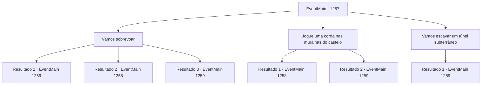

# Eventos principais · 1257

[Índice da tabela](index.md) · [Índice geral](../index.md)

ID: `pt:EventMain:1257` · Fonte: `EventMain4` · Versão: 1.2.47.

Mapeamento estático dos arquivos; a disponibilidade e a execução dependem do estado da run.

## Texto do evento

*Sem texto no arquivo.*

## Dados de entrada

```json
{
  "id": 1257,
  "grade": 1,
  "normalGoal": "",
  "required": ""
}
```

## Mapa das escolhas



## Escolhas e resultados

### Escolha 1

Vamos sobrevoar

Requisitos e outros campos da escolha:

```json
{
  "required": "-1|20_10_1|20_0_1"
}
```

#### Resultado 1.1

Você se agarra às paredes internas do castelo e voa para cima. Quando finalmente chega ao topo, o amplo pátio, o estábulo e os soldados que se movimentam atarefados tornam-se visíveis. Além do pátio fica o edifício principal — Fortaleza Greymoor. Uma larga escadaria conecta a fortaleza ao pátio. Jardins decoram a área ao lado. Qualquer espaço vazio é patrulhado por soldados. Perto da entrada da fortaleza, cavaleiros fortemente armados fazem guarda. Kalman fixa o olhar na fortaleza e resmunga para si mesmo. 

 "A fortaleza está protegida por um feitiço. Qualquer magia hostil vinda de fora será bloqueada."

 Os olhos dele ficam mais estreitos. 

 "Não ficaremos totalmente incapazes de lançar feitiços, mas... será trabalhoso. Algo para o qual não temos tempo."

 Ele se volta para você. 

 "Se tiver alguma ideia, sinta-se à vontade para compartilhá-la."


Continuação registrada: [Evento 1259](1259.md) na mesma tabela.

```json
{
  "required": "21_5_4|21_43",
  "chance": "1|0_6_1",
  "nextEvent": 1259,
  "type": 0,
  "reward": ""
}
```

#### Resultado 1.2

Você e Kalman se grudam às paredes internas do castelo e voam para cima. Mas assim que vocês dois chegam ao topo, cavaleiros em patrulha os avistam. 

 "Quem vai lá?!"

 Kalman estala a língua e começa a lançar um feitiço. Imediatamente, você saca sua arma e avança contra os cavaleiros também.

Continuação registrada: [Evento 1258](1258.md) na mesma tabela.

```json
{
  "required": "21_5_4|21_43",
  "chance": "16",
  "nextEvent": 1258,
  "type": 1,
  "reward": "6_0_197",
  "place": 4
}
```

#### Resultado 1.3

Você se agarra às paredes internas do castelo e voa para cima. Quando finalmente chega ao topo, o amplo pátio, o estábulo e os soldados que se movimentam atarefados tornam-se visíveis. Além do pátio fica o edifício principal — Fortaleza Greymoor. Uma larga escadaria conecta a fortaleza ao pátio. Jardins decoram a área ao lado. Qualquer espaço vazio é patrulhado por soldados. Perto da entrada da fortaleza, cavaleiros fortemente armados fazem guarda. Kalman fixa o olhar na fortaleza e resmunga para si mesmo. 

 "A fortaleza está protegida por um feitiço. Qualquer magia hostil vinda de fora será bloqueada."

 Os olhos dele ficam mais estreitos. 

 "Não ficaremos totalmente incapazes de lançar feitiços, mas... será trabalhoso. Algo para o qual não temos tempo."

 Ele se volta para você. 

 "Se tiver alguma ideia, sinta-se à vontade para compartilhá-la."


Continuação registrada: [Evento 1259](1259.md) na mesma tabela.

```json
{
  "required": "-1|20_5_4|20_43",
  "chance": "1",
  "nextEvent": 1259,
  "type": 2,
  "reward": ""
}
```

### Escolha 2

Jogue uma corda nas muralhas do castelo

Requisitos e outros campos da escolha:

```json
{
  "required": "8_39_2"
}
```

#### Resultado 2.1

Você vai precisar de muita corda se ela tiver que alcançar as muralhas internas do castelo. Você une duas cordas, depois faz um nó na ponta, formando um laço. Depois de dar alguns bons giros, você o lança bem alto sobre a muralha. A corda voa pelo ar, e o nó cai na borda. Você puxa algumas vezes para ter certeza de que está firme, e sobe. Mas assim que você chega ao topo, cavaleiros em patrulha te avistam. 

 "Quem vai lá?!"

 Kalman estala a língua e começa a lançar um feitiço. Imediatamente, você saca sua arma e também avança contra os cavaleiros.

Continuação registrada: [Evento 1258](1258.md) na mesma tabela.

```json
{
  "required": "21_5_4|21_43",
  "chance": "1",
  "nextEvent": 1258,
  "type": 2,
  "reward": "6_0_197|4_39_2",
  "place": 4
}
```

#### Resultado 2.2

Você vai precisar de muita corda se ela tiver que alcançar as muralhas internas do castelo. Você amarra duas cordas em uma, depois dá um nó na ponta, formando a forma de um laço. Depois de dar algumas boas rotações, você o lança alto sobre a muralha. A corda voa pelo ar, e o nó cai na borda. Você puxa algumas vezes para ter certeza de que está firme e sobe. Quando finalmente chega ao topo, o amplo pátio, o estábulo e os soldados andando apressados tornam-se visíveis. Além do pátio fica o edifício principal — Fortaleza Greymoor. Uma escadaria larga conecta a fortaleza ao pátio. Jardins decoram a área ao lado. Qualquer espaço vazio está sendo patrulhado por soldados. Perto da entrada da fortaleza, cavaleiros fortemente armados fazem a guarda. Kalman encara a fortaleza e murmura para si mesmo. 

 "A fortaleza está protegida por um feitiço. Qualquer magia hostil de fora será bloqueada."

 Seus olhos ficam menores. 

 "Não ficaremos completamente incapazes de lançar magias, mas... será penoso. Algo para o qual não temos tempo."

 Ele se vira para você. 

 "Se você tiver alguma ideia, sinta-se à vontade para compartilhá-la."


Continuação registrada: [Evento 1259](1259.md) na mesma tabela.

```json
{
  "required": "-1|20_5_4|20_43",
  "chance": "1",
  "nextEvent": 1259,
  "type": 2,
  "reward": "4_39_2"
}
```

### Escolha 3

Vamos escavar um túnel subterrâneo

Requisitos e outros campos da escolha:

```json
{
  "required": ""
}
```

#### Resultado 3.1

Você olha ao redor e encontra uma pá no quintal de uma casa próxima. Você a pega e vai para um canto. Você crava a pá no chão e começa a cavar. Felizmente, o chão não está tão duro. 

 "Tentando cavar um túnel? Tudo bem. Eu farei a vigília. Seja rápido."

 Felizmente, o local que você escolheu não fica na rota de patrulha de nenhum soldado. Você cava diligentemente, alcançando o interior do castelo. 

 "Ugh. Finalmente."

 Quando você finalmente chega, o amplo pátio, os estábulos e os soldados se movendo apressadamente tornam-se visíveis. Além do pátio está o edifício principal — Fortaleza Greymoor. Uma larga escadaria conecta a fortaleza ao pátio. Jardins decoram a área ao lado dela. Qualquer espaço vazio está sendo patrulhado por soldados. Perto da entrada da fortaleza, cavaleiros fortemente armados fazem a guarda. Kalman encara a fortaleza e murmura para si mesmo. 

 "A fortaleza é protegida por um feitiço. Qualquer magia hostil vinda de fora será bloqueada."

 Seus olhos ficam menores. 

 "Não ficaremos totalmente incapazes de lançar magias, mas... será penoso. Algo para o qual não temos tempo."

 Ele se vira para você. 

 "Se tiver alguma ideia, sinta-se à vontade para compartilhá-la."


Continuação registrada: [Evento 1259](1259.md) na mesma tabela.

```json
{
  "required": "",
  "chance": "1",
  "nextEvent": 1259,
  "type": 2,
  "reward": "3_38_1"
}
```

## Referências que chegam a este evento

- [Evento 1254 · escolha 1 · resultado 1](1254.md#escolha-1)
- [Evento 1254 · escolha 1 · resultado 3](1254.md#escolha-1)
- [Evento 1255 · escolha 1 · resultado 1](1255.md#escolha-1)
- [Evento 1255 · escolha 2 · resultado 1](1255.md#escolha-2)
