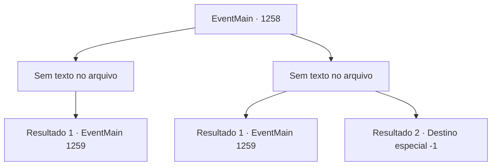

# Eventos principais · 1258

[Índice da tabela](index.md) · [Índice geral](../index.md)

ID: `pt:EventMain:1258` · Fonte: `EventMain4` · Versão: 1.2.47.

Mapeamento estático dos arquivos; a disponibilidade e a execução dependem do estado da run.

## Texto do evento

*Sem texto no arquivo.*

## Dados de entrada

```json
{
  "id": 1258,
  "grade": 1,
  "normalGoal": "",
  "required": ""
}
```

## Mapa das escolhas



## Escolhas e resultados

### Escolha 1

*Sem texto no arquivo; o papel dessa opção depende da interface do jogo.*

Requisitos e outros campos da escolha:

```json
{
  "required": ""
}
```

#### Resultado 1.1

Você resolve os cavaleiros, respira fundo e olha lá embaixo. O amplo pátio, as cocheiras e os soldados se movendo apressadamente tornam-se visíveis. Além do pátio fica o edifício principal — a Fortaleza de Greymoor. Uma larga escadaria liga a fortaleza ao pátio. Jardins decoram a área ao lado. Qualquer espaço vazio está sendo patrulhado por soldados. Perto da entrada da fortaleza, cavaleiros fortemente armados fazem guarda. Kalman fixa o olhar na fortaleza e murmura para si. 

 "A fortaleza está protegida por um feitiço. Qualquer magia hostil de fora será bloqueada."

 Seus olhos ficam menores. 

 "Nós não ficaremos completamente incapazes de lançar feitiços, mas... será penoso. Algo para o qual não temos tempo."

 Ele se vira para você. 

 "Se tiver alguma ideia, sinta-se à vontade para compartilhar."


Continuação registrada: [Evento 1259](1259.md) na mesma tabela.

```json
{
  "required": "",
  "chance": "1",
  "nextEvent": 1259,
  "type": 2,
  "reward": "5_945_1"
}
```

### Escolha 2

*Sem texto no arquivo; o papel dessa opção depende da interface do jogo.*

Requisitos e outros campos da escolha:

```json
{
  "required": ""
}
```

#### Resultado 2.1

A lâmina de aço passa bem ao lado do seu braço. Uma onda quente de sangue jorra da ferida. Então, um espinho ósseo afiado passa voando por você. 

 "...*tosse*"

 O cavaleiro desmorona no chão, depois de ter o peito perfurado pelo espinho ósseo. Kalman olha para o cavaleiro morto e desdenha. 

 "Hmph. Não perca tempo com esses fracos."

 Você pressiona sua ferida com um pedaço de pano para estancar o sangramento. Você olha lá embaixo. O amplo pátio, o estábulo e os soldados movimentando-se atarefados tornam-se todos visíveis. Além do pátio está o prédio principal - Fortaleza Greymoor. Uma larga escadaria conecta a fortaleza e o pátio. Jardins decoram a área ao lado. Qualquer espaço vazio está sendo patrulhado por soldados. Perto da entrada da fortaleza, cavaleiros pesadamente armados fazem guarda. Kalman encara a fortaleza e murmura para si. 

 "A fortaleza é protegida por um feitiço. Qualquer magia hostil de fora será bloqueada."

 Seus olhos ficam menores. 

 "Não ficaremos completamente impossibilitados de lançar feitiços, mas... será oneroso. Algo para o qual não temos tempo."

 Ele se vira para você. 

 "Se tiver alguma ideia, fique à vontade para compartilhar."


Continuação registrada: [Evento 1259](1259.md) na mesma tabela.

```json
{
  "required": "1_0_2|1_1_2",
  "chance": "1",
  "nextEvent": 1259,
  "type": 2,
  "reward": "0_0_-1|0_1_-1|5_945_1"
}
```

#### Resultado 2.2

Você se enreda com o cavaleiro de Greymoor e cai das muralhas do castelo. Sua consciência se desvanece com o impacto. A última coisa que você vê é Kalman te abandonando e fugindo.

Continuação registrada: [Destino especial `-1`](../destinos-especiais.md).

```json
{
  "required": "-1|2_0_2|2_1_2",
  "chance": "1",
  "nextEvent": -1,
  "type": 2,
  "reward": "0_0_-1|0_1_-1|15_7_18|15_7_13|25_8_1"
}
```

## Referências que chegam a este evento

- [Evento 1257 · escolha 1 · resultado 2](1257.md#escolha-1)
- [Evento 1257 · escolha 2 · resultado 1](1257.md#escolha-2)
