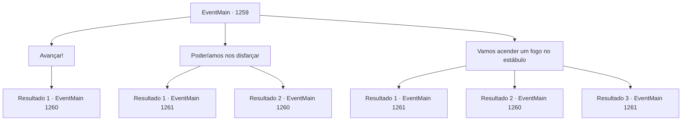

# Eventos principais · 1259

[Índice da tabela](index.md) · [Índice geral](../index.md)

ID: `pt:EventMain:1259` · Fonte: `EventMain4` · Versão: 1.2.47.

Mapeamento estático dos arquivos; a disponibilidade e a execução dependem do estado da run.

## Texto do evento

*Sem texto no arquivo.*

## Dados de entrada

```json
{
  "id": 1259,
  "grade": 1,
  "normalGoal": "",
  "required": ""
}
```

## Mapa das escolhas



## Escolhas e resultados

### Escolha 1

Avançar!

Requisitos e outros campos da escolha:

```json
{
  "required": ""
}
```

#### Resultado 1.1

Em vez de responder a Kalman, você vai direto para a fortaleza, arma em punho. Kalman te acompanha, como se tivesse percebido suas intenções. 

 "Essa é uma opção. De qualquer forma, eu não ia rondar por muito tempo."

 Então, cavaleiros que perceberam sua presença sacam suas armas e gritam. 

 "...PARE! VOCÊ NÃO PASSARÁ!"

 "INTRUSOS!!"

 Você os ignora e continua avançando, atacando o primeiro cavaleiro que encontra.

Continuação registrada: [Evento 1260](1260.md) na mesma tabela.

```json
{
  "required": "",
  "chance": "1",
  "nextEvent": 1260,
  "type": 2,
  "reward": "6_0_197",
  "place": 4
}
```

### Escolha 2

Poderíamos nos disfarçar

Requisitos e outros campos da escolha:

```json
{
  "required": "5_945_1"
}
```

#### Resultado 2.1

Você tira a armadura de um cavaleiro morto. Você veste sua armadura e elmo, então se vira para enfrentar Kalman. Kalman examina seu novo traje de cima a baixo. 

 "Ah, um disfarce. Boa ideia, poderíamos passar pelo portão da frente, mesmo. ...Espera, eu também tenho que vestir essas coisas?"

 A contragosto, Kalman concorda com seu plano. Você e Kalman caminham com confiança até a torre do castelo. Os guardas não percebem nada de errado, deixando vocês entrarem sem suspeitas. Logo, a caminho das escadas, Kalman sussurra para você. 

 "O escritório fica no terceiro andar."


Continuação registrada: [Evento 1261](1261.md) na mesma tabela.

```json
{
  "required": "",
  "chance": "1|0_12_1",
  "nextEvent": 1261,
  "type": 0,
  "reward": "16_384_1"
}
```

#### Resultado 2.2

Você tira a armadura de um cavaleiro morto. Você veste a armadura e o elmo dele, então se vira para encarar Kalman. Kalman examina seu novo traje dos pés à cabeça. 

 "Ah, um disfarce. Boa ideia, poderíamos até passar pelo portão da frente. ...Espera, eu tenho que vestir isso também?"

 Relutantemente, Kalman concorda com seu plano. Você e Kalman caminham confiantemente até a torre do castelo. 

 "...Espere. Você aí. Tire seu elmo."

 Então, um dos cavaleiros que estão de guarda aponta para você e fala. Você permanece em silêncio. Ele olha para você com desconfiança, apontando a arma para você. 

 "Senha. Glória?"

 Você e Kalman trocam olhares. Os dois atacam os cavaleiros simultaneamente.

Continuação registrada: [Evento 1260](1260.md) na mesma tabela.

```json
{
  "required": "",
  "chance": "26",
  "nextEvent": 1260,
  "type": 1,
  "reward": "16_384_1|6_0_197",
  "place": 4
}
```

### Escolha 3

Vamos acender um fogo no estábulo

Requisitos e outros campos da escolha:

```json
{
  "required": ""
}
```

#### Resultado 3.1

Você se aproxima sorrateiramente do estábulo atrás da torre do castelo. Lá dentro, você encontra muitos cavalos, amarrados aos seus postes. Pilhas de feno e ração ocupam um canto. Os cavalos começam a rolar os cascos, surpresos ao ver rostos desconhecidos. Você tira uma tocha de um suporte próximo. Você a atira na pilha de feno e abre os portões do estábulo, deixando os cavalos fugirem. As chamas se espalham além do estábulo e por todo o pátio. 

 "F— FOGO! FOGO!"

 "Todos vocês! Peguem água! Agora!"

 O incêndio repentino pega os soldados desprevenidos, e logo todos correm ao estábulo. Aproveitando o pânico, você e Kalman entram silenciosamente na torre. O grande salão ainda parece luxuoso. Um enorme lustre pendura-se do teto, e o chão de mármore reflete uma luz tênue. Mas nem uma única pessoa é visível agora. A torre está terrivelmente silenciosa — talvez os não combatentes também tenham se escondido. Logo, a caminho da escada, Kalman sussurra para você. 

 "O escritório fica no terceiro andar."


Continuação registrada: [Evento 1261](1261.md) na mesma tabela.

```json
{
  "required": "21_5_4|21_43",
  "chance": "1|0_6_1",
  "nextEvent": 1261,
  "type": 0,
  "reward": ""
}
```

#### Resultado 3.2

Você se esgueira até o estábulo atrás da torre do castelo. Lá dentro, você encontra muitos cavalos, amarrados aos seus postes. Pilhas de feno e ração ocupam um canto. Os cavalos começam a bater os cascos, surpresos ao ver rostos desconhecidos. Você retira uma tocha de um castiçal próximo. Mas quando você está prestes a acendê-la, um cavaleiro em patrulha o avista. 

 "...INTRUSO!!"

 Ele grita, pedindo reforços. Soldados que patrulhavam nas proximidades correm todos para o estábulo. Você rapidamente saca sua arma para lutar. 

 "Você cuida do cavaleiro. Eu cuido dos soldados."

 Você avança para atacar o cavaleiro.

Continuação registrada: [Evento 1260](1260.md) na mesma tabela.

```json
{
  "required": "21_5_4|21_43",
  "chance": "20",
  "nextEvent": 1260,
  "type": 1,
  "reward": "6_0_197",
  "place": 4
}
```

#### Resultado 3.3

Você se aproxima sorrateiramente do estábulo atrás da torre do castelo. Lá dentro, você encontra muitos cavalos, amarrados aos seus postes. Pilhas de feno e ração ocupam um canto. Os cavalos começam a rolar os cascos, surpresos ao ver rostos desconhecidos. Você tira uma tocha de um suporte próximo. Você a atira na pilha de feno e abre os portões do estábulo, deixando os cavalos fugirem. As chamas se espalham além do estábulo e por todo o pátio. 

 "F— FOGO! FOGO!"

 "Todos vocês! Peguem água! Agora!"

 O incêndio repentino pega os soldados desprevenidos, e logo todos correm ao estábulo. Aproveitando o pânico, você e Kalman entram silenciosamente na torre. O grande salão ainda parece luxuoso. Um enorme lustre pendura-se do teto, e o chão de mármore reflete uma luz tênue. Mas nem uma única pessoa é visível agora. A torre está terrivelmente silenciosa — talvez os não combatentes também tenham se escondido. Logo, a caminho da escada, Kalman sussurra para você. 

 "O escritório fica no terceiro andar."


Continuação registrada: [Evento 1261](1261.md) na mesma tabela.

```json
{
  "required": "-1|20_5_4|20_43",
  "chance": "1",
  "nextEvent": 1261,
  "type": 2,
  "reward": ""
}
```

## Referências que chegam a este evento

- [Evento 1256 · escolha 1 · resultado 1](1256.md#escolha-1)
- [Evento 1256 · escolha 2 · resultado 1](1256.md#escolha-2)
- [Evento 1257 · escolha 1 · resultado 1](1257.md#escolha-1)
- [Evento 1257 · escolha 1 · resultado 3](1257.md#escolha-1)
- [Evento 1257 · escolha 2 · resultado 2](1257.md#escolha-2)
- [Evento 1257 · escolha 3 · resultado 1](1257.md#escolha-3)
- [Evento 1258 · escolha 1 · resultado 1](1258.md#escolha-1)
- [Evento 1258 · escolha 2 · resultado 1](1258.md#escolha-2)
